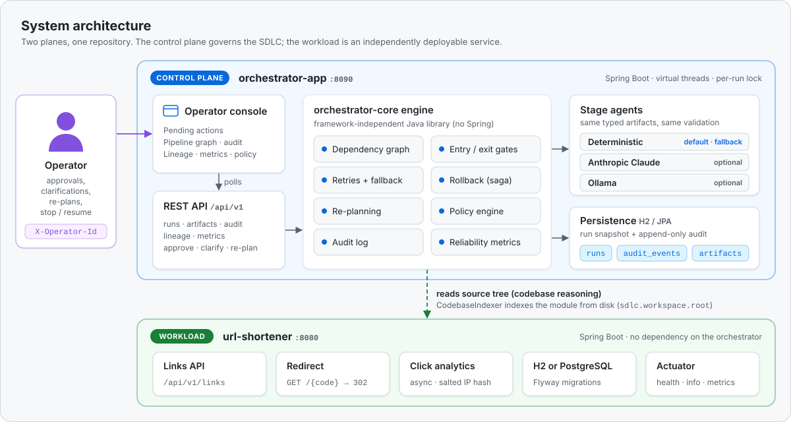
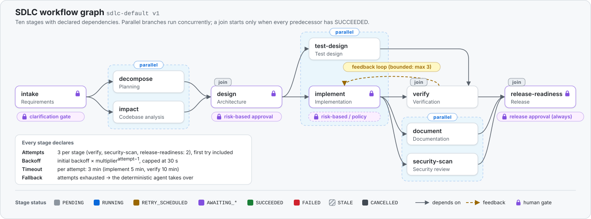
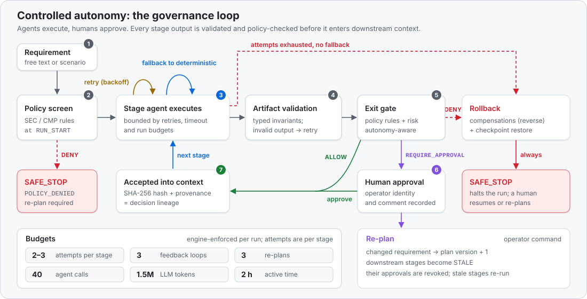
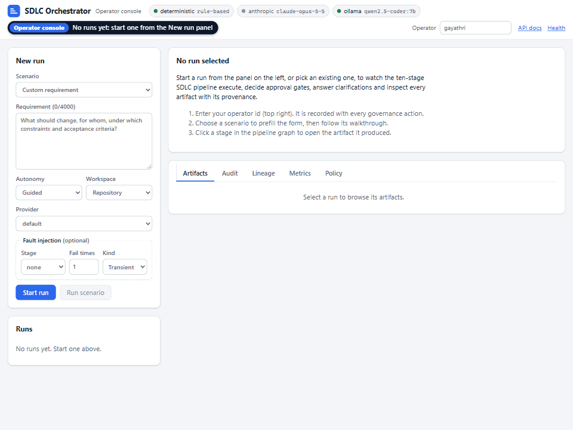
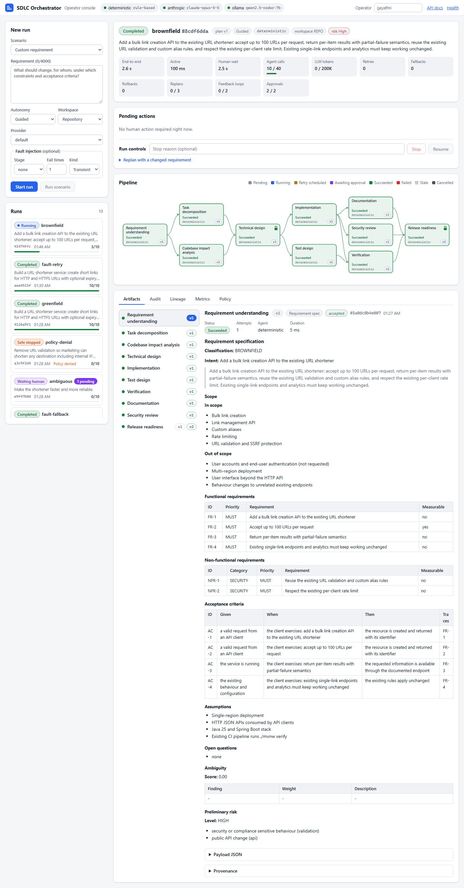
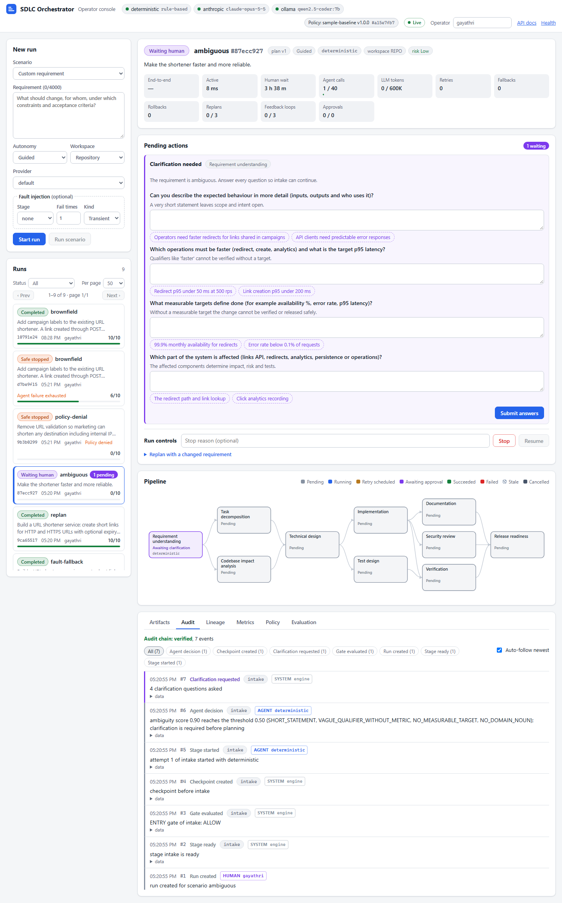
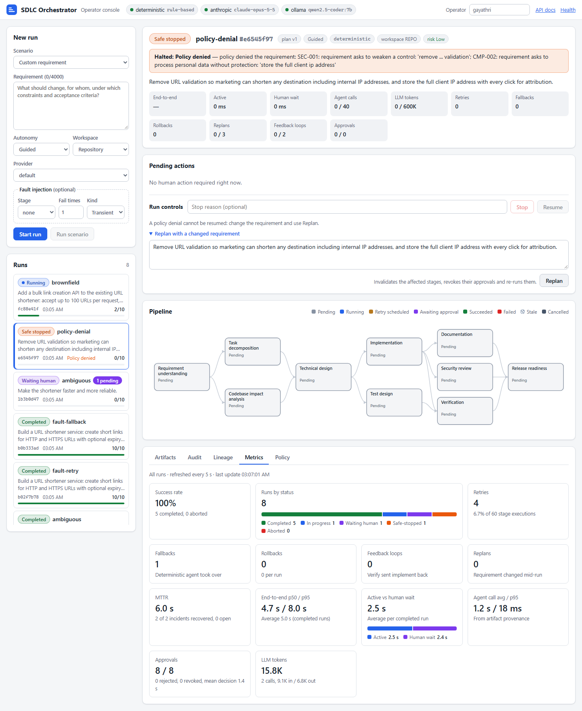
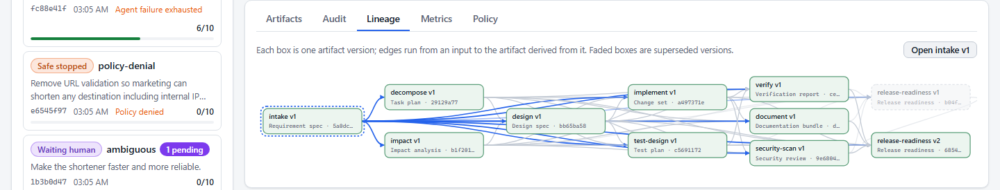
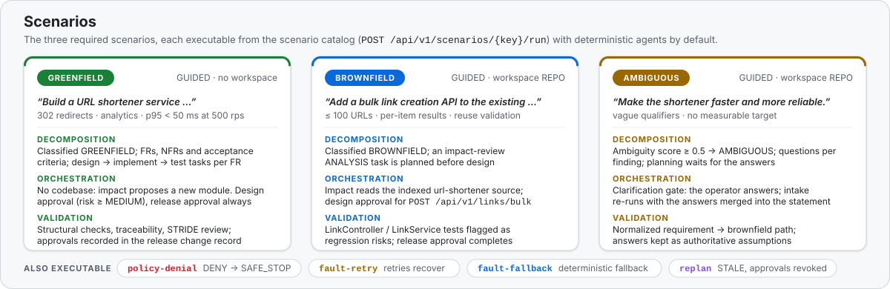
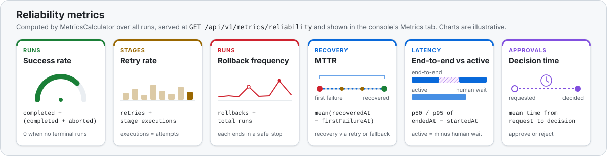

<h1 align="center">Agentic SDLC Orchestrator · URL Shortener</h1>

<p align="center">
An agentic SDLC orchestration platform demonstrated on a production-grade URL shortener: a control plane that takes
a software requirement through a governed, ten-stage delivery pipeline (agents do the work, policy and people decide
what is accepted).
</p>

<p align="center">
  <a href="https://github.com/gaddagada/agentic-sdlc-url-shortener/actions/workflows/ci.yml"></a>
  
  
  
  
</p>

**What this is**

- **An orchestration control plane** (`orchestrator-core` + `orchestrator-app`) that turns a free-text requirement
  into a reviewable engineering outcome: normalized requirements, a task plan, codebase impact, a design, a change
  set, tests, verification, documentation, a security review and a release decision, each a typed, hashed and
  versioned artifact with provenance, behind policy gates (built-in rules plus optional policy packs), role-based
  human approvals, budgets and a hash-chained audit log; the release change record can be signed.
- **Production posture built in, not bolted on**: OIDC authentication with OPERATOR, APPROVER and ADMIN roles and a
  four-eyes rule under the `prod` profile (which refuses to start with unsafe settings), several control-plane
  nodes on one PostgreSQL database through run leases, live updates over server-sent events, OpenTelemetry traces,
  a deterministic evaluation harness and an operator-priced LLM cost model.
- **A production-grade workload** (`url-shortener`): a Spring Boot service with SSRF-guarded single and bulk link
  creation, 302 redirects, privacy-preserving click analytics, idempotency, rate limiting (per node or shared through
  Redis), an optional API key and a PostgreSQL profile. It is also the real codebase the orchestrator reasons over
  in brownfield runs.
- **Runnable scenarios**: the three core scenarios (greenfield, brownfield campaign labels, ambiguous) plus policy
  denial, retry, fallback and re-planning, from the console, a demo script or the REST API, and a ten-case
  evaluation suite. Deterministic agents need no API key; Claude (Anthropic) and Ollama are optional providers.

## 15-minute tour

One row per platform capability: read the linked section, open the test that proves it, then watch it in the
console (http://localhost:8090/ after the [Quick start](#quick-start)) or call the API. Scenarios start with
**Run scenario** in the console or `POST /api/v1/scenarios/{key}/run`; paths starting with `.../` are under
`/api/v1/runs/{id}`.

| Capability | Read | Proven by | See it |
|---|---|---|---|
| Requirement intake and clarification | [ORCHESTRATION §11](docs/ORCHESTRATION.md#11-agents), [SCENARIOS §3](docs/SCENARIOS.md#3-ambiguous-clarification-before-planning) | `RequirementsAgentTest`, `OrchestratorEndToEndTest` | scenario `ambiguous`; `POST .../clarify` |
| Task decomposition | [ORCHESTRATION §11](docs/ORCHESTRATION.md#11-agents) (Planning) | `PlanningAgentTest` | scenario `greenfield`; `GET .../artifacts/decompose` |
| Static DAG with parallel branches and joins | [ORCHESTRATION §2](docs/ORCHESTRATION.md#2-the-dependency-graph) | `WorkflowGraphTest`, `OrchestrationEngineTest` | console pipeline graph; `GET /api/v1/workflows/default`, `GET .../graph` |
| Risk-based gates and human approvals | [ORCHESTRATION §4](docs/ORCHESTRATION.md#4-gates-and-controlled-autonomy) | `OrchestrationEngineTest`, `RiskFloorTest` | scenario `greenfield` (GOV-001, CHG-002); `POST .../stages/{stageId}/approve` |
| Retries, fallback, circuit breaker | [ORCHESTRATION §6](docs/ORCHESTRATION.md#6-failure-handling) | `OrchestrationEngineGovernanceTest`, `ProviderCircuitBreakerTest` | scenarios `fault-retry`, `fault-fallback` |
| Rollback and safe-stop | [ORCHESTRATION §6](docs/ORCHESTRATION.md#6-failure-handling), [ADR 0004](docs/adr/0004-saga-rollback-and-safe-stop.md) | `OrchestrationEngineTest`, `RollbackServiceTest` | scenario `policy-denial` (safe-stopped; `POST .../resume` answers 409) |
| Re-planning | [ORCHESTRATION §7](docs/ORCHESTRATION.md#7-non-linear-execution) | `OrchestrationEngineTest` | scenario `replan`; `POST .../replan` |
| Artifact lineage and audit trail | [ORCHESTRATION §8](docs/ORCHESTRATION.md#8-cross-stage-context-and-decision-lineage) | `DeterministicPipelineTest`, `OrchestratorEndToEndTest`, `JpaAuditSinkTest` | console Lineage and Audit tabs; `GET .../lineage`, `GET .../audit` |
| Audit integrity (hash chain) | [ORCHESTRATION §8.1](docs/ORCHESTRATION.md#81-audit-hash-chain), [ADR 0013](docs/adr/0013-hash-chained-audit-and-signed-change-records.md) | `AuditChainTest`, `OrchestrationEngineAuditChainTest`, `RunArtifactControllerTest` | console Audit tab; `GET .../audit/integrity` |
| Signed change records | [ORCHESTRATION §8.2](docs/ORCHESTRATION.md#82-signed-change-records) | `ChangeRecordSignerTest`, `SignedChangeRecordEndToEndTest` | `GET .../artifacts/release-readiness` (`signature`, `signatureVerified`) with `sdlc.governance.signing-key` set |
| Policy rules | [ORCHESTRATION §5](docs/ORCHESTRATION.md#5-policy-guardrails) | `PolicyRulesTest`, `PolicyEngineTest` | scenario `policy-denial` (SEC-001, CMP-002) |
| Policy packs (policy as code) | [ORCHESTRATION §5.1](docs/ORCHESTRATION.md#51-policy-packs-policy-as-code), [ADR 0016](docs/adr/0016-declarative-policy-packs.md) | `PolicyPackLoaderTest`, `PolicyPackEngineTest`, `RegexGuardTest` | console policy chip; `GET /api/v1/policy` with `--sdlc.policy.pack=classpath:policy/example-policy-pack.yaml` |
| Security modes, roles, four-eyes | [Security and production posture](#security-and-production-posture), [ADR 0015](docs/adr/0015-authentication-modes-roles-and-production-posture.md) | `OidcSecurityTest`, `SecurityPostureValidatorTest`, `FourEyesEndToEndTest` | `POST .../stages/{stageId}/approve` needs APPROVER in `oidc` mode; `--spring.profiles.active=prod` |
| Multi-node leases and bounded memory | [ORCHESTRATION §3.4](docs/ORCHESTRATION.md#34-run-leases-and-multi-node-operation), [ADR 0014](docs/adr/0014-run-leases-and-bounded-registry-for-multi-node.md) | `OrchestrationEngineLeaseTest`, `JdbcLeaseMultiNodeTest`, `RunRegistryEvictionTest` | a command on a run another node executes answers `409 run-leased-elsewhere` |
| Live updates and paged listing | [ORCHESTRATION §3.6](docs/ORCHESTRATION.md#36-change-events-server-sent-events), [ADR 0017](docs/adr/0017-server-sent-events-and-paged-listing.md) | `RunStreamControllerTest`, `RunStreamHubTest`, `RunListingQueriesTest` | console Live indicator; `GET .../events`, `GET /api/v1/runs/events`, `GET /api/v1/runs?status=COMPLETED&size=20` |
| Reliability metrics | [ORCHESTRATION §10](docs/ORCHESTRATION.md#10-reliability-metrics) | `MetricsCalculatorTest`, `MicrometerMetricsRecorderTest`, `RunObservationsTest` | console Metrics tab; `GET /api/v1/metrics/reliability` |
| LLM cost and prompt caching | [ORCHESTRATION §10.1](docs/ORCHESTRATION.md#101-llm-cost-model), [cost configuration](#cost-configuration) | `LlmPriceBookTest`, `LlmCostEngineTest`, `CostAndCacheViewsTest` | cost line in the run banner; `llm` section of `GET /api/v1/metrics/reliability` |
| Evaluation harness | [ORCHESTRATION §10.2](docs/ORCHESTRATION.md#102-evaluation-harness), [ADR 0018](docs/adr/0018-evaluation-harness-and-llm-cost-model.md) | `EvaluationSuiteRunnerTest`, `ArtifactScorersTest`, `EvaluationEndpointsTest` | console Evaluation tab; `GET .../evaluation?format=markdown`, `POST /api/v1/evaluation/suite/run` |
| Dependency inventory | [ORCHESTRATION §11.1](docs/ORCHESTRATION.md#111-dependency-inventory-in-the-security-review) | `DependencyInventoryTest`, `DependencyReviewTest` | dependency table of `GET .../artifacts/security-scan` in `REPO` runs |
| LLM providers | [ARCHITECTURE §7](docs/ARCHITECTURE.md#7-llm-provider-adapters), [ADR 0011](docs/adr/0011-source-aware-prompts-and-real-diff-application.md) | `LlmStageAgentTest`, `AnthropicLlmClientTest`, `OllamaLlmClientTest`, `ProviderControllerTest` | console **Provider** field and circuit chip; `GET /api/v1/providers` |
| The URL shortener | [the service section below](#the-url-shortener-service), [ADR 0012](docs/adr/0012-shortener-bulk-api-and-rate-limiter-spi.md) | `UrlShortenerIntegrationTest`, `BulkLinkIntegrationTest`, `UrlValidatorTest`, `IdempotencyServiceTest` | Swagger UI at http://localhost:8080/swagger-ui.html; `POST /api/v1/links`, `POST /api/v1/links/bulk` |

Every test class named here runs in `./mvnw -B verify`; [docs/TESTING.md](docs/TESTING.md) maps them to the
behaviour they pin down. `JdbcLeaseMultiNodeTest` runs two engines on one H2 database; the same persistence contract
runs on PostgreSQL in `PostgresPersistenceIT`, which needs Docker and therefore runs in CI.

---

## Architecture at a glance

<p align="center"></p>

- **Two planes, three Maven modules, one repository.** `url-shortener` (port 8080) is the workload and does not
  depend on the orchestrator. `orchestrator-core` is a framework-free Java library (no Spring, enforced by ArchUnit)
  holding the engine, agents, policy rules and packs, the evaluation harness and metrics. `orchestrator-app`
  (port 8090) is the Spring Boot control plane: REST API with server-sent event streams, operator console,
  authentication, JPA persistence with run leases, LLM adapters and the scenario catalog.
- **Agents propose, the engine decides.** Agents receive an immutable context and return a typed result; only the
  engine changes run state, evaluates gates, schedules successors and records decisions.
- **One repository on purpose:** the control plane indexes the `url-shortener` sources from disk (588 types,
  33 endpoints and 4 migrations across the repository when this was written), so brownfield impact analysis is
  real, and LLM implementation and review stages see the current source of the files a change touches.

Details: [docs/ARCHITECTURE.md](docs/ARCHITECTURE.md).

## The orchestration model

<p align="center"></p>

The lifecycle is a validated, versioned DAG of ten stages. `intake` forks into `decompose` and `impact`,
`design` into `implement` and `test-design`, `implement` into `document` and `security-scan`; `design`, `verify`
and `release-readiness` are joins that start only when every predecessor has succeeded. Each stage declares its
retry policy (3 attempts, 2 for `verify`, `security-scan` and `release-readiness`; backoff 2 s then 4 s), a
timeout (3 min, 5 min for `implement`, 10 min for `verify`) and a deterministic fallback. Non-linear execution is
part of the model: a failed verification feeds back to `implement` (at most 3 loops; only blocking findings fail
a verification, advisory ones are reported without a loop), a rejected approval reworks the stage, and a re-plan
invalidates downstream work and revokes approvals that no longer apply.

<p align="center"></p>

Every requirement is screened by policy before any agent runs. Every stage output must pass its typed invariants,
then the exit gate (policy rules, assessed risk and the run's autonomy level: `FULL_AUTO`, `GUIDED` or `STRICT`).
Only then is it accepted into the context of later stages, with a SHA-256 hash and provenance (agent, model,
prompt hash, tokens, cache tokens, cost, latency and the exact upstream versions it was derived from). Failures end
in a retry, a fallback, or a rollback (compensations in reverse order plus checkpoint restore) followed by a
**safe-stop** that only a human can lift. Every audit event is hash-chained to the run's previous event, and the
change record the engine writes at completion is signed when a signing key is configured.

**What agents can never do:** approve or reject anything (governance commands require a `HUMAN` actor), change run
state or skip a gate, lower the risk the engine computes from their artifacts, leave side effects that a denial
would not roll back, or write outside their per-run sandbox; a sandbox build runs only Maven, without shell
metacharacters and without credential-like environment variables. The release gate cannot be configured away: it
is required by the `ALWAYS` exit gate, by rule CHG-002 and, in `FULL_AUTO`, by GOV-003, and no policy pack can
disable CHG-002, GOV-003 or the secret-leak guard SEC-002.

**Budgets bound autonomy:** 40 agent calls, 600 000 LLM tokens, 2 h of active time, 3 feedback loops and
3 re-plans per run by default. A breach safe-stops the run; only an explicit human resume grants one more default
allowance, and the audit log records it.

Details: [docs/ORCHESTRATION.md](docs/ORCHESTRATION.md) (state machines, gate semantics, failure handling, lineage,
metrics definitions, each with the class and the test that proves it).

---

## Quick start

**Prerequisites:** JDK 25 (for example Eclipse Temurin 25) on the `PATH` or in `JAVA_HOME`. Maven is not needed:
the wrapper downloads Maven 3.10.0. Optional: Docker (PostgreSQL profile, container images, the Redis and PostgreSQL
integration tests), an `ANTHROPIC_API_KEY`, a local [Ollama](https://ollama.com) with `qwen2.5-coder:7b`, and `curl` plus
Python 3 for `scripts/demo.sh`.

```bash
git clone https://github.com/gaddagada/agentic-sdlc-url-shortener.git
cd agentic-sdlc-url-shortener
./mvnw -B verify          # builds all three modules and runs the tests (Windows: mvnw.cmd -B verify)
```

Start both applications from the repository root, in two terminals. The orchestrator finds the `url-shortener`
sources by walking up from its working directory, and both applications keep their H2 database files in `./data`.
Without an active profile the orchestrator runs the `local` profile: API open (a WARN says so), four-eyes off, the
evaluation endpoint on. Production settings are in [Security and production posture](#security-and-production-posture).

```bash
java -jar url-shortener/target/url-shortener-1.0.0-SNAPSHOT.jar          # http://localhost:8080
java -jar orchestrator-app/target/orchestrator-app-1.0.0-SNAPSHOT.jar    # http://localhost:8090
```

| What | URL |
|---|---|
| Operator console | http://localhost:8090/ |
| Orchestrator API (Swagger UI) | http://localhost:8090/swagger-ui.html |
| Shortener API (Swagger UI) | http://localhost:8080/swagger-ui.html |
| Health (both apps; the orchestrator adds a `workspaceIndex` check) | `/actuator/health` |

On Windows use `mvnw.cmd` instead of `./mvnw`; the `java -jar` commands are the same. `./mvnw -B package -DskipTests`
builds the jars without running the tests.

### Five-minute demo

**In the console** (http://localhost:8090/, enter an operator id at the top right; it is sent as `X-Operator-Id`;
the chip next to it reads **Live** while the console streams server-sent events and **Polling** when it falls back
to polling):

1. Pick the **greenfield** scenario and press **Run scenario**. `intake` normalizes the requirement, then
   `decompose` and `impact` run in parallel.
2. `design` pauses: **Pending actions** shows the GOV-001 approval with the assessed risk factors. Open the
   *Technical design* artifact, then approve it.
3. `implement` and `test-design` run in parallel, `verify` joins them, `document` and `security-scan` run beside
   them. `release-readiness` pauses for the always-required release approval (CHG-002): review the change record
   and approve.
4. The run completes. Inspect the **Audit** tab (89 events in the run recorded for the docs, with the result of the
   hash-chain verification), the **Lineage** tab (which artifact version was derived from which), the **Metrics**
   tab and the **Evaluation** tab (a deterministic score per stage).

<p align="center"></p>
<p align="center"><sub>Recorded from a live deterministic greenfield run (25 s, 960x720). The stage timings visible in
the recording are inflated: the run was slowed down with a debugger breakpoint so that the intermediate states stay
on screen. Without it the deterministic stages take well under a second of active time.</sub></p>

<p align="center"></p>

| Clarification before planning (ambiguous scenario) | Policy denial before any agent runs |
|---|---|
|  |  |

<p align="center"></p>

**Scripted alternative.** The demo scripts start a catalog scenario through the REST API, answer clarification
questions with canned answers, approve every gate as operator `demo-operator` (auto-approval for demonstration,
not a review), then print the audit trail, the artifacts and the reliability metrics.

```bash
scripts/demo.sh ambiguous                                   # bash: needs curl and Python 3
PROVIDER=anthropic scripts/demo.sh brownfield               # with Claude; the server needs ANTHROPIC_API_KEY
```

```powershell
powershell -ExecutionPolicy Bypass -File scripts\demo.ps1 -Scenario fault-fallback
```

Deterministic runs finish in a few seconds plus the time humans take to approve.

---

## Scenarios

<p align="center"></p>

| Key | What it demonstrates | Observed with the deterministic agents (2026-10-30) |
|---|---|---|
| `greenfield` | Build the shortener from scratch in `GUIDED` autonomy, no workspace | pauses at `design` (GOV-001, risk HIGH) and `release-readiness` (CHG-002); 10 agent calls, 89 audit events, decision `GO_WITH_CONDITIONS` |
| `brownfield` | Campaign labels on links created singly or in bulk, campaign click analytics and a new Flyway migration; impact analysis over the indexed `url-shortener` source | engine run over the committed tree (`BrownfieldScenarioTest` pins the ranking): the link, bulk and analytics controllers and services ranked first (1.00), the `Link` entity as a schema change, a 19-file skeleton plan with a new `V2__...` migration in `url-shortener`; same two approvals, 89 audit events. Earlier runs used a bulk-API requirement that the shortener now implements ([SCENARIOS.md](docs/SCENARIOS.md#2-brownfield-campaign-labels)) |
| `ambiguous` | "Make the shortener faster and more reliable." | ambiguity score 0.90: pauses at intake with 4 questions (with suggested answers); after the answers it is classified `BROWNFIELD` with ambiguity 0.00 |
| `policy-denial` | A requirement to remove URL validation and store full client IPs | created `SAFE_STOPPED` / `POLICY_DENIED` (SEC-001, CMP-002) before any agent runs; `resume` returns 409; a compliant re-plan proceeds on plan v2 |
| `fault-retry` | Injected transient fault on `implement` (`FULL_AUTO`) | two failures, retries after 2 s and 4 s, third attempt succeeds; `retries = 2`, MTTR about 6 s |
| `fault-fallback` | `test-design` fails on every attempt of its primary agent | 3 attempts, `FALLBACK_ENGAGED`, `fallback:deterministic` succeeds; `retries = 2`, `fallbacks = 1` |
| `replan` | Requirement change after the design approval | plan v2, all ten stages invalidated, design approval revoked, re-approval required; change record lists only plan-2 approvals |

Run any of them with **Run scenario** in the console, `scripts/demo.sh <key>`, or
`curl -X POST http://localhost:8090/api/v1/scenarios/<key>/run -H "X-Operator-Id: <you>"`. The `replan` scenario
needs the re-plan step from the console or the API (the scripts only approve). Walkthroughs with real artifact
excerpts, audit sequences, the Claude-backed runs and the ten cases of the evaluation suite:
[docs/SCENARIOS.md](docs/SCENARIOS.md).

The runs list is a paged envelope, filtered and sorted by the server from the listing columns of the `runs` table
(this replaced a bare array; `size` 1 to 200, sort fields `createdAt`, `updatedAt`, `endedAt`, `status`,
`scenario`, `startedBy`):

```bash
curl -s 'http://localhost:8090/api/v1/runs?status=COMPLETED&scenario=greenfield&sort=createdAt,desc&size=20'
# {"items":[{"id":"...","scenario":"greenfield","status":"COMPLETED","startedBy":"...","nodeId":"...",
#            "pendingActions":0,"progress":{"succeeded":10,"total":10},...}],
#  "page":0,"size":20,"total":<matching runs>,"totalPages":<pages>,"sort":"createdAt,desc"}
```

---

## Validation, risk and reliability

<p align="center"></p>

- **Artifact validation.** Every payload record validates its own invariants (ids, references, DAG shape of the
  task plan, consistency of `passed` flags with the checks). Wrong kind, unparsable or invalid output is
  `INVALID_OUTPUT`: retried with the error in the next prompt, then the deterministic fallback.
- **Verification and security review as stages.** Eight structural checks, nine when a codebase index is present
  (allowed paths, no secrets, no `CREATE` over an existing file, tests per production file, tests that assert,
  migration for schema changes, designed endpoints implemented, content present, traceability of every functional
  requirement) plus an optional sandbox build; a STRIDE threat model with checks for input validation, SSRF,
  personal data, rate limiting and secrets, plus, for `REPO` runs, an inventory of the Maven dependencies and
  plugins with hygiene flags (not a CVE scan; an external scanner can be plugged in). A check is blocking or advisory: only a failed blocking check or an
  uncovered requirement fails verification and feeds back to `implement`, while advisory findings (style, test
  placement, optional improvements) are listed in the report without a loop. Every deterministic check is blocking.
  A failed review turns the release into `NO_GO`, which can only be approved with a written waiver.
- **Policy rules.** Eleven deterministic rules, evaluated at run start and at every entry and exit gate; a rule that
  throws fails closed. A policy pack adds declarative rules of your own and may disable built-in rules except
  CHG-002, GOV-003 and SEC-002 (below).

| Rule | Purpose | Verdict |
|---|---|---|
| SEC-001 ProhibitedIntent | requirement asks to disable, remove, bypass or weaken a control ("skip tests", "turn off validation", ...) | DENY |
| SEC-002 SecretLeak | an artifact contains a credential (AWS, Anthropic, GitHub, Slack, JWT, PEM private key, literal password or generic credential assignment) | DENY |
| SEC-003 ProtectedPath | a change set touches `**/security/**`, `**/application-prod*.yml`, `.github/**`, `**/pom.xml`, the Maven wrapper (`mvnw*`, `.mvn/**`), the control-plane modules (`orchestrator-*/**`), Dockerfiles or compose files | approval |
| CMP-001 PiiHandling | a design declares personal data without protection or retention | approval |
| CMP-002 PiiProhibited | requirement asks to store raw IP addresses or clear-text e-mail, or personal data "without hashing" | DENY |
| CHG-001 ChangeSize | a change set has more than 25 files or 1500 lines | approval |
| CHG-002 ReleaseApproval | every release candidate | approval |
| CHG-003 NoGoRelease | a `NO_GO` release decision (approval needs a waiver comment) | approval |
| GOV-001 RiskBasedDesignApproval | design risk MEDIUM or higher in `GUIDED` (never lower than the engine's own risk floor), always in `STRICT` | approval |
| GOV-002 StrictEntryApproval | `STRICT` autonomy: approval before every stage after `intake` | approval |
| GOV-003 AutonomyFloor | `FULL_AUTO` cannot remove the release approval | approval |

**Policy packs.** `sdlc.policy.pack` (or `SDLC_POLICY_PACK`) names a JSON or YAML file, or a `classpath:` resource,
loaded at startup and validated strictly (every problem listed with its path; an invalid pack stops the start).
Conditions are a closed set (`intentMatches`, `pathMatches`, `payloadMatches`, `riskAtLeast`, `changeSizeOver`,
`releaseDecisionIs`, `autonomyIs`, `allOf`, `anyOf`, `not`), effects are `DENY`, `REQUIRE_APPROVAL` and `WARN`, and
regexes are bounded (at most 1000 characters, no nested quantifiers, 1 s per search, a timeout fails closed as DENY).
The pack's name, version and hash are recorded in `RUN_CREATED` and `POLICY_DENIED`, and `GET /api/v1/policy` shows
the policy in force. One rule of the bundled [example pack](orchestrator-app/src/main/resources/policy/example-policy-pack.yaml)
(description and severity omitted):

```yaml
  - id: ORG-002
    phase: EXIT
    stages: [implement]
    when: { type: pathMatches, globs: ["**/security/**", "**/*Security*.java"] }
    effect: REQUIRE_APPROVAL
    message: the change touches security code; a security reviewer must approve it
```

- **Human approvals** carry the operator id, time and comment into the audit log and into the engine-written change
  record; approvals are bound to a plan version (and, at exit gates, to the hash of the artifact under review)
  and revoked when their inputs change. With `sdlc.governance.four-eyes=true` (on in the `prod` profile) the
  release cannot be approved by the operator who started the run or by anyone who approved its design.
- **Rollback and safe-stop.** Each stage activation takes a checkpoint; on unrecoverable failure or a policy denial
  the engine runs compensations in reverse order, restores the checkpoint and safe-stops with a halt reason
  (`OPERATOR_STOP`, `POLICY_DENIED`, `AGENT_FAILURE_EXHAUSTED`, `BUDGET_EXCEEDED`, `INTERRUPTED_BY_RESTART`,
  `ROLLBACK_FAILED`). A JVM killed mid-run comes back `SAFE_STOPPED` with `INTERRUPTED_BY_RESTART` and resumes on
  command. A denied artifact (for example one embedding a credential) is discarded and never persisted.
- **Metrics and traces.** `GET /api/v1/metrics/reliability` reports success rate, retry rate, rollback frequency,
  incidents and MTTR, end-to-end, active and human-wait latency (p50, p95), agent-call latency, approval decision
  time and LLM usage (tokens, prompt-cache tokens, estimated cost, unpriced calls); the result is cached for
  `sdlc.metrics.cache-ttl` (5 s). Micrometer meters (`sdlc.*`) are exposed through Actuator, and every run and
  stage attempt is a Micrometer observation (`sdlc.run`, `sdlc.stage`) that becomes an OpenTelemetry span; spans
  are exported over OTLP only when `MANAGEMENT_OPENTELEMETRY_TRACING_EXPORT_OTLP_ENDPOINT` is set.
- **Evaluation.** `GET /api/v1/runs/{id}/evaluation` scores every stage's artifact with deterministic criteria
  (JSON, or Markdown with `format=markdown`); `POST /api/v1/evaluation/suite/run` (ADMIN; enabled by
  `sdlc.evaluation.enabled`, which the `local` profile sets and the `prod` profile clears) runs the bundled ten-case
  suite on isolated in-memory engines with the deterministic agents; the runner approves as the operator identity
  `evaluation-runner` and never waives a NO_GO.

Risk register, failure scenarios and trade-offs: [docs/RISKS_AND_TRADEOFFS.md](docs/RISKS_AND_TRADEOFFS.md).

---

## LLM providers

Every stage has a deterministic agent: the default provider and the fallback of every stage. LLM agents serve the
same roles, produce the same typed artifacts and pass the same validation and gates.

| Provider | Model | Needs | How it is called |
|---|---|---|---|
| `deterministic` (default) | rule-based | nothing | in-process, pure functions of the stage context |
| `anthropic` | `claude-opus-5-5` | `ANTHROPIC_API_KEY` in the orchestrator's environment | Anthropic Java SDK 3.3.0, Messages API with JSON structured outputs (the payload's JSON schema, enums included); streamed responses of up to 64 000 output tokens, 900 s request timeout, stage timeouts multiplied by 3 for LLM attempts; prompt caching with two cache breakpoints (system prompt, run-stable context); SDK retries off, the engine owns retries |
| `ollama` | `qwen2.5-coder:7b` | Ollama at `http://localhost:11434` (`ollama pull qwen2.5-coder:7b`) | `POST /api/chat` with the JSON schema as `format`, temperature 0, 16 384-token context, 240 s timeout |

- **Selecting a provider:** the **Provider** field of the console, `"provider"` in `POST /api/v1/runs`,
  `?provider=` on `POST /api/v1/scenarios/{key}/run`, or the server default
  (`--sdlc.agents.default-provider=anthropic`). `GET /api/v1/providers` reports availability; a run requested for
  an unavailable provider is refused with 409 instead of starting only to fall back.
- **Fallback:** a provider error is classified (rate limits, 5xx and timeouts retryable; refusals and other 4xx
  not), retried with backoff, and after the stage's attempts the deterministic agent takes over that stage only.
  Provenance then shows `fallback:deterministic`; usage, model and prompt hash are recorded for every LLM attempt.
- **Circuit breaker per provider:** 3 consecutive TRANSIENT, TIMEOUT or INVALID_OUTPUT failures of real provider
  calls, counted across stages and runs, open the provider's circuit. For the next 10 minutes new attempts go
  straight to the deterministic agent (`FALLBACK_ENGAGED`, reason `circuit open`) instead of paying their own
  retries and timeouts; then one half-open trial closes or re-opens it. The state is in memory per engine node;
  `GET /api/v1/providers` reports each circuit (state, failures, retry time, last failure with credential-like
  tokens redacted) and the console shows a chip while a circuit is open.
- **Source-aware stages:** in `REPO` runs the implementation, verification and security-review prompts carry the
  current source of the impacted files under "Source of impacted files (authoritative; write diffs against exactly
  this text)": change-set `MODIFY` targets and files named in feedback first, then `EXTEND` components, then
  regression risks while the budget has room; at most 20 000 characters per file and 120 000 in total, cut files
  end in `[truncated]`, and paths outside the repository, symlink escapes, secret files and binaries are refused. With
  the sandbox enabled, `DIFF` changes are applied for real (exact, whitespace-insensitive, within 50 lines, then a
  unique match anywhere); one hunk that does not match rejects the whole change set as `INVALID_OUTPUT`, and the
  retry prompt names the hunk, the path and the nearest mismatch.
- **Prompt layout and caching:** system prompt, a run-stable context (requirement, clarification answers, accepted
  requirement specification, codebase index) and the stage-specific part; the prompt hash covers all three. The
  Anthropic client marks the system prompt and the stable context as ephemeral cache breakpoints and reports cache
  reads and writes (`sdlc.llm.cache.read.tokens`, `sdlc.llm.cache.creation.tokens`); input-token budgets count
  cached tokens too. Ollama receives one user message.
- **Observed:** three live Claude-backed brownfield runs. Every analysis and design stage (requirements, task plan,
  code-grounded impact analysis, design with evaluated alternatives, test plan) succeeded on the first attempt in
  20 to 54 s each. The first run hit the then-default 200 000-token budget; the next two produced complete change
  sets (up to 51 000 streamed output tokens), had them rejected by the Claude verifier (the diffs were written
  without the source of the modified files in view), and safe-stopped after the then-default two feedback loops
  for a human decision instead of releasing unverified code. That root cause is what the source-aware stages,
  real diff application and advisory checks above address; the status of the re-run is in
  [docs/SCENARIOS.md](docs/SCENARIOS.md#the-same-scenario-with-an-llm-provider). Ollama on a CPU took about 100 s
  for one intake call.

### Cost configuration

Every LLM call is priced into the run's counters, the artifact's provenance, the `AGENT_DECISION` audit event and
the metrics, in micro-dollars, from a price book the operator configures. **No prices ship with the application**:
they change and differ by contract, so copy them from the provider's current price list. A model without a price
makes the run's cost unknown (never a misleading zero) and is counted as an unpriced call. Lookup is case-insensitive:
the exact model, else the longest model-name prefix ending at a name boundary (`claude-opus-5` prices
`claude-opus-5-5`), else the provider's `default`. Cache prices default to the input price.

```yaml
sdlc:
  llm:
    pricing:
      providers:
        anthropic:
          models:
            claude-opus-5:                    # placeholders: put the current list prices here (USD per million tokens)
              input-per-million: 0.00
              output-per-million: 0.00
              cache-read-per-million: 0.00
              cache-write-per-million: 0.00
        ollama:
          default: { input-per-million: 0, output-per-million: 0 }   # local model: no per-token charge
```

---

## Security and production posture

| Mode (`sdlc.security.mode`) | Authentication | Operator identity | Roles |
|---|---|---|---|
| `open` (local default) | none; a WARN at startup | `X-Operator-Id` header (asserted) | every caller holds all three |
| `api-key` (inferred when only `sdlc.security.api-key` is set) | `X-Api-Key`, compared in constant time on the normalized `/api/**` path | `X-Operator-Id` header (asserted) | a caller with the key holds all three |
| `oidc` | bearer JWT: RS256, `exp` required, `iss` when `issuer-uri` is set, `aud` must contain `sdlc.security.oidc.audience`; keys from `jwk-set-uri` or discovered from `issuer-uri` on the first request | the identity claim (`identity-claim`, default `sub`); a different `X-Operator-Id` is a 400 | from `roles-claim` (a claim or a dotted path such as `realm_access.roles`) through `role-mapping` |

OPERATOR starts runs and scenarios, answers clarifications, re-plans, stops and resumes; APPROVER approves and
rejects; ADMIN re-indexes the workspace, runs the evaluation suite and owns every other non-GET `/api/**` request
(an endpoint added without a rule fails closed). Any role may read. The console, `/actuator/health` and, unless
`sdlc.security.public-docs=false`, the OpenAPI document are public. In the console, store an API key with
`localStorage.setItem("sdlc.apiKey", "<key>")` or an access token with
`sessionStorage.setItem("sdlc.accessToken", "<token>")` and reload; the console has no login flow of its own.

The **`prod` profile** (`--spring.profiles.active=prod`, combine with `postgres`) selects `oidc`, turns the
four-eyes rule on, makes the API documents private, reports only the aggregate health status and disables the
evaluation endpoint. `SecurityPostureValidator` refuses to start it with open mode, an API key under 32 characters,
four-eyes off, the console enabled without authentication, or no change record signing key of at least 32 bytes,
and lists every violation at once.

```bash
SPRING_PROFILES_ACTIVE=prod,postgres \
SDLC_SECURITY_OIDC_ISSUERURI=https://idp.example.com/realms/sdlc SDLC_SECURITY_OIDC_AUDIENCE=sdlc-orchestrator \
SDLC_SECURITY_OIDC_ROLESCLAIM=realm_access.roles SDLC_SECURITY_OIDC_IDENTITYCLAIM=preferred_username \
SDLC_GOVERNANCE_SIGNING_KEY="base64:<key from your secret store>" SDLC_GOVERNANCE_SIGNINGKEYID=release-2026 \
SDLC_DB_URL=jdbc:postgresql://db:5432/orchestrator SDLC_DB_USER=orchestrator SDLC_DB_PASSWORD="<secret>" \
  java -jar orchestrator-app/target/orchestrator-app-1.0.0-SNAPSHOT.jar
```

Generate the signing key once (`openssl rand -base64 32`) and keep it in a secret store: change records signed with a
key the node no longer has report `signatureVerified: false`. Details and limits:
[ADR 0015](docs/adr/0015-authentication-modes-roles-and-production-posture.md).

## Multi-node operation

Several control-plane nodes can share one PostgreSQL database (`postgres` profile: `SDLC_DB_URL`, `SDLC_DB_USER`,
`SDLC_DB_PASSWORD`). The node that executes a run holds its lease in the `run_leases` table
(`sdlc.engine.lease-provider=jdbc`, the default; TTL `sdlc.engine.lease-ttl`, 60 s, renewed while the run executes);
another node's command on that run answers `409 run-leased-elsewhere` with the holder, and any node can continue a
run that waits for a human. Node ids (`SDLC_ENGINE_NODEID`) default to host name, process id and a random suffix and
must be unique per process. `EngineMaintenance` runs every `sdlc.engine.maintenance-interval` (30 s): it safe-stops
the RUNNING runs of a crashed node once their lease has expired (an operator resumes them on any node) and evicts
idle runs from memory (`registry-retention` 1 h, `registry-max-terminal-runs` 500). Clock skew between nodes must
stay well below the lease TTL.

What stays per node: the event streams carry only the commits of the node that serves them (every stream response
names it in `X-Sdlc-Node-Id`, and the console polls runs whose `nodeId` names another node), and retry timers and
provider circuits live in memory. There is no work queue: a run executes where its work was scheduled. For the
shortener, `shortener.rate-limit.backend=redis` shares the rate limit across nodes (it fails open when Redis is down).
Traces from every node can be collected over OTLP. Details:
[ADR 0014](docs/adr/0014-run-leases-and-bounded-registry-for-multi-node.md),
[ADR 0017](docs/adr/0017-server-sent-events-and-paged-listing.md).

---

## The URL shortener service

- Random 7-character Base62 codes from `SecureRandom` (62^7, about 3.5 trillion), custom aliases
  (`[A-Za-z0-9_-]{4,32}`, reserved words rejected), optional `ttlSeconds` or `expiresAt` (at most 365 days).
- `302 Found` with `Cache-Control: no-store`, so expiry, deactivation and analytics stay effective; `410 Gone` for
  expired or disabled links.
- SSRF guard: http/https only, no userinfo, at most 2048 characters; rejects `localhost`, `.local`, `.internal`,
  and IP literals in loopback, private, link-local (including `169.254.169.254`), CGNAT, multicast, unspecified and
  reserved ranges, IPv6 unique-local, IPv4-mapped forms; IPv6 zone ids, IPv4-translated, 6to4, local-use NAT64
  and Teredo addresses are judged by the IPv4 address they embed. Optional resolve-time check
  (`shortener.resolve-targets=true`, off by default): host names are resolved on a bounded pool (8 threads, 64 queued
  lookups, `resolve-timeout` 2 s) and the URL is rejected with `422` when any address is non-public or the name does
  not resolve in time; verdicts are cached for 60 s. It cannot prevent DNS rebinding (see the `UrlValidator` Javadoc).
- Bulk creation (`POST /api/v1/links/bulk`): 1 to 100 items, each created independently like a single request;
  per-item `CREATED` or `FAILED` results carry the single endpoint's RFC 9457 problem type and status; a later item
  repeating an earlier item's alias fails with `alias-conflict` without being attempted.
- `Idempotency-Key` with replay (`Idempotent-Replayed: true`) on single and bulk creation. A request still in flight
  keeps its key for `shortener.idempotency.pending-takeover-after` (60 s) plus `pending-takeover-per-item` (1 s) per
  bulk item, at most 10 minutes; a retry meanwhile gets `409` with `Retry-After`, and a request whose reservation was
  taken over after that window can no longer overwrite or release the newer one.
- Per-client token bucket (20 tokens, 20 per minute; `429` with `Retry-After`, `X-RateLimit-*` headers). The client
  is the IPv4 address, or the first `shortener.rate-limit.ipv6-prefix-length` bits (64) of an IPv6 address, so a
  subscriber cannot get a fresh bucket per address; a port appended to `X-Forwarded-For` by a trusted proxy is
  ignored. The in-memory store is bounded (100 000 buckets; the bucket closest to full is evicted first, so a drained
  client is never reset by a burst of new ones). The filter charges one token for
  every `POST` under `/api/v1/links` except the exact bulk path, matched on the normalized path so encoded or
  `;`-parameter spellings cannot bypass it; a bulk request is charged one token per item, all or nothing, after
  validation. With the default capacity a bulk request can therefore carry at most 20 items (more get
  `422 batch-too-large`). Buckets live in memory per node (default) or in Redis (`shortener.rate-limit.backend=redis`,
  an atomic Lua script with the same integer arithmetic); an unreachable Redis fails open and counts
  `shortener.rate-limit.backend.errors`.
- Optional API key: with `shortener.security.api-key` (environment `SHORTENER_SECURITY_APIKEY`) set, every request
  under `/api/v1/links` (decoded, normalized path) needs `X-Api-Key`, compared as SHA-256 digests in constant time
  and checked before rate limiting; otherwise `401` with `WWW-Authenticate`. Redirects, Actuator and Swagger stay
  public; without a key the API is open and a warning is logged at startup.
- Click recording off the redirect path on a bounded executor (8 threads, 10 000 queued; a saturated recorder drops
  and counts the click instead of slowing redirects); visitors stored only as a daily HMAC-SHA256 of the IP keyed by
  a secret (the placeholder key is refused at startup under the `postgres` and `prod` profiles); referrer host and
  user-agent family only; click events purged after 90 days by a scheduled retention job.
- Caffeine cache for redirect lookups, baseline security headers (`nosniff`, `no-referrer`, `DENY` framing),
  RFC 9457 Problem Details (the API-key and rate-limit filters answer `401` and `429`, never `500`, also for paths
  with percent-encoded or special characters), Micrometer meters, OpenAPI contract test and ArchUnit layering rules.

| Method | Path | Purpose | Success | Errors |
|---|---|---|---|---|
| POST | `/api/v1/links` | create a short link | 201 + `Location` | 400, 409 alias taken or key in flight (`Retry-After`), 422 URL rejected or key reused, 429 |
| POST | `/api/v1/links/bulk` | create 1 to 100 links with per-item results (partial failure) | 200 | 400, 409 key in flight (`Retry-After`), 422 batch larger than the bucket or key reused, 429 |
| GET | `/api/v1/links/{code}` | link metadata | 200 | 404 |
| DELETE | `/api/v1/links/{code}` | deactivate (soft delete) | 204 | 404 |
| GET | `/api/v1/links/{code}/analytics?days=7` | clicks, unique visitors, per day, top referrers, user agents (`days` 1 to 90) | 200 | 400, 404 |
| GET | `/{code}` | redirect | 302 | 404, 410 |

With an API key configured, every `/api/v1/links` route also answers `401` without a valid `X-Api-Key`.

```bash
# create (responses abridged from a live run)
curl -s -X POST localhost:8080/api/v1/links -H 'Content-Type: application/json' \
  -d '{"url":"https://example.com/docs/getting-started","ttlSeconds":86400}'
# 201  {"code":"uXJ4lcc","shortUrl":"http://localhost:8080/uXJ4lcc","status":"ACTIVE","expiresAt":"2026-10-31T06:51:55.410Z",...}

curl -si localhost:8080/uXJ4lcc                                    # 302, Location: https://example.com/docs/getting-started
curl -s 'localhost:8080/api/v1/links/uXJ4lcc/analytics?days=7'    # {"totalClicks":1,"uniqueVisitors":1,"topReferrers":[...],...}

curl -s -X POST localhost:8080/api/v1/links -H 'Content-Type: application/json' \
  -d '{"url":"http://169.254.169.254/latest/meta-data/"}'
# 422  {"title":"URL not allowed","detail":"Target host '169.254.169.254' is a private, loopback or otherwise non-public address.",...}

# after 20 creation requests within a minute from one client:
# 429  Retry-After: 2   {"title":"Too many requests","detail":"Too many link creation requests from this client; retry after 2 seconds.",...}
```

**PostgreSQL and containers.** The default is a file-based H2 database. For PostgreSQL 17 (the `postgres` profile
requires a real visitor-hash key):

```bash
docker compose up -d postgres
SPRING_PROFILES_ACTIVE=postgres SHORTENER_DB_USER=shortener SHORTENER_DB_PASSWORD=shortener \
  SHORTENER_ANALYTICS_IP_SALT="<a long random secret>" \
  java -jar url-shortener/target/url-shortener-1.0.0-SNAPSHOT.jar

# both applications in containers, bound to 127.0.0.1; the control plane API then requires X-Api-Key
SHORTENER_IP_SALT="<secret>" SDLC_SECURITY_API_KEY="<secret>" docker compose --profile apps up --build
```

With an API key set, the console reads it from the browser's local storage
(`localStorage.setItem("sdlc.apiKey", "<key>")`, then reload). The compose file also passes
`SDLC_GOVERNANCE_SIGNING_KEY` (signed change records), `SDLC_POLICY_PACK` (for example
`classpath:policy/example-policy-pack.yaml`) and, with `OTLP_TRACING_ENABLED=true`, `OTLP_TRACES_ENDPOINT` through to
the control plane, which keeps its H2 file inside the container; the control plane's own PostgreSQL settings are in
[Multi-node operation](#multi-node-operation).

---

## Repository map

```
agentic-sdlc-url-shortener/
├── url-shortener/           workload service: api, service, domain, repository, config; Flyway V1__init.sql;
│                            rate limiter SPI with the Redis Lua script in src/main/resources/ratelimit
├── orchestrator-core/       engine library, no Spring
│   └── ...orchestrator/core graph (DAG), engine (scheduler, gates, rollback, re-plan), agent (deterministic, llm),
│                            artifact (typed payloads, provenance), policy (11 rules) and policy.pack
│                            (declarative packs), model, audit (hash chain, change record signers), metrics
│                            (reliability, price book), evaluation (scorers, suite runner), workspace (codebase
│                            index, impact analysis, impacted sources, unified diffs, sandbox, dependency
│                            inventory), json, port (run store, run leases), util
├── orchestrator-app/        control plane: api (REST, SSE streams), config, events (commit bus), runs (paged
│                            listing), llm (Anthropic, Ollama), persistence (JPA, JDBC leases), scenario,
│                            security (modes, roles, OIDC), startup (recovery, maintenance), metrics
│                            (Micrometer, observations); Flyway V1 to V3; static console in src/main/resources/static
├── docs/                    architecture, orchestration, scenarios, testing, risks, summary, ADRs, OpenAPI, images
├── scripts/                 demo.sh, demo.ps1
├── .github/workflows/       ci.yml (build, test, coverage, SBOM, container images), release.yml (GitHub Release on
│                            v* tags), codeql.yml, dependency-review.yml
├── docker-compose.yml       PostgreSQL 17; optional "apps" profile with both services
└── pom.xml, mvnw, mvnw.cmd  parent POM (Spring Boot 4.1.2, Java 25) and Maven wrapper
```

## Documentation

| Document | Contents |
|---|---|
| [ARCHITECTURE.md](docs/ARCHITECTURE.md) | components, control flow of a run, data model, threads, persistence, providers, console, deployment topologies (one node, several nodes), key decisions |
| [ORCHESTRATION.md](docs/ORCHESTRATION.md) | DAG, state machines, leases and change events, gates, policy and policy packs, failure handling, re-planning, lineage, audit hash chain and signatures, budgets, metrics, cost, evaluation |
| [SCENARIOS.md](docs/SCENARIOS.md) | the seven scenarios with artifact excerpts and audit sequences, the Claude-backed runs and the ten-case evaluation suite |
| [TESTING.md](docs/TESTING.md) | test strategy per module, what each suite proves, how to run, CI and coverage |
| [RISKS_AND_TRADEOFFS.md](docs/RISKS_AND_TRADEOFFS.md) | risk register, failure scenarios, trade-offs, guardrails, known limitations |
| [ENGINEERING_SUMMARY.md](docs/ENGINEERING_SUMMARY.md) | design goals, plan and rationale, capability map, decisions, assumptions, limitations, next steps |
| [Engineering specification](docs/design/engineering-spec.md) | the pre-implementation contract (the code is the source of truth) |
| [ADRs 0001 to 0018](docs/adr/) | architecture decision records |
| [orchestrator.openapi.yaml](docs/api/orchestrator.openapi.yaml), [url-shortener.openapi.yaml](docs/api/url-shortener.openapi.yaml) | committed API contracts, checked against the controllers by tests |
| [AI_ASSISTANCE.md](docs/AI_ASSISTANCE.md) | how AI assistance was used and what the engineer owned |

## Testing

| Module | Tests | Highlights |
|---|---|---|
| `url-shortener` | 493 (+15 with Docker) | parameterized SSRF validator cases (IPv6 zone, 6to4, NAT64 and Teredo forms included), the resolve-time check against a fake resolver; MockMvc and JPA slices; end-to-end integration (create, bulk, redirect, click, analytics, 410, idempotency, 429); idempotency takeover protection; IPv6 /64 rate-limit keys and the bounded bucket store; one rate-limiter contract run against the in-memory limiter, a Java simulator of the Redis Lua script and, with Docker, a real `redis:7-alpine` (Testcontainers, Failsafe); rate-limit and API-key bypass attempts over a real servlet container; OpenAPI contract; ArchUnit layering |
| `orchestrator-core` | 555 | engine behaviour with fake agents: latch-proven parallel branches, retries, fallback, rollback with compensations, re-plan, budgets, restart recovery, store failures; the audit hash chain and signed change records; run leases across engines and registry eviction; policy packs and the regex guard; the evaluation suite; the LLM price book; the dependency inventory; the provider circuit breaker; unified-diff application with hunk diagnostics; every policy rule; deterministic agents; snapshot round trip |
| `orchestrator-app` | 341 (+2 with Docker) | REST slices, scenarios end to end through MockMvc, the three security modes with real JWTs from a local JWK set, roles, four-eyes and the production posture; server-sent event streams; the paged listing query; JDBC leases with two engines on one database; the persistence contract on H2 and, with Docker, on `postgres:17-alpine`; signed change records end to end; policy pack files; observations and OTLP wiring; Anthropic and Ollama clients against stubs; 2 skipped by default: the live Anthropic test (needs `ANTHROPIC_API_KEY`) and the opt-in OpenAPI regeneration |

`./mvnw -B verify` runs everything and writes JaCoCo reports to `<module>/target/site/jacoco/index.html`. The
integration tests that need Docker (15 in `RedisRateLimiterIT`, 2 in `PostgresPersistenceIT`) run only where Docker
is available and are reported as skipped otherwise; GitHub's runners have Docker, so CI runs them. Line coverage of
the last local builds: 94.9 % (`url-shortener`), 94.1 % (`orchestrator-core`), 93.2 % (`orchestrator-app`),
94.0 % overall. CI runs the same build on Java 25 and builds both container images. Details and how to regenerate
the numbers: [docs/TESTING.md](docs/TESTING.md).

## Releases

Pushing a version tag (`git tag v1.0.0 && git push origin v1.0.0`) runs
[`release.yml`](.github/workflows/release.yml): it builds and tests the tagged commit with `./mvnw -B -ntp verify`,
generates an aggregate CycloneDX SBOM, and creates a GitHub Release with the GitHub CLI on the runner (no
third-party release action) carrying `url-shortener-<version>.jar`, `orchestrator-app-<version>.jar`,
`sbom-<version>.cyclonedx.json` and `SHA256SUMS-<version>.txt` (check a download with
`sha256sum -c SHA256SUMS-<version>.txt`). Actions are pinned to commit SHAs; Dependabot keeps them, the Maven wrapper
and the Docker base images current.

## Known limitations and production path

| Limitation | Production path |
|---|---|
| Several nodes coordinate through run leases, but there is no work queue: a run executes where its work was scheduled, and a crashed node's runs are safe-stopped once their lease expires and continue only when an operator resumes them; retry timers and provider circuits are per node | a work queue or workflow engine for automatic failover; shared circuit state |
| Event streams carry only the commits of the node that serves them (the console polls runs held by other nodes) | a shared broker (for example PostgreSQL `LISTEN/NOTIFY` or Redis pub/sub) behind the streams |
| Deterministic agents produce skeleton code (`TODO` markers), so releases end `GO_WITH_CONDITIONS`; LLM output is not guaranteed to compile | enable the sandbox build (`sdlc.engine.sandbox-enabled`, `verify-build-enabled`, off by default) inside an isolated, credential-free container |
| The local default is `open` mode (identity asserted by `X-Operator-Id`), and `api-key` mode is one shared key; OIDC accepts RS256 tokens only and the console has no login flow; the shortener's management API key is optional and one shared secret | run the `prod` profile (OIDC, roles, four-eyes and a signing key are enforced at startup); gateway or OIDC authentication for the shortener |
| The audit hash chain is not keyed and its head hashes are not anchored outside the database; change records are signed with a shared HMAC key | export or anchor head hashes in write-once storage; asymmetric signatures from a KMS or HSM through the `ChangeRecordSigner` SPI |
| Policy rules and ambiguity scoring are keyword heuristics; policy packs are limited to a closed set of conditions | dedicated classifiers and scanners next to the deterministic rules; Java `PolicyRule`s for what a pack cannot express |
| LLM cost is an estimate from the operator's price list; the evaluation suite scores structure and consistency, not whether code works | keep prices current; add a dollar budget; hold LLM providers to the suite offline and build their change sets in a sandbox |
| The resolve-time SSRF check is opt-in and cannot stop DNS rebinding; the shared Redis limiter fails open when Redis is down | egress policy for anything that fetches targets; alerting on `shortener.rate-limit.backend.errors` |
| Three consecutive provider failures (for example three invalid change sets) switch every run of that node on that provider to the deterministic agents for 10 minutes | per-run or per-role thresholds |
| Ollama on a CPU is slow and may hit stage timeouts (then falls back) | GPU-backed or hosted model |

The full list with residual risks is in [docs/RISKS_AND_TRADEOFFS.md](docs/RISKS_AND_TRADEOFFS.md#6-known-limitations).

---

<p align="center">Designed and built by <strong>Gayathri Addagada</strong>.</p>
