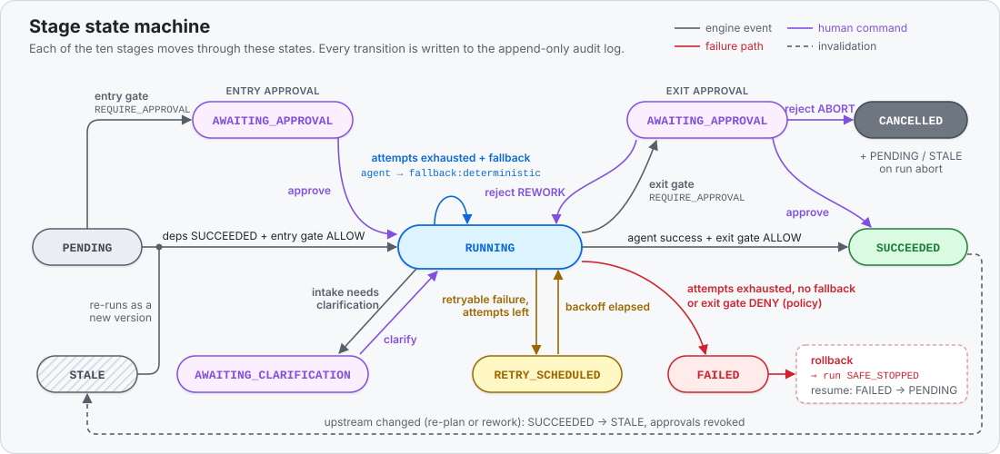
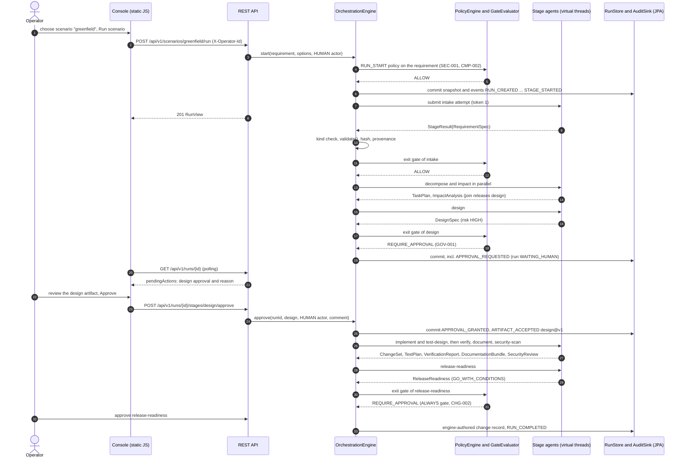
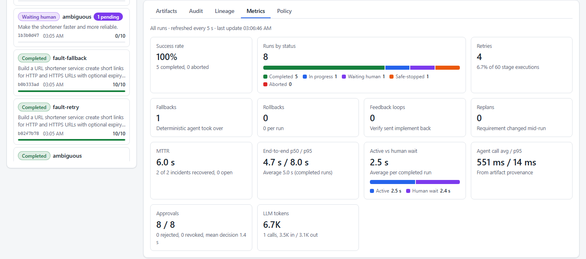

# Architecture

How the system is put together: the three modules and their boundaries, how one run flows through the control
plane, what is stored, which threads do what, how a crash is survived, how LLM providers plug in, and how it is
deployed. The mechanics of the engine (state machines, gates, failure handling, lineage) are specified in
[ORCHESTRATION.md](ORCHESTRATION.md); design intent is in the [engineering specification](design/engineering-spec.md)
and the [ADRs](adr/).

## 1. Components

Two planes in one repository ([ADR 0001](adr/0001-separate-control-plane-from-workload.md)): the **workload** is
a production-grade URL shortener; the **control plane** governs changes to it. The repository is shared so the
control plane can index the shortener's source tree from disk; nothing at runtime couples the two applications.

| Module | Role | Depends on | Port |
|---|---|---|---|
| `url-shortener` | The workload service: links API, redirects, click analytics, reliability controls | Spring Boot only | 8080 |
| `orchestrator-core` | The engine as a framework-free library: workflow graph, scheduler, gates, agents, policy, audit, metrics, codebase reasoning | Jackson 3, SLF4J, JSpecify (no Spring) | n/a |
| `orchestrator-app` | The control plane: REST API, operator console, JPA persistence, LLM adapters, scenario catalog, Micrometer | `orchestrator-core`, Spring Boot | 8090 |

### 1.1 `orchestrator-core` packages (`com.agenticsdlc.orchestrator.core`)

| Package | Responsibility | Key types |
|---|---|---|
| `graph` | Versioned workflow definition and the validated DAG (cycle detection, layers, closures) | `WorkflowDefinitions`, `WorkflowGraph`, `StageDefinition`, `RetryPolicy`, `ApprovalRequirement` |
| `engine` | Commands, scheduling, gates, execution, retries, fallback, rollback, re-planning, recovery | `OrchestrationEngine`, `Scheduler`, `GateEvaluator`, `StageExecutor`, `RollbackService`, `ReplanService`, `RunControl`, `RunRegistry` |
| `agent` | Agent contract, context, results, failures, registry; fault injection | `StageAgent`, `StageContext`, `StageResult`, `AgentRegistry`, `ClarificationGate`, `FaultInjectingStageAgent` |
| `agent.deterministic` | Ten rule-based agents: default provider and fallback of every stage | `RequirementsAgent`, `PlanningAgent`, `ArchitectureAgent`, `VerificationAgent`, `ReleaseAgent`, ... |
| `agent.llm` | Provider SPI, prompt templates, JSON schema derivation, the generic LLM stage agent | `LlmClient`, `LlmStageAgent`, `PromptTemplates`, `JsonSchemas` |
| `artifact` | Artifact envelope, provenance and the ten typed payload records with their invariants | `Artifact`, `Provenance`, `RequirementSpec`, `TaskPlan`, `DesignSpec`, `ChangeSet`, `ReleaseReadiness`, ... |
| `policy`, `policy.rules` | Policy engine and the eleven built-in rules (SEC, CMP, CHG, GOV) | `PolicyEngine`, `DefaultPolicyRules`, `SecretLeakRule`, ... |
| `model` | The run aggregate and its value types | `Run`, `StageExecution`, `Approval`, `Checkpoint`, `Compensation`, `RunBudget`, `RunSnapshot` |
| `audit` | Append-only audit events and actors | `AuditEvent`, `AuditEventType` (31 types), `Actor`, `AuditSink` |
| `port` | Persistence SPI with in-memory implementations | `RunStore`, `InMemoryRunStore` |
| `metrics` | Reliability metrics from run snapshots; recorder SPI | `MetricsCalculator`, `ReliabilityMetrics`, `MetricsRecorder` |
| `workspace` | Codebase index, impact analysis, sandbox and build runner | `CodebaseIndexer`, `ImpactAnalyzer`, `WorkspaceSandbox`, `ProcessBuildRunner` |
| `json`, `util` | Canonical JSON and hashing; leaf helpers and secret patterns | `JsonCodec`, `Hashes`, `SecretPatterns` |

Boundaries are executable: [`CoreArchitectureTest`](../orchestrator-core/src/test/java/com/agenticsdlc/orchestrator/core/CoreArchitectureTest.java)
forbids Spring in the core, keeps the engine independent of the deterministic agents, keeps agents, policy and
workspace from depending on the engine, and keeps `util` a leaf package.

### 1.2 `orchestrator-app` packages (`com.agenticsdlc.orchestrator.app`)

| Package | Responsibility |
|---|---|
| `api`, `api.dto` | `RunController`, `RunArtifactController` (artifacts, audit, lineage), `ScenarioController`, `MetricsController`, `WorkflowController`, `WorkspaceController`, `ProviderController`; `OperatorIdentityResolver` turns `X-Operator-Id` into a `HUMAN` actor; `ApiExceptionHandler` maps errors to RFC 9457 Problem Details |
| `config` | `EngineConfiguration` builds the graph, registry, policy engine and engine; `WorkspaceRootDetector` finds the repository root; `OrchestratorProperties` (`sdlc.*`) |
| `llm` | `AnthropicLlmClient`, `OllamaLlmClient`, `ProviderCatalog` (availability, default provider), `StructuredOutputSchema` |
| `persistence` | `JpaRunStore`, `JpaAuditSink` and the entities of the three tables |
| `scenario` | `ScenarioCatalog`: the seven executable scenarios |
| `security` | Optional `ApiKeyAuthFilter` (`X-Api-Key` for `/api/**` when `sdlc.security.api-key` is set) |
| `startup` | `WorkspaceIndexWarmup` (indexes the source tree), `StartupRecovery` (calls `recoverInterrupted`), `WorkspaceIndexHealthIndicator` |
| `metrics` | `MicrometerMetricsRecorder`: `sdlc.stage.*`, `sdlc.run.*`, `sdlc.agent.call`, `sdlc.llm.tokens` |

[`AppArchitectureTest`](../orchestrator-app/src/test/java/com/agenticsdlc/orchestrator/app/AppArchitectureTest.java)
keeps `api` and `persistence` apart, confines engine construction to `config`, keeps `llm` free of web and
persistence code, and forbids field injection, standard streams and generic exceptions.

### 1.3 `url-shortener` packages (`com.agenticsdlc.shortener`)

`api` (controllers, DTOs, Problem Details, redirect metrics) depends on `service` (link lifecycle, URL validation,
codes, idempotency, analytics, click recording, retention), which depends on `repository` (Spring Data JPA) and
`domain` (entities); `config` holds properties, cache, the bounded click-recorder executor, scheduling, the
rate-limit filter and the security-headers filter.
[`ArchitectureTest`](../url-shortener/src/test/java/com/agenticsdlc/shortener/ArchitectureTest.java) enforces the
layering and keeps the service layer transport-agnostic.

## 2. Orchestration model in one page

- **Graph.** Ten stages, three parallel segments, three joins, declared once in
  `WorkflowDefinitions.defaultSdlc()` and validated by `WorkflowGraph` ([ADR 0003](adr/0003-static-lifecycle-dag-with-dynamic-invalidation.md)).
- **Stage execution.** A stage starts when all predecessors have `SUCCEEDED` and its entry gate allows it; its
  agent runs with a timeout; failures are classified (TRANSIENT, TIMEOUT, INVALID_OUTPUT, FATAL), retried with
  exponential backoff and then handed to the deterministic fallback.
- **Gates.** The exit gate combines policy findings, the stage's approval requirement and the autonomy level; the
  result is ALLOW, REQUIRE_APPROVAL (a human decides) or DENY (rollback and safe-stop) ([ADR 0005](adr/0005-risk-based-approvals-and-autonomy-levels.md)).
- **Artifacts and lineage.** Accepted payloads are hashed over canonical JSON and carry provenance; downstream
  stages see only accepted versions of succeeded stages; `derivedFrom` edges form the lineage graph.
- **Recovery.** Checkpoint per activation, compensations in reverse order, safe-stop with a halt reason; only a
  human resumes or re-plans ([ADR 0004](adr/0004-saga-rollback-and-safe-stop.md)).

## 3. Control flow of a run

The sequence below follows a `GUIDED` greenfield run from the console. Every box on the engine side is one
mutation under the run's lock, persisted before it becomes visible.

Observed for this flow with the deterministic agents: 10 agent calls, 2 approvals, 89 audit events, 11 artifacts
(10 agent versions plus the change record) and about 0.1 s of active time; the rest of the end-to-end time is
human wait. [SCENARIOS.md](SCENARIOS.md) shows the real artifacts.

## 4. Data model

The run is an aggregate persisted as a JSON snapshot next to two append-only tables
([ADR 0006](adr/0006-aggregate-snapshot-persistence-with-audit-and-artifact-tables.md);
[`V1__orchestrator_schema.sql`](../orchestrator-app/src/main/resources/db/migration/V1__orchestrator_schema.sql)).

| Table | Content | Keys and indexes |
|---|---|---|
| `runs` | `snapshot_json` (the whole aggregate: stages, artifact history, accepted versions, approvals, checkpoints, compensations, counters, budget, findings) plus query columns: scenario, status, halt reason, requirement, plan version, timestamps; `version` for optimistic locking | PK `id`, index on `created_at` |
| `audit_events` | one row per engine event: `seq`, `ts`, stage, type, actor type and id, message, `data_json` | unique `(run_id, seq)`, index on `run_id` |
| `artifacts` | every persisted artifact version: kind, version, plan version, SHA-256 hash, payload and provenance JSON | unique `(run_id, stage_id, version)`, index on `run_id` |

`JpaRunStore.commit` upserts the run row, inserts only artifacts not yet stored and appends the mutation's audit
events, all in one transaction (`RunStore.commit`), so a failed audit insert rolls back the snapshot update. Artifacts denied at an exit gate are removed from the aggregate before saving, so they
never reach the `artifacts` table. The API projects the aggregate into `RunView` (status, stages, pending actions,
budget usage, counters, timing, risk, policy findings), `GraphView`, `LineageView` (artifact versions as nodes,
`derivedFrom` as edges) and `AuditEventView`.

The shortener has its own schema ([`V1__init.sql`](../url-shortener/src/main/resources/db/migration/V1__init.sql)):
`links`, `click_events` (indexed by link and time, and by time for retention) and `idempotency_records`. Both
applications use `ddl-auto: validate`, so Flyway is the only schema author.

## 5. Thread model

| Thread | Work | Why |
|---|---|---|
| Servlet request threads (virtual, `spring.threads.virtual.enabled`) | REST commands and queries; a command executes one locked mutation and returns a copy of the run | cheap blocking I/O |
| `sdlc-stage-*` virtual threads, one per attempt | builds the context under the lock, runs the agent in a nested virtual-thread task bounded by the stage timeout, re-acquires the lock to apply the result | parallel branches overlap for real; a slow LLM call blocks nothing else |
| `sdlc-retry-scheduler` (one daemon platform thread) | delivers retry wake-ups at `nextAttemptAt` | durable timers are persisted in the snapshot; the thread only wakes them |
| Per-run `ReentrantLock` (`RunRegistry`) | serializes commands and completions of one run; different runs proceed independently | consistent aggregate and gap-free audit sequence ([ADR 0007](adr/0007-virtual-threads-and-per-run-locking.md)) |
| Shortener `click-recorder-*` pool (8 threads, queue of 10 000) | persist click events after the redirect response; when saturated, a click is dropped and counted (`shortener.clicks.dropped`) | a redirect never waits for analytics, and click recording cannot take more than 8 database connections |
| Shortener scheduled jobs | hourly purge of expired idempotency records and of click events beyond retention | bounded storage and data minimization |

Results of attempts carry a token; a result whose token is no longer current (cancelled, timed out or superseded)
is dropped, even if the agent ignored the interrupt.

## 6. Persistence and recovery

- **Durability before visibility.** Inside each mutation the engine commits the snapshot and the mutation's audit
  events (`RunStore.commit`), then publishes a copy. A failed commit surfaces to the caller; the in-memory run keeps
  the mutation and the next successful commit persists the complete state again. The default `commit` writes the
  snapshot and the events in two steps, which the JPA adapter runs as separate transactions (known limitation, R-07
  in [RISKS_AND_TRADEOFFS.md](RISKS_AND_TRADEOFFS.md)).
- **Restart.** `StartupRecovery` calls `recoverInterrupted()`: every run that was `RUNNING` becomes `SAFE_STOPPED`
  with `INTERRUPTED_BY_RESTART` and its running stages reset; runs waiting for a human are untouched. A human
  `resume` re-runs the interrupted stages and re-arms persisted retries. Killing the JVM while a stage was in
  `RETRY_SCHEDULED` and restarting produced exactly this, and `resume` completed the run.
- **Tolerant loading.** A snapshot that cannot be restored is logged and skipped, so one corrupt row cannot prevent
  the control plane from starting (`loadOfAnUnknownRunIsEmptyAndCorruptSnapshotsAreSkipped`).
- **Fault injection** counts are persisted with the run, so injected failures stay deterministic across restarts.

## 7. LLM provider adapters

The core defines the provider SPI (`LlmClient`: id, model, availability, `complete(request, outputType)`); the
control plane implements it and registers one `LlmStageAgent` per role for every enabled provider
([ADR 0002](adr/0002-deterministic-agents-default-llm-optional.md)).

| Concern | Implementation |
|---|---|
| Prompt | System prompt: role, governance constraints (reference only indexed files, never include secrets, JSON only, upper-case enum values); user prompt: requirement, clarification answers, accepted upstream artifacts as JSON, codebase index for codebase-aware roles, feedback, previous error, output schema |
| Output contract | JSON schema derived from the payload record (`JsonSchemas`): all properties required, `additionalProperties: false`, enums as string enums; Anthropic receives it as structured output (`StructuredOutputSchema` adapts maps to entry arrays), Ollama as `format` |
| Validation | the same `validate()` invariants and exit gates as deterministic output; approvals an LLM writes into a change record are discarded |
| Errors | unavailable provider or non-retryable error: FATAL, immediate fallback; rate limits, 408/409/429/5xx, I/O and truncation: retryable; unparsable or invalid output: INVALID_OUTPUT with the error in the next prompt |
| Accounting | model, prompt hash (SHA-256), input and output tokens and latency go into provenance, counters and the token budget, also for failed attempts |
| Selection | per run (`provider`), default `sdlc.agents.default-provider=deterministic`; `ProviderCatalog` refuses a run for an unavailable provider (409) |

## 8. Operator console

A static single-page application served by the control plane (`index.html`, `app.js`, `styles.css` and five small
ES modules in `js/`; no framework, no build step, no CDN). It polls the run list every 3 s and the selected run
every 2 s (10 s once terminal, slower while the tab is hidden), escapes server strings before rendering, and
renders artifacts from their Markdown with a small safe renderer. Panels: new run (scenario or custom requirement,
autonomy, workspace, provider, optional fault), runs list, status banner with budget usage, pending actions
(approve, reject with rework or abort, clarify, re-plan, stop, resume), the pipeline graph, and tabs for artifacts,
audit, lineage, metrics and policy findings. The operator id entered in the header is sent as `X-Operator-Id`.

## 9. Deployment view

| Item | Shortener | Orchestrator |
|---|---|---|
| Port, docs | 8080, `/swagger-ui.html`, `/v3/api-docs` | 8090, console at `/`, `/swagger-ui.html`, `/v3/api-docs` |
| Actuator | `health`, `info`, `metrics` | `health` (with details and the `workspaceIndex` indicator), `info`, `metrics` |
| Database | H2 file `./data/url-shortener`; PostgreSQL 17 with the `postgres` profile (credentials from `SHORTENER_DB_USER` and `SHORTENER_DB_PASSWORD`; the visitor-hash key `SHORTENER_ANALYTICS_IP_SALT` must not be the placeholder) | H2 file `./data/orchestrator` |
| Container | `url-shortener/Dockerfile`: multi-stage build, Temurin 25 JRE, non-root user (uid 10001), ZGC | `orchestrator-app/Dockerfile`: same base; copies the `url-shortener` sources to `/workspace-src` (`SDLC_WORKSPACE_ROOT`), so the image indexes only the shortener |
| Compose | `docker compose up -d postgres`; `docker compose --profile apps up --build` starts both services on `127.0.0.1`, the shortener on PostgreSQL, and refuses to start without `SHORTENER_IP_SALT` | requires `SDLC_SECURITY_API_KEY` (so the API demands `X-Api-Key`), passes `ANTHROPIC_API_KEY` through and points Ollama at `host.docker.internal:11434` |

CI ([`ci.yml`](../.github/workflows/ci.yml)) runs `./mvnw -B -ntp verify` on Temurin 25, uploads Surefire and
JaCoCo reports, then builds both container images.

## 10. Key decisions

| ADR | Decision | Rationale in one line |
|---|---|---|
| [0001](adr/0001-separate-control-plane-from-workload.md) | Separate control plane and workload, one repository | clear blast radius, while brownfield analysis reads real source |
| [0002](adr/0002-deterministic-agents-default-llm-optional.md) | Deterministic agents by default and as fallback; LLMs optional | reproducible governance in CI without keys; degraded but working pipeline in an outage |
| [0003](adr/0003-static-lifecycle-dag-with-dynamic-invalidation.md) | Static lifecycle DAG with dynamic invalidation | every gate is known and reviewable before a run starts |
| [0004](adr/0004-saga-rollback-and-safe-stop.md) | Compensations plus checkpoint restore; rollback ends in safe-stop | side effects are undone and humans own recovery |
| [0005](adr/0005-risk-based-approvals-and-autonomy-levels.md) | Risk-based approvals, autonomy levels, non-removable release gate | oversight proportional to risk |
| [0006](adr/0006-aggregate-snapshot-persistence-with-audit-and-artifact-tables.md) | JSON snapshot plus append-only audit and artifact tables | simple restore and recovery without event-sourcing machinery |
| [0007](adr/0007-virtual-threads-and-per-run-locking.md) | Virtual threads per attempt, lock per run | real parallelism with serializable state transitions, no infrastructure |
| [0008](adr/0008-shortener-redirect-code-and-privacy-choices.md) | 302, random Base62, salted IP hashing, no DNS-time SSRF check | correct analytics and expiry, no enumeration, privacy by default |
| [0009](adr/0009-prototype-security-model.md) | Mandatory operator identity, optional API key; SSO later | attributable approvals today, authentication as a deployment decision |
| [0010](adr/0010-java-25-and-spring-boot-4.1-baseline.md) | Java 25 and Spring Boot 4.1.2 | current, supported baseline with mature virtual threads |

## 11. What would change for production

| Area | Prototype | Production |
|---|---|---|
| Scale-out | one engine node; locks and retry timers in memory | engine nodes behind a distributed lock or a work queue (or a workflow engine such as Temporal); timers in the database |
| Persistence | H2; snapshot and audit in separate transactions | PostgreSQL with snapshot, artifacts and audit in one transaction; hash-chained or write-once audit storage |
| Identity | `X-Operator-Id` header, optional shared API key | OIDC/SSO with Spring Security; identity from the token; role-based approvals; four-eyes rule |
| Secrets | `ANTHROPIC_API_KEY` from the environment | secrets manager (for example Vault or a cloud KMS) with rotation; no credentials in the build sandbox |
| Generated code | optional sandbox build in a directory copy | ephemeral container or VM without credentials, egress denied, resource limits |
| Observability | Micrometer meters through Actuator, structured logs | OpenTelemetry traces across API, engine and provider calls; dashboards and alerts on the reliability metrics |
| Console | polling | server-sent events (the engine already publishes a copy after every mutation through `EngineListener`) |
| Shortener | per-node limiter and cache, no DNS-time SSRF check, unauthenticated management API | shared limiter and cache invalidation, egress or resolve-time checks, gateway authentication |
