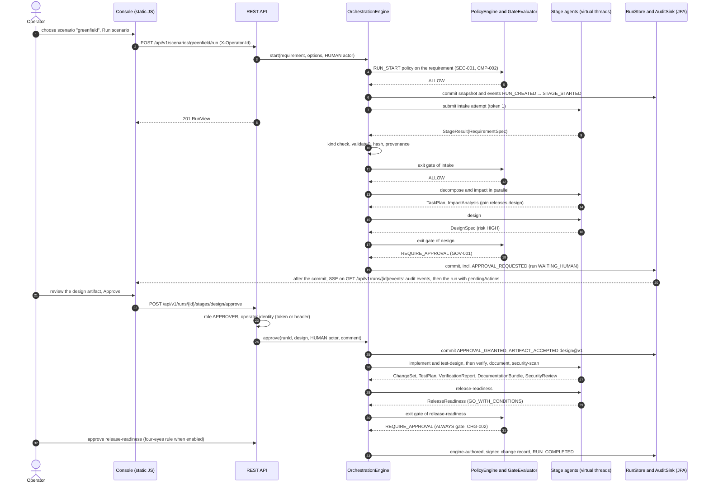

# Architecture

How the system is put together: the three modules and their boundaries, how one run flows through the control
plane, what is stored, which threads do what, how a crash is survived, how LLM providers plug in, and how it is
deployed on one node or on several. The mechanics of the engine (state machines, gates, failure handling, lineage) are specified in
[ORCHESTRATION.md](ORCHESTRATION.md); design intent is in the [engineering specification](design/engineering-spec.md)
and the [ADRs](adr/).

## 1. Components

Two planes in one repository ([ADR 0001](adr/0001-separate-control-plane-from-workload.md)): the **workload** is
a production-grade URL shortener; the **control plane** governs changes to it. The repository is shared so the
control plane can index the shortener's source tree from disk; nothing at runtime couples the two applications.

| Module | Role | Depends on | Port |
|---|---|---|---|
| `url-shortener` | The workload service: links API, redirects, click analytics, reliability controls | Spring Boot only | 8080 |
| `orchestrator-core` | The engine as a framework-free library: workflow graph, scheduler, gates, agents, policy and policy packs, hash-chained audit, run leases, metrics and cost, evaluation harness, codebase reasoning | Jackson 3, SLF4J, JSpecify (no Spring) | n/a |
| `orchestrator-app` | The control plane: REST API with server-sent event streams, operator console, authentication and roles, JPA persistence and JDBC run leases, LLM adapters, scenario catalog, Micrometer and OpenTelemetry | `orchestrator-core`, Spring Boot (web, data JPA, security with the OAuth 2.0 resource server, actuator), Micrometer tracing with the OTLP exporter | 8090 |

### 1.1 `orchestrator-core` packages (`com.agenticsdlc.orchestrator.core`)

| Package | Responsibility | Key types |
|---|---|---|
| `graph` | Versioned workflow definition and the validated DAG (cycle detection, layers, closures) | `WorkflowDefinitions`, `WorkflowGraph`, `StageDefinition`, `RetryPolicy`, `ApprovalRequirement` |
| `engine` | Commands, scheduling, gates, execution, retries, fallback, provider circuit breakers, rollback, re-planning, recovery, run leases, registry eviction | `OrchestrationEngine`, `Scheduler`, `GateEvaluator`, `StageExecutor`, `ProviderCircuits`, `RollbackService`, `ReplanService`, `RunControl`, `RunRegistry`, `RunLeasedElsewhereException` |
| `agent` | Agent contract, context, results, failures, registry; fault injection; the dependency inventory added to every `REPO` security review | `StageAgent`, `StageContext`, `StageResult`, `AgentRegistry`, `ClarificationGate`, `FaultInjectingStageAgent`, `DependencyReview` |
| `agent.deterministic` | Ten rule-based agents: default provider and fallback of every stage | `RequirementsAgent`, `PlanningAgent`, `ArchitectureAgent`, `VerificationAgent`, `ReleaseAgent`, ... |
| `agent.llm` | Provider SPI, prompt templates, JSON schema derivation, the generic LLM stage agent | `LlmClient`, `LlmStageAgent`, `PromptTemplates`, `JsonSchemas` |
| `artifact` | Artifact envelope, provenance and the ten typed payload records with their invariants | `Artifact`, `Provenance`, `RequirementSpec`, `TaskPlan`, `DesignSpec`, `ChangeSet`, `ReleaseReadiness`, ... |
| `policy`, `policy.rules` | Policy engine and the eleven built-in rules (SEC, CMP, CHG, GOV) | `PolicyEngine`, `DefaultPolicyRules`, `SecretLeakRule`, ... |
| `policy.pack` | Declarative policy packs: closed condition set, strict loader, regex guard ([ADR 0016](adr/0016-declarative-policy-packs.md)) | `PolicyPack`, `DeclarativeRule`, `Condition`, `Effect`, `PolicyPackLoader`, `DeclarativePolicyRule`, `RegexGuard` |
| `model` | The run aggregate and its value types | `Run`, `StageExecution`, `Approval`, `Checkpoint`, `Compensation`, `RunBudget`, `RunCounters`, `RunSnapshot` |
| `audit` | Append-only, hash-chained audit events and actors; change record signers ([ADR 0013](adr/0013-hash-chained-audit-and-signed-change-records.md)) | `AuditEvent`, `AuditEventType` (31 types), `Actor`, `AuditSink`, `AuditChain`, `ChainVerification`, `ChangeRecordSigner`, `HmacChangeRecordSigner`, `UnsignedChangeRecordSigner` |
| `port` | Persistence and lease SPIs with in-memory implementations ([ADR 0014](adr/0014-run-leases-and-bounded-registry-for-multi-node.md)) | `RunStore`, `InMemoryRunStore`, `RunLeaseProvider`, `RunLease`, `InMemoryRunLeaseProvider` |
| `metrics` | Reliability metrics from run snapshots; recorder SPI; LLM price book | `MetricsCalculator`, `ReliabilityMetrics`, `MetricsRecorder`, `LlmPriceBook`, `LlmPrice` |
| `evaluation` | Deterministic scorers per artifact kind, run evaluation, the bundled suite and its runner ([ADR 0018](adr/0018-evaluation-harness-and-llm-cost-model.md)) | `ArtifactScorers`, `RunEvaluator`, `EvaluationReport`, `EvaluationSuite`, `EvaluationSuiteRunner` |
| `workspace` | Codebase index, impact analysis, bounded reading of impacted sources, unified-diff parsing and application, sandbox and build runner, dependency inventory | `CodebaseIndexer`, `ImpactAnalyzer`, `ImpactedSources`, `UnifiedDiff`, `WorkspaceSandbox`, `ProcessBuildRunner`, `DependencyInventory` |
| `json`, `util` | Canonical and strict canonical JSON, hashing; leaf helpers and secret patterns (detection and redaction) | `JsonCodec`, `Hashes`, `SecretPatterns` |

Boundaries are executable: [`CoreArchitectureTest`](../orchestrator-core/src/test/java/com/agenticsdlc/orchestrator/core/CoreArchitectureTest.java)
forbids Spring in the core, keeps the engine independent of the deterministic agents, keeps agents, policy and
workspace from depending on the engine, keeps policy packs inside the policy layer, lets only the evaluation harness
depend on `evaluation` (and the harness use agents only through the engine), and keeps `util` a leaf package.

### 1.2 `orchestrator-app` packages (`com.agenticsdlc.orchestrator.app`)

| Package | Responsibility |
|---|---|
| `api`, `api.dto` | `RunController` (commands and the paged list), `RunArtifactController` (artifacts with signature verification, audit, audit integrity, lineage), `RunStreamController` and `RunStreamHub` (server-sent event streams), `ScenarioController`, `MetricsController` (cached reliability metrics), `PolicyController`, `EvaluationController`, `WorkflowController`, `WorkspaceController`, `ProviderController` (availability and circuit state); `OperatorIdentityResolver` turns the token identity or `X-Operator-Id` into a `HUMAN` actor; `FourEyesGuard`; `ApiExceptionHandler` maps errors to RFC 9457 Problem Details |
| `config` | `EngineConfiguration` builds the graph, registry, policy engine (with the pack from `PolicyPackFiles`), change record signer, lease provider, price book and engine; `EvaluationEngines` builds the isolated engines of the evaluation suite; `RunEventsConfiguration`, `SchedulingConfig`; `WorkspaceRootDetector` finds the repository root; `OrchestratorProperties` (`sdlc.*`) |
| `events` | `RunEventBus`: in-process bus of the changes this node commits, fed after each commit (`RunCommitted`, `RunCommitListener`) |
| `runs` | The read model of the paged runs list: `RunListing`, `RunListQuery`, `RunListSort`, `RunListPage`, `RunListItem` |
| `llm` | `AnthropicLlmClient` (prompt caching), `OllamaLlmClient`, `ProviderCatalog` (availability, default provider), `StructuredOutputSchema`, `LlmProperties` (including `pricing`) |
| `persistence` | `JpaRunStore` (atomic commit, listing columns, after-commit publication), `JpaAuditSink` with `AuditChainContinuity`, `JdbcRunLeaseProvider`, `JpaRunListing` and `RunListingQueries`, and the entities of the three tables (`run_leases` is plain JDBC) |
| `scenario` | `ScenarioCatalog`: the seven executable scenarios |
| `security` | `SecurityConfig` (one stateless filter chain for the `open`, `api-key` and `oidc` modes), `ApiAuthorizationRules`, `ControlPlaneRole`, `ApiKeyAuthFilter`, `OidcTokens`, `OidcRoleMapper`, `SecurityContextOperatorIdentity`, `SecurityPostureValidator`, `SecurityHeadersFilter`, `SecurityProblemHandlers` ([ADR 0015](adr/0015-authentication-modes-roles-and-production-posture.md)) |
| `startup` | `WorkspaceIndexWarmup` (indexes the source tree), `StartupRecovery` (calls `recoverInterrupted`), `EngineMaintenance` (periodic recovery and eviction), `WorkspaceIndexHealthIndicator` |
| `metrics` | `MicrometerMetricsRecorder`: `sdlc.stage.*`, `sdlc.run.*`, `sdlc.agent.call`, `sdlc.approval.decision`, `sdlc.llm.*`; `RunObservations`: the `sdlc.run` and `sdlc.stage` observations |

[`AppArchitectureTest`](../orchestrator-app/src/test/java/com/agenticsdlc/orchestrator/app/AppArchitectureTest.java)
keeps `api` and `persistence` apart, confines engine construction to `config`, confines Spring Security to
`security`, keeps `llm` and `events` free of web and persistence code and `runs` and `scenario` free of other app
packages, and forbids field injection, standard streams and generic exceptions.

### 1.3 `url-shortener` packages (`com.agenticsdlc.shortener`)

`api` (controllers including `BulkLinkController`, DTOs, Problem Details through one `ProblemMapper` shared by the
exception handler, the filters and the per-item bulk errors, redirect metrics) depends on `service` (link lifecycle,
bulk creation, URL validation with the optional `HostResolver`, codes, idempotency with takeover protection,
client IP resolution (forwarded ports stripped, IPv6 clients keyed by prefix), analytics, click recording, retention,
and the `RateLimiter` SPI), which depends on `repository` (Spring Data JPA) and `domain` (entities);
`config` holds properties, cache, the bounded click-recorder executor, scheduling, the security-headers, API-key and
rate-limit filters, the two `RateLimiter` implementations (`TokenBucketRateLimiter` in memory, `RedisRateLimiter`
over `ratelimit/token-bucket.lua`) and `RedisBackendAutoConfigurationFilter`, which keeps Spring Boot's Redis
auto-configuration out unless `shortener.rate-limit.backend=redis`.
[`ArchitectureTest`](../url-shortener/src/test/java/com/agenticsdlc/shortener/ArchitectureTest.java) enforces the
layering and keeps the service layer transport-agnostic.

## 2. Orchestration model in one page

- **Graph.** Ten stages, three parallel segments, three joins, declared once in
  `WorkflowDefinitions.defaultSdlc()` and validated by `WorkflowGraph` ([ADR 0003](adr/0003-static-lifecycle-dag-with-dynamic-invalidation.md)).
- **Stage execution.** A stage starts when all predecessors have `SUCCEEDED` and its entry gate allows it; its
  agent runs with a timeout; failures are classified (TRANSIENT, TIMEOUT, INVALID_OUTPUT, FATAL), retried with
  exponential backoff and then handed to the deterministic fallback; while a provider's circuit is open (three
  consecutive provider failures across runs), attempts go to the deterministic agent without calling it.
- **Context.** Each attempt gets an immutable context; implementation, verification and security review of `REPO`
  runs also get the bounded source of the impacted files, and with the sandbox enabled a change set's diffs are
  applied to a copy of the workspace or rejected as a whole.
- **Gates.** The exit gate combines policy findings, the stage's approval requirement and the autonomy level; the
  result is ALLOW, REQUIRE_APPROVAL (a human decides) or DENY (rollback and safe-stop) ([ADR 0005](adr/0005-risk-based-approvals-and-autonomy-levels.md)).
- **Artifacts and lineage.** Accepted payloads are hashed over canonical JSON and carry provenance; downstream
  stages see only accepted versions of succeeded stages; `derivedFrom` edges form the lineage graph.
- **Recovery.** Checkpoint per activation, compensations in reverse order, safe-stop with a halt reason; only a
  human resumes or re-plans ([ADR 0004](adr/0004-saga-rollback-and-safe-stop.md)).
- **Evidence.** Every audit event is hash-chained to the run's previous one; the release change record is signed
  when a key is configured ([ADR 0013](adr/0013-hash-chained-audit-and-signed-change-records.md)).
- **Several nodes.** The node executing a run holds its lease; other nodes refuse commands on it until the run waits
  for a human, ends or the lease expires ([ADR 0014](adr/0014-run-leases-and-bounded-registry-for-multi-node.md)).

## 3. Control flow of a run

The sequence below follows a `GUIDED` greenfield run from the console. Every box on the engine side is one
mutation under the run's lock, persisted before it becomes visible.

The console opens the run's event stream when the run is selected; the stream is fed by the store's after-commit
hook through the in-process `RunEventBus`, so an event never shows state that could still roll back. While a stream
is down the console polls.

Observed for this flow with the deterministic agents: 10 agent calls, 2 approvals, 89 audit events, 11 artifacts
(10 agent versions plus the change record) and about 0.1 s of active time; the rest of the end-to-end time is
human wait. [SCENARIOS.md](SCENARIOS.md) shows the real artifacts.

## 4. Data model

The run is an aggregate persisted as a JSON snapshot next to two append-only tables and a lease table
([ADR 0006](adr/0006-aggregate-snapshot-persistence-with-audit-and-artifact-tables.md);
[`V1__orchestrator_schema.sql`](../orchestrator-app/src/main/resources/db/migration/V1__orchestrator_schema.sql),
[`V2__audit_chain_leases_run_columns.sql`](../orchestrator-app/src/main/resources/db/migration/V2__audit_chain_leases_run_columns.sql),
[`V3__run_list_progress_columns.sql`](../orchestrator-app/src/main/resources/db/migration/V3__run_list_progress_columns.sql)).

| Table | Content | Keys and indexes |
|---|---|---|
| `runs` | `snapshot_json` (the whole aggregate: stages, artifact history, accepted versions, approvals, checkpoints, compensations, counters, budget, findings, chain head) plus listing columns copied from it on every save: scenario, status, halt reason, requirement, plan version, timestamps (V1); autonomy, workspace mode, started by, risk level, node id, audit head hash (V2); pending actions, stages succeeded and total (V3); `version` for optimistic locking | PK `id`; indexes on `created_at`, `updated_at`, `(status, updated_at)`, `(scenario, updated_at)`, `(started_by, updated_at)` |
| `audit_events` | one row per engine event: `seq`, `ts`, stage, type, actor type and id, message, `data_json`, `prev_hash`, `hash` (V2; NULL for events written before it) | unique `(run_id, seq)`, index on `run_id` |
| `artifacts` | every persisted artifact version: kind, version, plan version, SHA-256 hash, payload and provenance JSON | unique `(run_id, stage_id, version)`, index on `run_id` |
| `run_leases` (V2) | one row per run a node is executing: owner (node id), token, `expires_at` (UTC) | PK `run_id` |

`JpaRunStore.commit` upserts the run row with its listing columns, inserts only artifacts not yet stored and appends
the mutation's audit events, all in one transaction (`RunStore.commit`), so a failed audit insert rolls back the
snapshot update; inside that transaction `JpaAuditSink` refuses a batch that does not continue the run's stored hash
chain. Only after the transaction commits is the change handed to the `RunEventBus` (`JpaRunStoreCommitEventsTest`).
Leases are written by `JdbcRunLeaseProvider` in their own short transactions. Artifacts denied at an exit gate are
removed from the aggregate before saving, so they never reach the `artifacts` table. `GET /api/v1/runs` reads only the
listing columns (`RunListingQueries`), never a snapshot; rows written before V2 or V3 keep NULLs in the new columns
until the run is saved again. The API projects the aggregate into `RunView` (status, stages, pending actions,
budget usage, counters, timing, risk, policy findings), `GraphView`, `LineageView` (artifact versions as nodes,
`derivedFrom` as edges) and `AuditEventView`.

The shortener has its own schema ([`V1__init.sql`](../url-shortener/src/main/resources/db/migration/V1__init.sql)):
`links`, `click_events` (indexed by link and time, and by time for retention) and `idempotency_records`. Both
applications use `ddl-auto: validate`, so Flyway is the only schema author.

## 5. Thread model

| Thread | Work | Why |
|---|---|---|
| Servlet request threads (virtual, `spring.threads.virtual.enabled`) | REST commands and queries; a command executes one locked mutation and returns a copy of the run | cheap blocking I/O |
| `sdlc-stage-*` virtual threads, one per attempt | builds the context under the lock, runs the agent in a nested virtual-thread task bounded by the stage timeout, re-acquires the lock to apply the result | parallel branches overlap for real; a slow LLM call blocks nothing else |
| `sdlc-retry-scheduler` (one daemon platform thread) | delivers retry wake-ups at `nextAttemptAt` | durable timers are persisted in the snapshot; the thread only wakes them |
| Per-run `ReentrantLock` (`RunRegistry`) | serializes commands and completions of one run; different runs proceed independently | consistent aggregate and gap-free audit sequence ([ADR 0007](adr/0007-virtual-threads-and-per-run-locking.md)) |
| Shortener `click-recorder-*` pool (8 threads, queue of 10 000) | persist click events after the redirect response; when saturated, a click is dropped and counted (`shortener.clicks.dropped`) | a redirect never waits for analytics, and click recording cannot take more than 8 database connections |
| `sdlc-run-events` (one daemon platform thread) | dispatches committed run changes from the `RunEventBus` queue (1 000) to the event streams and the observations, in commit order | publishing never blocks the committing thread; a full queue drops and counts |
| `sdlc-sse-*` virtual threads and the Spring task scheduler | write events to event-stream clients (at most one write per stream at a time); send the 15 s heartbeats | a slow client never blocks the bus or another stream |
| Attempt heartbeats (on the attempt's thread, every `leaseTtl / 3`) and the scheduled `EngineMaintenance` pass (every 30 s) | renew a run's lease while an agent runs; recover runs of dead nodes and evict idle runs | a long LLM call keeps its lease; memory and stuck runs stay bounded |
| Shortener scheduled jobs | hourly purge of expired idempotency records and of click events beyond retention | bounded storage and data minimization |
| Shortener `host-resolver-*` daemon threads (8, queue of 64, started on first use) | DNS lookups of the optional resolve-time SSRF check; the caller waits at most `shortener.resolve-timeout` | `InetAddress.getAllByName` has no timeout; a full pool refuses lookups instead of growing |

Results of attempts carry a token; a result whose token is no longer current (cancelled, timed out or superseded)
is dropped, even if the agent ignored the interrupt.

## 6. Persistence and recovery

- **Durability before visibility.** Inside each mutation the engine renews the run's lease, commits the snapshot
  and the mutation's audit events (`RunStore.commit`), then publishes a copy. A failed commit is a conflict for the
  caller (409) and the mutation is discarded: the run leaves the node's memory and its lease is released, so the
  next command or read uses the stored state, whose chain head comes from the audit log. The core's default `commit`
  writes the snapshot and the events in two steps; `JpaRunStore` and `InMemoryRunStore` override it with an atomic
  commit (R-07 in [RISKS_AND_TRADEOFFS.md](RISKS_AND_TRADEOFFS.md)).
- **Restart.** `StartupRecovery` calls `recoverInterrupted()`: every run that was `RUNNING` and that no node holds a
  valid lease on becomes `SAFE_STOPPED` with `INTERRUPTED_BY_RESTART` and its running stages reset; runs waiting for
  a human are untouched. A human `resume` re-runs the interrupted stages and re-arms persisted retries. Killing the
  JVM while a stage was in `RETRY_SCHEDULED` and restarting produced exactly this, and `resume` completed the run.
  `EngineMaintenance` repeats the recovery every 30 s, so on several nodes the runs of a crashed node are safe-stopped
  once its leases expire (60 s by default) and can be resumed on any node.
- **Tolerant loading.** A snapshot that cannot be restored is logged and skipped, so one corrupt row cannot prevent
  the control plane from starting (`loadOfAnUnknownRunIsEmptyAndCorruptSnapshotsAreSkipped`).
- **Fault injection** counts are persisted with the run, so injected failures stay deterministic across restarts.

## 7. LLM provider adapters

The core defines the provider SPI (`LlmClient`: id, model, availability, `complete(request, outputType)`); the
control plane implements it and registers one `LlmStageAgent` per role for every enabled provider
([ADR 0002](adr/0002-deterministic-agents-default-llm-optional.md)).

| Concern | Implementation |
|---|---|
| Prompt | Three parts (`LlmRequest`): system prompt (role, governance constraints: reference only indexed files, never include secrets, JSON only, upper-case enum values); run-stable context (requirement, clarification answers, accepted requirement specification, codebase index for codebase-aware roles); stage part (direct predecessors' artifacts as JSON, summaries of the others, the source of the impacted files with credential-like tokens redacted for implementation, verification and security review, feedback, previous error, output schema). The Anthropic adapter marks the system prompt and the stable context as ephemeral cache breakpoints; Ollama receives the stable context and the stage part as one user message |
| Output contract | JSON schema derived from the payload record (`JsonSchemas`): all properties required, `additionalProperties: false`, enums as string enums; Anthropic receives it as structured output (`StructuredOutputSchema` adapts maps to entry arrays), Ollama as `format` |
| Validation | the same `validate()` invariants and exit gates as deterministic output; approvals an LLM writes into a change record are discarded |
| Errors | unavailable provider or non-retryable error: FATAL, immediate fallback; rate limits, 408/409/429/5xx, I/O and truncation: retryable; unparsable or invalid output, or a change set the sandbox rejects: INVALID_OUTPUT with the error in the next prompt; three consecutive TRANSIENT, TIMEOUT or INVALID_OUTPUT failures open the provider's circuit for 10 minutes |
| Accounting | model, prompt hash (SHA-256), input, output, cache-read and cache-creation tokens, latency and the estimated cost from the operator's price book go into provenance, counters, the `AGENT_DECISION` audit event, metrics and the token budget, also for failed attempts; no prices ship |
| Selection | per run (`provider`), default `sdlc.agents.default-provider=deterministic`; `ProviderCatalog` refuses a run for an unavailable provider (409); `GET /api/v1/providers` reports availability and each provider's circuit (state, failures, retry time, redacted last failure) |

## 8. Operator console

A static single-page application served by the control plane (`index.html`, `app.js`, `styles.css` and five small
ES modules in `js/`; no framework, no build step, no CDN). It reads the server-sent event streams of the runs list
and of the selected run with `fetch` and a `ReadableStream` (so `X-Api-Key` and `Authorization` headers travel,
which `EventSource` cannot send) and reconnects with `Last-Event-ID`; a header chip shows **Live** or **Polling**.
While a stream is down it polls as before (the run list every 3 s, the selected run every 2 s, 10 s once terminal,
slower while the tab is hidden), and while a stream is up it keeps a 30 s safety poll; a run whose `nodeId` names
another node is polled, because its commits never reach this node's stream. The graph, the artifact list and the
open tab are refetched once a burst of events has settled. It escapes server strings before rendering and renders
artifacts from their Markdown with a small safe renderer. Panels: new run (scenario or custom requirement, autonomy,
workspace, provider, optional fault), a paged runs list with a status filter, a status banner with budget usage and
the run's LLM cost, a policy chip (built-in rules or the active pack), a chip for an open provider circuit, pending
actions (approve, reject with rework or abort, clarify, re-plan, stop, resume), the pipeline graph, and tabs for
artifacts (with the change record signature and, for a security review, the dependency table), audit (with the
hash-chain verification), lineage, metrics, policy findings and evaluation. In `open` and `api-key` mode the
operator id entered in the header is sent as `X-Operator-Id`; an API key (`localStorage` key `sdlc.apiKey`) or an
access token (`sessionStorage` key `sdlc.accessToken`) is sent when stored.

## 9. Deployment view

| Item | Shortener | Orchestrator |
|---|---|---|
| Port, docs | 8080, `/swagger-ui.html`, `/v3/api-docs` | 8090, console at `/`, `/swagger-ui.html`, `/v3/api-docs` (behind authentication with `sdlc.security.public-docs=false`, as in `prod`) |
| Actuator | `health`, `info`, `metrics` | `health` (public; component statuses such as `workspaceIndex` without details, only the aggregate status under `prod`), `info`, `metrics` |
| Profiles | `postgres`, `prod` (refuse the placeholder visitor-hash key) | `local` (default without an active profile), `prod` (security posture enforced at startup), `postgres` |
| Database | H2 file `./data/url-shortener`; PostgreSQL 17 with the `postgres` profile (credentials from `SHORTENER_DB_USER` and `SHORTENER_DB_PASSWORD`; the visitor-hash key `SHORTENER_ANALYTICS_IP_SALT` must not be the placeholder) | H2 file `./data/orchestrator`; PostgreSQL with the `postgres` profile (`SDLC_DB_URL`, `SDLC_DB_USER`, `SDLC_DB_PASSWORD`) |
| Container | `url-shortener/Dockerfile`: multi-stage build, Temurin 25 JRE, non-root user (uid 10001), ZGC | `orchestrator-app/Dockerfile`: same base; copies the `url-shortener` sources to `/workspace-src` (`SDLC_WORKSPACE_ROOT`), so the image indexes only the shortener |
| Compose | `docker compose up -d postgres`; `docker compose --profile apps up --build` starts both services on `127.0.0.1`, the shortener on PostgreSQL, and refuses to start without `SHORTENER_IP_SALT` | requires `SDLC_SECURITY_API_KEY` (so the API runs in `api-key` mode), passes `ANTHROPIC_API_KEY`, `SDLC_GOVERNANCE_SIGNING_KEY` and `SDLC_POLICY_PACK` through, optionally exports traces over OTLP (`OTLP_TRACING_ENABLED`, `OTLP_TRACES_ENDPOINT`) and points Ollama at `host.docker.internal:11434`; keeps its H2 file inside the container |

CI ([`ci.yml`](../.github/workflows/ci.yml)) runs `./mvnw -B -ntp verify` on Temurin 25 (GitHub's runners have
Docker, so the Testcontainers integration tests `RedisRateLimiterIT` and `PostgresPersistenceIT` run there), uploads
Surefire and JaCoCo reports and an aggregate CycloneDX SBOM, then builds both container images (a build is retried
on transient Maven Central errors). [`release.yml`](../.github/workflows/release.yml) builds and tests a `v*` tag and publishes both
jars, the SBOM and a SHA-256 checksum file as a GitHub Release with the GitHub CLI; CodeQL and dependency review run
as separate workflows.

### 9.1 Deployment topologies

| | Single node (local default) | Several nodes (production shape) |
|---|---|---|
| Control-plane database | H2 file `./data/orchestrator`, owned by one process | one PostgreSQL database shared by every node (`postgres` profile; Flyway V1 to V3 run on start) |
| Run coordination | per-run lock; the JDBC lease provider is still the default, with one node it only ever meets its own leases | per-run lock within a node, a `run_leases` row per executing run across nodes; unique `SDLC_ENGINE_NODEID` per process (the default is unique); clocks synchronized well below the 60 s lease TTL |
| Recovery | `StartupRecovery` at start, `EngineMaintenance` every 30 s | the same on every node: a crashed node's RUNNING runs are safe-stopped once its leases expire and can be resumed on any node |
| Authentication | `open` (header identity), or `api-key` (compose) | `prod` profile: `oidc` against the organization's identity provider (issuer or JWK set, audience, roles claim), four-eyes on, private API docs, a signing key from the secret store |
| Console updates | server-sent events from the one node, polling as fallback | each node streams only its own commits; the console polls runs whose `nodeId` names another node |
| Shortener | H2, in-memory rate limiter | PostgreSQL, `shortener.rate-limit.backend=redis` (shared buckets, fail open), optional API key or gateway authentication, `trust-forwarded-headers` behind the proxy |
| Observability | Micrometer meters on `/actuator/metrics`; spans stay in the process | the same meters per node, plus spans of `sdlc.run`, `sdlc.stage` and HTTP requests exported over OTLP (`MANAGEMENT_OPENTELEMETRY_TRACING_EXPORT_OTLP_ENDPOINT`) to a collector |

Retry timers, provider circuits and the event bus remain per node in both shapes, and there is no work queue: a run
executes on the node that scheduled its work ([ADR 0014](adr/0014-run-leases-and-bounded-registry-for-multi-node.md),
[ADR 0017](adr/0017-server-sent-events-and-paged-listing.md)).

## 10. Key decisions

| ADR | Decision | Rationale in one line |
|---|---|---|
| [0001](adr/0001-separate-control-plane-from-workload.md) | Separate control plane and workload, one repository | clear blast radius, while brownfield analysis reads real source |
| [0002](adr/0002-deterministic-agents-default-llm-optional.md) | Deterministic agents by default and as fallback; LLMs optional | reproducible governance in CI without keys; degraded but working pipeline in an outage |
| [0003](adr/0003-static-lifecycle-dag-with-dynamic-invalidation.md) | Static lifecycle DAG with dynamic invalidation | every gate is known and reviewable before a run starts |
| [0004](adr/0004-saga-rollback-and-safe-stop.md) | Compensations plus checkpoint restore; rollback ends in safe-stop | side effects are undone and humans own recovery |
| [0005](adr/0005-risk-based-approvals-and-autonomy-levels.md) | Risk-based approvals, autonomy levels, non-removable release gate | oversight proportional to risk |
| [0006](adr/0006-aggregate-snapshot-persistence-with-audit-and-artifact-tables.md) | JSON snapshot plus append-only audit and artifact tables | simple restore and recovery without event-sourcing machinery |
| [0007](adr/0007-virtual-threads-and-per-run-locking.md) | Virtual threads per attempt, lock per run | real parallelism with serializable state transitions, no infrastructure |
| [0008](adr/0008-shortener-redirect-code-and-privacy-choices.md) | 302, random Base62, salted IP hashing, no DNS-time SSRF check (made an opt-in by 0012) | correct analytics and expiry, no enumeration, privacy by default |
| [0009](adr/0009-prototype-security-model.md) | Mandatory operator identity, optional API key; SSO later (superseded by 0015 for the control plane) | attributable approvals today, authentication as a deployment decision |
| [0010](adr/0010-java-25-and-spring-boot-4.1-baseline.md) | Java 25 and Spring Boot 4.1.2 | current, supported baseline with mature virtual threads |
| [0011](adr/0011-source-aware-prompts-and-real-diff-application.md) | Bounded impacted sources in LLM prompts, real diff application, blocking and advisory checks, provider circuit breaker | LLM change sets must be written against, and checked against, the real code |
| [0012](adr/0012-shortener-bulk-api-and-rate-limiter-spi.md) | Bulk creation charged per item, rate limiter SPI with a Redis backend that fails open, optional API key, opt-in resolve-time SSRF check | the brownfield feature for real; scaling and abuse gaps closed as options |
| [0013](adr/0013-hash-chained-audit-and-signed-change-records.md) | Per-run SHA-256 hash chain over the audit events; HMAC-signed release change records behind a signer SPI | tamper evidence for the trail and the document a change board reads |
| [0014](adr/0014-run-leases-and-bounded-registry-for-multi-node.md) | Run leases (JDBC by default) and a bounded run registry instead of a work queue | several nodes on one database without new infrastructure |
| [0015](adr/0015-authentication-modes-roles-and-production-posture.md) | `open`, `api-key` and `oidc` modes; OPERATOR, APPROVER, ADMIN; four-eyes; a `prod` profile that refuses unsafe settings | authenticated, role-checked approvals in production, zero configuration locally |
| [0016](adr/0016-declarative-policy-packs.md) | Declarative policy packs with a closed condition set and protected built-in rules | organization rules by configuration without weakening the guarantees |
| [0017](adr/0017-server-sent-events-and-paged-listing.md) | Server-sent events fed after commit; a paged, filtered run listing from table columns | live console without polling load; a listing that scales |
| [0018](adr/0018-evaluation-harness-and-llm-cost-model.md) | Deterministic artifact scorers with a ten-case suite; an operator-priced LLM cost model with no shipped prices | measurable output quality and cost without a model judging a model |

## 11. What would change for production

| Area | Prototype | Production |
|---|---|---|
| Scale-out | several nodes on one database through run leases; retry timers, provider circuits and the event bus per node; no work queue | a work queue or workflow engine (for example Temporal) for automatic failover and durable timers |
| Persistence | PostgreSQL (`postgres` profile) with snapshot, artifacts and audit in one transaction and a hash-chained audit trail; H2 by default | head hashes exported or anchored in write-once storage; backups and retention for the audit tables |
| Identity | `prod` profile: OIDC with roles and four-eyes, enforced at startup; locally `open` or `api-key` | a console login flow; token revocation checks; asymmetric signing keys in a KMS or HSM |
| Secrets | `ANTHROPIC_API_KEY` and `SDLC_GOVERNANCE_SIGNING_KEY` from the environment | secrets manager (for example Vault or a cloud KMS) with rotation; no credentials in the build sandbox |
| Generated code | optional sandbox build in a directory copy | ephemeral container or VM without credentials, egress denied, resource limits |
| Observability | Micrometer meters, `sdlc.run` and `sdlc.stage` spans exported over OTLP when an endpoint is set, structured logs | spans for provider calls; dashboards and alerts on the reliability metrics, `shortener.rate-limit.backend.errors` and the event bus drop counter |
| Console | server-sent events of the serving node, polling as fallback | a shared broker behind the streams so every node streams every run |
| Shortener | per-node cache; shared Redis limiter optional and failing open; opt-in resolve-time SSRF check; optional shared API key | cache invalidation across nodes, the Redis limiter with alerting on fail-open, egress policy, gateway or OIDC authentication |
