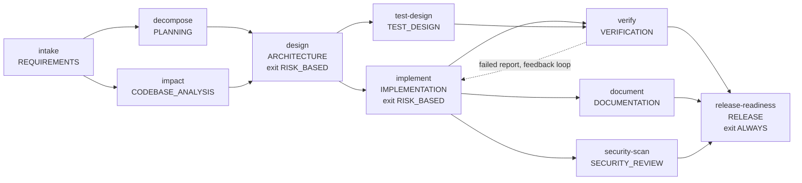
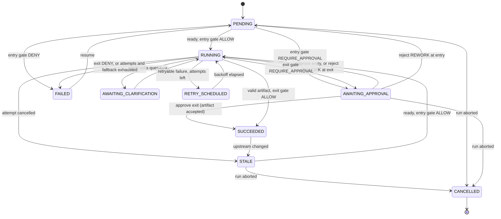
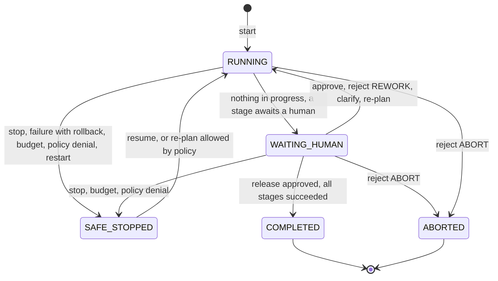
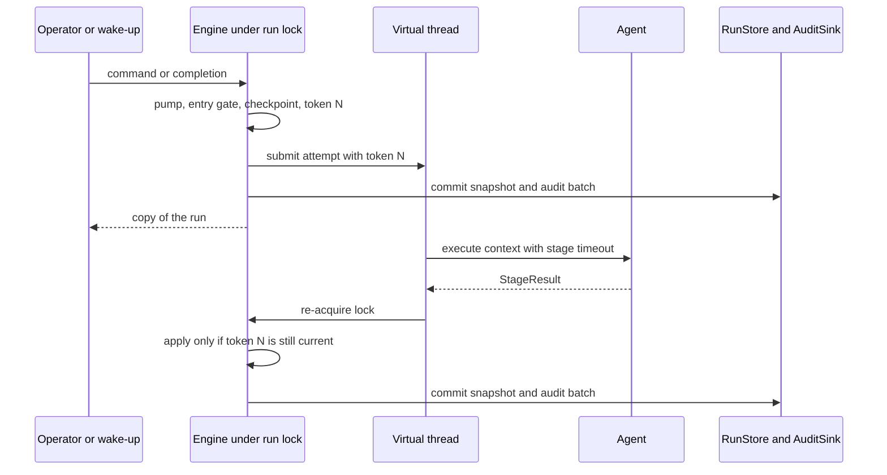

# Orchestration

How `orchestrator-core` drives a change from requirement to release: the workflow graph, state machines,
gates, failure handling, non-linear execution, lineage, budgets and metrics, plus multi-node leases, change events,
policy packs, the audit hash chain, signed change records, the LLM cost model, the evaluation harness and the
dependency inventory. Every statement describes the code
as it is and names the class that implements it and the test that proves it. Design intent lives in the
[engineering specification](design/engineering-spec.md) and the [ADRs](adr/); section 13 lists where the code refines the spec.

## 1. Purpose and vocabulary

The engine ([`OrchestrationEngine`](../orchestrator-core/src/main/java/com/agenticsdlc/orchestrator/core/engine/OrchestrationEngine.java)) is a framework-free library (no Spring, enforced by
[`CoreArchitectureTest`](../orchestrator-core/src/test/java/com/agenticsdlc/orchestrator/core/CoreArchitectureTest.java)). Agents produce typed artifacts; the engine decides what runs, when, with
which inputs, and whether a human must decide first. Agents never change run state.

| Term | Meaning in this codebase | Implemented by |
|---|---|---|
| Run | One execution of the workflow for one requirement: stage executions, full artifact history, accepted versions, approvals, checkpoints, compensations, counters, human-wait intervals, policy findings, audit sequence | [`Run`](../orchestrator-core/src/main/java/com/agenticsdlc/orchestrator/core/model/Run.java) |
| Stage | A graph node executed by one agent role; per run a `StageExecution` tracks status, attempts, active agent, feedback, pending approval and a correlation token | [`StageDefinition`](../orchestrator-core/src/main/java/com/agenticsdlc/orchestrator/core/graph/StageDefinition.java) |
| Activation, attempt | An activation is one start of a stage (a checkpoint is taken); an attempt is one agent call within it. Retries and fallback are further attempts of the same activation | [`OrchestrationEngine`](../orchestrator-core/src/main/java/com/agenticsdlc/orchestrator/core/engine/OrchestrationEngine.java) |
| Gate | Entry gate before an activation, exit gate after a valid artifact; combines the policy verdict, the stage's `ApprovalRequirement` and the run's autonomy | [`GateEvaluator`](../orchestrator-core/src/main/java/com/agenticsdlc/orchestrator/core/engine/GateEvaluator.java) |
| Artifact | Immutable, versioned, typed stage output, hashed (SHA-256 of canonical JSON), with provenance | [`Artifact`](../orchestrator-core/src/main/java/com/agenticsdlc/orchestrator/core/artifact/Artifact.java) |
| Accepted version | Per stage, the artifact version downstream stages consume (`Run.acceptedVersions`) | [`Run`](../orchestrator-core/src/main/java/com/agenticsdlc/orchestrator/core/model/Run.java) |
| Lineage | `Provenance.derivedFrom`: upstream stage id to the exact accepted version the agent was given | [`Provenance`](../orchestrator-core/src/main/java/com/agenticsdlc/orchestrator/core/artifact/Provenance.java) |
| Checkpoint | Accepted versions, plan version and ids of compensations registered so far, captured when an activation starts | [`Checkpoint`](../orchestrator-core/src/main/java/com/agenticsdlc/orchestrator/core/model/Checkpoint.java) |
| Compensation | Undo action for a side effect, registered with the agent's result before the exit gate runs, executed in reverse order on rollback or abort | [`RollbackService`](../orchestrator-core/src/main/java/com/agenticsdlc/orchestrator/core/engine/RollbackService.java) |
| Plan version | Starts at 1, incremented by each re-plan; stamped on artifacts, approvals, checkpoints, policy findings | [`ReplanService`](../orchestrator-core/src/main/java/com/agenticsdlc/orchestrator/core/engine/ReplanService.java) |
| Autonomy level | `FULL_AUTO`, `GUIDED` (default) or `STRICT`; bounds how often humans are consulted | [`AutonomyLevel`](../orchestrator-core/src/main/java/com/agenticsdlc/orchestrator/core/model/AutonomyLevel.java) |
| Safe-stop | Status `SAFE_STOPPED` with a `HaltReason`; consistent, and moves again only on a human command | [`RunControl`](../orchestrator-core/src/main/java/com/agenticsdlc/orchestrator/core/engine/RunControl.java) |
| Lease | Time-bounded claim of one node on a run it is executing; other nodes' commands on the run are refused until it is released or expires (section 3.4) | [`RunLeaseProvider`](../orchestrator-core/src/main/java/com/agenticsdlc/orchestrator/core/port/RunLeaseProvider.java) |
| Policy pack | Named, versioned set of declarative rules evaluated after the built-in rules (section 5.1) | [`PolicyPack`](../orchestrator-core/src/main/java/com/agenticsdlc/orchestrator/core/policy/pack/PolicyPack.java) |
| Chain head | Hash of a run's last audit event; every event links to the previous one (section 8.1) | [`AuditChain`](../orchestrator-core/src/main/java/com/agenticsdlc/orchestrator/core/audit/AuditChain.java) |

## 2. The dependency graph

[`WorkflowDefinitions.defaultSdlc()`](../orchestrator-core/src/main/java/com/agenticsdlc/orchestrator/core/graph/WorkflowDefinitions.java) defines workflow `sdlc-default`, version 1. Every stage uses
`RetryPolicy.of(n)` (initial backoff 2 s, multiplier 2.0) and `fallbackToDeterministic = true`. "Max attempts"
includes the first attempt and applies per activation and per agent (the fallback agent gets a fresh count).

| Stage | Role, artifact | Depends on | Entry / exit approval | Policy rules that can fire | Max attempts | Timeout |
|---|---|---|---|---|---|---|
| `intake` | REQUIREMENTS, `RequirementSpec` | none | NEVER / NEVER (intrinsic clarification gate) | SEC-001, CMP-002, SEC-002 | 3 | 3 min |
| `decompose` | PLANNING, `TaskPlan` | intake | NEVER / NEVER | SEC-002 | 3 | 3 min |
| `impact` | CODEBASE_ANALYSIS, `ImpactAnalysis` | intake | NEVER / NEVER | SEC-002 | 3 | 3 min |
| `design` | ARCHITECTURE, `DesignSpec` | decompose, impact | NEVER / RISK_BASED | GOV-001, CMP-001, SEC-002 | 3 | 3 min |
| `implement` | IMPLEMENTATION, `ChangeSet` | design | NEVER / RISK_BASED | SEC-003, CHG-001, SEC-002 | 3 | 5 min |
| `test-design` | TEST_DESIGN, `TestPlan` | design | NEVER / NEVER | SEC-002 | 3 | 3 min |
| `verify` | VERIFICATION, `VerificationReport` | implement, test-design | NEVER / NEVER (a report with a failed blocking check starts a feedback loop) | SEC-002 | 2 | 10 min |
| `document` | DOCUMENTATION, `DocumentationBundle` | implement | NEVER / NEVER | SEC-002 | 3 | 3 min |
| `security-scan` | SECURITY_REVIEW, `SecurityReview` | implement | NEVER / NEVER (failed review becomes NO_GO) | SEC-002 | 2 | 3 min |
| `release-readiness` | RELEASE, `ReleaseReadiness` | verify, document, security-scan | NEVER / ALWAYS | CHG-002, CHG-003, GOV-003, SEC-002 | 2 | 3 min |

In `STRICT` autonomy, rule GOV-002 adds an entry approval to every stage except `intake`.

**Parallelism and joins.** `intake` forks into `decompose` and `impact`, `design` into `implement` and
`test-design`, `implement` into `document` and `security-scan`. A stage starts only when every predecessor is
`SUCCEEDED` ([`Scheduler`](../orchestrator-core/src/main/java/com/agenticsdlc/orchestrator/core/engine/Scheduler.java)), so `design`, `verify` and `release-readiness` are joins. Because `document`
and `security-scan` depend only on `implement`, they overlap `test-design` and `verify`; at most three attempts
of one run are in flight. `parallelBranchesOverlapAndTheJoinWaitsForBoth` ([`OrchestrationEngineTest`](../orchestrator-core/src/test/java/com/agenticsdlc/orchestrator/core/engine/OrchestrationEngineTest.java))
proves the overlap with a latch and that `verify` waits for both inputs.

**Validation.** [`WorkflowGraph`](../orchestrator-core/src/main/java/com/agenticsdlc/orchestrator/core/graph/WorkflowGraph.java) validates a definition once and is immutable afterwards: it rejects an
empty workflow, duplicate ids, unknown dependencies, self-dependencies and cycles (Kahn's algorithm, definition
order as tie-breaker, the error names the stages left in the cycle). `StageDefinition` enforces ids matching
`[a-z0-9][a-z0-9-]{0,63}` and positive timeouts; `RetryPolicy` at least one attempt and a multiplier of at least
1.0. The graph precomputes topological order, longest-path layers (layer 0 `intake`, layer 5 `release-readiness`)
and closures; the engine refuses a graph whose roles lack a deterministic agent, so a fallback always exists.

## 3. Run and stage state machines

### 3.1 Stage states

[`StageStatus`](../orchestrator-core/src/main/java/com/agenticsdlc/orchestrator/core/model/StageStatus.java): `PENDING` and `STALE` are schedulable, `RUNNING` and `RETRY_SCHEDULED` are in
progress, `AWAITING_APPROVAL` and `AWAITING_CLARIFICATION` wait for a human. Every reset goes through
`RunControl.resetToReady`, which picks `STALE` when the stage still has an accepted artifact and `PENDING`
otherwise; the diagram shows one of the two for brevity.

- **Entry** (`pump`, `startActivation`): with all predecessors `SUCCEEDED` and budgets intact, ALLOW records a
  checkpoint and submits attempt 1; REQUIRE_APPROVAL creates an `ENTRY` approval; DENY fails the stage.
- **Exit** (`handleSuccess`): ALLOW accepts the artifact and gives `SUCCEEDED`; REQUIRE_APPROVAL creates an `EXIT`
  approval bound to the artifact's version and hash, and the artifact is accepted only when that approval is
  granted; DENY removes the candidate artifact from the history and fails the stage.
- **Failure** (`handleFailure`): retry if possible, else engage the fallback (the stage stays `RUNNING` with
  agent `fallback:deterministic` and a reset attempt count), else `FAILED` with rollback (`failStage`).
- **Rework** (`reject` with REWORK): an entry rework records the feedback and returns the stage to `PENDING` or
  `STALE`, so the entry gate is evaluated again and asks for approval again; an exit rework re-runs the primary
  agent with the feedback. The rejected version was never accepted and never becomes accepted
  (`exitApprovalAcceptsTheArtifactOnlyWhenGrantedAndReworkNeverAcceptsTheRejectedVersion`,
  [`OrchestrationEngineReviewFixesTest`](../orchestrator-core/src/test/java/com/agenticsdlc/orchestrator/core/engine/OrchestrationEngineReviewFixesTest.java)).
- **Reset**: cancelled attempts (stop, safe-stop, abort, re-plan, restart recovery, `verify` after its own
  failed report) and invalidated stages (re-plan, feedback loop, upstream hash change, rollback) become `STALE`
  or `PENDING`. `resume` turns `FAILED` into `PENDING`; an abort cancels every stage not `SUCCEEDED` or `FAILED`.

### 3.2 Run states

[`RunStatus`](../orchestrator-core/src/main/java/com/agenticsdlc/orchestrator/core/model/RunStatus.java): `RUNNING` and `WAITING_HUMAN` are active, `SAFE_STOPPED` is halted, `COMPLETED` and
`ABORTED` are terminal. After every mutation `updateWaitingState` sets `WAITING_HUMAN` exactly when no stage is
in progress and at least one awaits a human. With the default rules a run completes from `WAITING_HUMAN`,
because its last stage needs the release approval. A requirement denied at `RUN_START` goes from `RUNNING` to
`SAFE_STOPPED` inside `start`, before any agent runs.

### 3.3 Locking, token-guarded completion, durability before visibility

- **Per-run lock.** [`RunRegistry`](../orchestrator-core/src/main/java/com/agenticsdlc/orchestrator/core/engine/RunRegistry.java) holds, per run, the `Run`, a `ReentrantLock`, the in-flight map
  `stageId -> (token, Future)` and a token sequence. Every command and completion runs through `mutate`: lock,
  apply the change with one fixed timestamp, `pump` (schedule ready stages), commit, copy, unlock.
  Two operators approving one gate are serialized; the second gets `InvalidRunStateException` (no longer pending),
  which the control plane maps to 409. `approve` and `reject` also accept the id of the approval the operator
  reviewed and refuse the command when the pending approval is a different one, so a decision cannot land on an
  approval that replaced the one on screen (`anApprovalIsBoundToTheApprovalTheOperatorReviewed`).
- **Off-lock execution.** Attempts run on virtual threads; the agent runs on a nested virtual-thread task awaited
  with the stage timeout ([`StageExecutor`](../orchestrator-core/src/main/java/com/agenticsdlc/orchestrator/core/engine/StageExecutor.java)); one daemon thread delivers retry wake-ups.
- **Token-guarded completion.** Each attempt and scheduled retry gets a fresh token, stored on the stage and in
  the in-flight map. A result is applied only if the token is still current, the stage is still `RUNNING` and
  the run is active (retry wake-ups check the same for `RETRY_SCHEDULED`), so late results of cancelled,
  timed-out or superseded attempts are dropped even if the agent ignored the interrupt
  (`stopCancelsInFlightWorkAndResumeContinues`, `stopDuringAScheduledRetryKeepsItAndResumeRearmsIt`).
- **Durability before visibility.** Under the lock `RunStore.commit(run, events, auditSink)` persists the
  aggregate and the command's audit events; only then is a copy returned and passed to the optional
  `EngineListener`. The default `commit` saves the snapshot and then appends the events (not atomic);
  [`InMemoryRunStore`](../orchestrator-core/src/main/java/com/agenticsdlc/orchestrator/core/port/InMemoryRunStore.java) and the control plane's `JpaRunStore` override it
  to persist both atomically, and a failed commit of the in-memory store leaves neither the run change nor its
  events (`aFailedCommitOfTheAtomicInMemoryStoreLeavesNeitherTheRunChangeNorItsEventsAndRestoresTheChainHead`,
  [`OrchestrationEngineAuditChainTest`](../orchestrator-core/src/test/java/com/agenticsdlc/orchestrator/core/engine/OrchestrationEngineAuditChainTest.java)). The run's lease is renewed right
  before every commit, so a node that lost the lease never commits (section 3.4). A failed commit is a conflict: the
  caller gets an `InvalidRunStateException` (409 in the control plane) with the store's exception as its cause, and the
  mutation is discarded: the run leaves the in-memory registry, its in-flight attempts are abandoned and its lease is
  released, so the next command or read loads the stored state, and recovery on any node can take the run over;
  scheduled retries survive (`aCommitFailureIsAConflictThatDiscardsTheMutationAndTheNextCommandReloadsTheStoredRun`).
  A start whose first commit fails leaves no run behind (`aStartWhoseFirstCommitFailsLeavesNoGhostRun`): the run is
  marked discarded before it is unregistered, so an attempt of that run that finishes in the meantime cannot commit
  it either (`anAttemptThatFinishesWhileTheFirstCommitFailsNeverPersistsTheDiscardedRun`). Audit sequence numbers are
  per run and gap-free (the GUIDED test asserts 1..n); a run reloaded after a failed commit continues the hash chain
  from the head the audit log holds (section 8.1).

### 3.4 Run leases and multi-node operation

Several engines, one per control-plane node, can share one `RunStore`. A run is leased
([`RunLeaseProvider`](../orchestrator-core/src/main/java/com/agenticsdlc/orchestrator/core/port/RunLeaseProvider.java), [`RunLease`](../orchestrator-core/src/main/java/com/agenticsdlc/orchestrator/core/port/RunLease.java)) by the
node that executes its stages: the engine acquires the lease when a command or an internal event schedules work on
the run, renews it at every mutation, right before every commit and every `leaseTtl / 3` while an attempt runs, and
releases it when the run waits for a human, is `SAFE_STOPPED`, `COMPLETED` or `ABORTED`. While another node holds a valid lease, every command
throws [`RunLeasedElsewhereException`](../orchestrator-core/src/main/java/com/agenticsdlc/orchestrator/core/engine/RunLeasedElsewhereException.java) (an
`InvalidRunStateException`; the control plane answers `409 run-leased-elsewhere` with `holder` and `runId`). Reads
never need a lease. When this node acquires a lease, and when it reads a run it is not executing, it first reloads
the run if the store holds a newer state written by another node. A node that finds it lost a lease it was using
(a renewal that fails from an attempt's heartbeat, at the start of a mutation or right before a commit) writes
nothing, drops the lease, abandons the run's in-flight attempts (outcome `LEASE_LOST`: nothing is applied or retried
on this node), evicts the run from memory and logs a WARN. Within one node the per-run lock of section 3.3 stays the
mechanism.

| [`EngineConfig`](../orchestrator-core/src/main/java/com/agenticsdlc/orchestrator/core/engine/EngineConfig.java) | Default | Notes |
|---|---|---|
| `nodeId` | host name, process id and a random suffix, computed once per JVM (at most 128 characters) | lease owner; recorded in `RUN_CREATED`, `RUN_RESUMED`, `REPLAN`, `RUN_INTERRUPTED` and `STAGE_STARTED` data; must be unique per running process |
| `leaseProvider` | a new [`InMemoryRunLeaseProvider`](../orchestrator-core/src/main/java/com/agenticsdlc/orchestrator/core/port/InMemoryRunLeaseProvider.java) on the engine clock (coordinates this engine only) | the control plane uses [`JdbcRunLeaseProvider`](../orchestrator-app/src/main/java/com/agenticsdlc/orchestrator/app/persistence/JdbcRunLeaseProvider.java) on the `run_leases` table by default |
| `leaseTtl` | 60 s | should exceed the longest retry backoff (`maxBackoff * backoffScale`), during which nothing renews the lease; the control plane refuses a shorter TTL at startup |

The SPI contract: `tryAcquire` grants a new token only when the run has no valid lease (not re-entrant, also for the
same owner); `renew` extends a lease by its token, also after expiry as long as nobody took the run over; `release`
removes it only while the token still holds the run; `holderOf` names the owner of a valid lease; `reclaim` grants a
new token to an owner that holds the run's valid lease under a token it no longer knows (a node restarted with a
fixed node id). An expired lease can be taken over by any node; expiry is judged with the provider's clock, so clock
skew between nodes must stay well below the TTL. `JdbcRunLeaseProvider` implements each call with one portable
conditional statement in its own transaction, so a lease change is visible to other nodes at once and a failed run
commit cannot roll it back.

Recovery and shutdown: `recoverInterrupted()` (and `recoverInterruptedCount()`, which returns the number) safe-stops
only RUNNING runs that no node holds a valid lease on (section 6); a run whose valid lease names this node while the
engine holds none locally is reclaimed and recovered at once. `close()` cancels in-flight attempts and releases this
node's leases (one retry when a release fails), so another node can recover its runs without waiting for expiry. A
release that fails is kept as release-pending: the node's own commands keep using the lease, the run is not evicted,
and `releasePendingLeases()` (called by every recovery pass) and `close()` retry it. The control plane's
[`EngineMaintenance`](../orchestrator-app/src/main/java/com/agenticsdlc/orchestrator/app/startup/EngineMaintenance.java) repeats recovery and eviction every
`sdlc.engine.maintenance-interval` (30 s), so the runs of a crashed node are safe-stopped once their lease has
expired and can be resumed on any node.

Proven by [`OrchestrationEngineLeaseTest`](../orchestrator-core/src/test/java/com/agenticsdlc/orchestrator/core/engine/OrchestrationEngineLeaseTest.java)
(`commandsOfAnotherNodeAreRefusedWhileTheRunExecutesAndAllowedOnceTheLeaseExpired`,
`aRunWaitingForAHumanCanBeContinuedByAnyNode`, `aLongAttemptKeepsItsLeaseThroughHeartbeats`,
`aLeaseTakenOverBetweenTheMutationAndItsCommitWritesNothing`,
`anAttemptWhoseHeartbeatFindsTheLeaseLostIsInterruptedAndNothingIsWritten`,
`closingANodeReleasesItsLeasesSoAnotherNodeCanRecoverItsRuns`,
`aFailedReleaseKeepsTheLeasePendingSoTheNodeIsNotLockedOutAndTheRunIsNotEvicted`,
`aNodeRestartedWithItsNodeIdReclaimsItsOwnLeaseAndIsNeverRefusedWithItsOwnId`),
`InMemoryRunLeaseProviderTest` (`concurrentAcquisitionsGrantExactlyOneLease`) and, in the control plane,
`JdbcRunLeaseProviderTest` and [`JdbcLeaseMultiNodeTest`](../orchestrator-app/src/test/java/com/agenticsdlc/orchestrator/app/persistence/JdbcLeaseMultiNodeTest.java) (two
engines on one database: `aRunOfACrashedNodeIsRecoveredOnlyOnceItsLeaseExpired`,
`aNodeRestartedWithItsFixedNodeIdTakesItsRunBackWithoutWaitingForTheOldLeaseToExpire`). What leases do not provide:
work distribution (a run executes where its work was scheduled), shared retry timers or shared provider circuits
([ADR 0014](adr/0014-run-leases-and-bounded-registry-for-multi-node.md)).

### 3.5 Bounded run registry

[`RunRegistry`](../orchestrator-core/src/main/java/com/agenticsdlc/orchestrator/core/engine/RunRegistry.java) no longer keeps every run it has seen.
`OrchestrationEngine.evictIdleRuns()` drops runs that are not executing on this node (`WAITING_HUMAN`,
`SAFE_STOPPED`, `COMPLETED`, `ABORTED`) after `registryRetention` (default 1 h) without a change, then the least
recently ended terminal runs beyond `registryMaxTerminalRuns` (default 500). A run is never evicted while it is
RUNNING, has an attempt in flight or is leased by this node (also release-pending); a run whose commit failed has
already left the registry (section 3.3). The engine evicts after every command and in `list()`; the control plane
also does it in every maintenance pass. `get` and `list` read evicted runs from the store, and the next command
loads the run again (`aRunWaitingLongerThanTheRetentionIsEvictedAndItsApprovalContinuesCorrectly`,
`terminalRunsBeyondTheMaximumAreEvictedLeastRecentlyEndedFirst`, `runsExecutingOnThisNodeAreNeverEvicted`,
[`RunRegistryEvictionTest`](../orchestrator-core/src/test/java/com/agenticsdlc/orchestrator/core/engine/RunRegistryEvictionTest.java)). `list()` is authoritative but reads every
run of the store; `listCached()` returns only the registry, cheaply and possibly incomplete
(`listCachedReturnsOnlyTheRegistryWhileListAlsoReadsTheStore`).

### 3.6 Change events (server-sent events)

The engine offers an optional `EngineListener` that receives a copy of the run after every mutation. The control
plane does not use it for the console: an event must only describe state that is durable, so
[`JpaRunStore`](../orchestrator-app/src/main/java/com/agenticsdlc/orchestrator/app/persistence/JpaRunStore.java) hands each committed change (the run's list row, the committed
snapshot and the audit events of the commit) to the in-process
[`RunEventBus`](../orchestrator-app/src/main/java/com/agenticsdlc/orchestrator/app/events/RunEventBus.java) after the transaction commits (never after a rollback). The bus
delivers on one dispatcher thread in commit order through a bounded queue of 1 000 changes; a change that does not
fit is dropped and counted, and the streams recover by reading the store. Subscribers are the event streams
([`RunStreamHub`](../orchestrator-app/src/main/java/com/agenticsdlc/orchestrator/app/api/RunStreamHub.java)) and the run and stage observations of section 10.

| Stream | Events (SSE `event:` name, data) | Resumption and end |
|---|---|---|
| `GET /api/v1/runs/{id}/events` | on connect the audit events after `Last-Event-ID` (all without it) as `audit` (SSE id = audit `seq`, data `AuditEventView`), then the current `run` (`RunView`); afterwards, per commit, its new `audit` events, then the new `run`; `heartbeat` (`{"time": ...}`) every 15 s | reconnect with `Last-Event-ID` to receive exactly the missed events; the stream ends after the final `run` event of a `COMPLETED` or `ABORTED` run |
| `GET /api/v1/runs/events` | a `heartbeat` first and every 15 s; a `run-summary` (the item shape of `GET /api/v1/runs`) per commit | no replay: load the list with `GET /api/v1/runs`, then apply the summaries |

Limits (`sdlc.console.*`): at most `max-sse-connections` (200) streams per node, beyond that `503
stream-limit-reached` with `Retry-After`; a stream lives `sse-timeout` (30 min) and the client reconnects; the
initial backlog is at most 20 000 audit events, and a stream that falls more than 1 000 live events behind is
closed (the client reconnects with `Last-Event-ID`); writes run on a bounded executor, one write at a time per
stream, so a slow client never blocks the publisher. Every stream response carries `X-Sdlc-Node-Id`: a stream only
carries the commits of its node, so in a multi-node deployment the console polls a run whose `nodeId` names another
node and keeps a 30 s safety poll for every open stream. Proven by
[`RunStreamControllerTest`](../orchestrator-app/src/test/java/com/agenticsdlc/orchestrator/app/api/RunStreamControllerTest.java)
(`aRunStreamStartsWithTheAuditBacklogWithSequenceIdsThenTheRunView`, `lastEventIdResumesAfterTheLastSeenSequence`,
`committedChangesStreamTheirNewAuditEventsAndRunViewAndTheTerminalRunEndsTheStream`), `RunStreamHubTest`
(`aStreamWhoseLiveEventsPileUpIsClosedAndFreesItsSlot`, `closingAStreamWhoseWriteIsBlockedNeverBlocksThePublisher`)
and `JpaRunStoreCommitEventsTest` (`aFailedCommitPublishesNothing`,
`theEngineFeedsTheBusInCommitOrderWithContiguousAuditSequences`); see also
[ADR 0017](adr/0017-server-sent-events-and-paged-listing.md).

## 4. Gates and controlled autonomy

### 4.1 Entry and exit gates

[`GateEvaluator`](../orchestrator-core/src/main/java/com/agenticsdlc/orchestrator/core/engine/GateEvaluator.java) combines the policy verdict for the phase with the stage's `ApprovalRequirement`
(DENY > REQUIRE_APPROVAL > ALLOW). The exit gate runs only for a payload of the role's artifact kind that passed
its `validate()` invariants; anything else is an `INVALID_OUTPUT` failure. The version is then recorded in the
history, not accepted, and the gate is evaluated on a prospective copy of the run in which it is accepted, so the
policy rules and the `RISK_BASED` requirement see the risk the run would have with this artifact. The artifact is
accepted (`ARTIFACT_ACCEPTED`) only after an ALLOW or a granted exit approval; until then the previously accepted
version, if any, stays accepted and successors cannot consume the candidate. Each evaluation is audited as
`GATE_EVALUATED` with verdict, rule-prefixed reasons, notes and rule ids.

| Requirement | FULL_AUTO | GUIDED (default) | STRICT |
|---|---|---|---|
| `RISK_BASED` (`design`, `implement` exits) | never | when risk is at least MEDIUM and not already accepted in this plan version | always |
| `ALWAYS` (`release-readiness` exit) | always | always | always |
| Policy-raised (SEC-003, CHG-001, CMP-001, CHG-003) | yes | yes | yes |
| GOV-002 entry approval | no | no | every stage except `intake` |

Proven by `guidedHappyPathPausesAtDesignAndReleaseThenCompletes`, `fullAutoOnlyPausesAtTheReleaseGate`,
`strictRequiresApprovalAtEveryStageEntryExceptIntake` (nine entry and three exit approvals) and
`protectedPathRequiresApprovalEvenInFullAuto` ([`OrchestrationEngineTest`](../orchestrator-core/src/test/java/com/agenticsdlc/orchestrator/core/engine/OrchestrationEngineTest.java)).

### 4.2 Risk-based approvals and accepted risk

`Run.currentRisk()` merges the accepted `RequirementSpec.preliminaryRisk` and `DesignSpec.risk` (both reported by
agents) with a deterministic floor the engine computes from the accepted design and impact analysis
([`RiskFloor`](../orchestrator-core/src/main/java/com/agenticsdlc/orchestrator/core/artifact/RiskFloor.java)): HIGH
for a non-backward-compatible data model change, a breaking API change, personal data in the design's data
handling, or an impacted component of type FILTER or CONFIG or under a `/security/` path; MEDIUM for any data
model or API change or any impacted component the change modifies or extends. Floor factors are prefixed
`engine: ` in the audit trail, so engine facts are distinguishable from agent claims, and an agent cannot lower
the risk to skip an approval (`aDesignThatUnderReportsItsRiskIsStillGatedByTheEngineRiskFloor`,
`RiskFloorTest`). Each approval stores the risk level at request time. In `GUIDED` a `RISK_BASED` gate skips the approval when an `APPROVED`
approval of the current plan version carries an equal or higher level, and records the gate note
`risk X already accepted by the approval of <stage> in plan vN`. Risk escalation, a re-plan (new plan version, approvals revoked) or a
revocation brings the approval back. GOV-001 is independent of this carry-forward: it requires the design
approval on every design exit in `GUIDED` at MEDIUM or above, and always in `STRICT`.

### 4.3 The release gate and NO_GO waivers

Three independent mechanisms require the release approval: the `ALWAYS` exit gate, CHG-002 (any
`ReleaseReadiness` candidate) and, in `FULL_AUTO`, GOV-003, which makes the autonomy floor explicit in the audit
trail; with the default rules even a workflow that set the gate to `NEVER` would stop for a human. A `NO_GO`
decision adds CHG-003 (HIGH); `approve` then rejects a blank comment and records the comment as the waiver
(`noGoReleaseRequiresAWaiverCommentToApprove`). At completion the engine, not an agent, writes the change record
as a new `release-readiness` version authored by `engine`: every approval of the current plan version (approver,
time, comment and, for exit gates, the hash of the artifact that was approved) and the verdict
"REQUIRE_APPROVAL satisfied: release approved by ...", plus " with waiver" for NO_GO.

### 4.4 Human decisions, operator identity, and what agents can never do

`approve`, `reject` (REWORK or ABORT, reason required), `clarify` (every open question, known ids only),
`replan`, `stop` and `resume` require an [`Actor`](../orchestrator-core/src/main/java/com/agenticsdlc/orchestrator/core/audit/Actor.java) of type `HUMAN`, else `InvalidCommandException`. The
operator id goes into the approval (`decidedBy`), the audit actor and the change record. `start(..., Actor
requestedBy)` attributes `RUN_CREATED` to the requester and records `requestedBy` in its data; the control plane
passes the operator identity, so API-created runs are audited with a `HUMAN` actor (the overload without an
actor, used by engine tests, records the system actor; `runCreationIsAttributedToTheRequestingOperator`,
[`OrchestrationEngineHardeningTest`](../orchestrator-core/src/test/java/com/agenticsdlc/orchestrator/core/engine/OrchestrationEngineHardeningTest.java)). The identity comes from the control plane: the identity claim of a
verified bearer token in `oidc` mode, the `X-Operator-Id` header in `open` and `api-key` mode, and the control plane
also checks the caller's role and, when enabled, the four-eyes rule before a command reaches the engine
([ADR 0015](adr/0015-authentication-modes-roles-and-production-posture.md)). Agents can never:

- issue those commands: ArchUnit forbids agent, policy and workspace packages from depending on the engine;
- mutate run state, skip a gate, choose successors or extend a budget: an agent receives an immutable
  [`StageContext`](../orchestrator-core/src/main/java/com/agenticsdlc/orchestrator/core/agent/StageContext.java) and returns a `StageResult`;
- record approvals: [`LlmStageAgent`](../orchestrator-core/src/main/java/com/agenticsdlc/orchestrator/core/agent/llm/LlmStageAgent.java) discards approvals an LLM writes into a change record;
- leave side effects behind: compensations an agent reports are registered with its result before the exit gate
  runs, so a denial or a later failure executes them;
- put a credential into the audit log: a rationale that matches a secret pattern is audited as
  `[rationale redacted: contained a credential-like token]` (`aRationaleContainingACredentialIsRedactedBeforeItIsAudited`);
- lower the run's risk below the engine's floor (section 4.2);
- write outside `<sandboxRoot>/<runId>` ([`WorkspaceSandbox`](../orchestrator-core/src/main/java/com/agenticsdlc/orchestrator/core/workspace/WorkspaceSandbox.java)) or run anything but `./mvnw`, `mvnw` or
  `mvn` without shell metacharacters ([`ProcessBuildRunner`](../orchestrator-core/src/main/java/com/agenticsdlc/orchestrator/core/workspace/ProcessBuildRunner.java)); the build process starts with every
  environment variable whose name contains `key`, `token`, `secret`, `password`, `passwd`, `credential` or `auth`
  (case-insensitive) removed (`ProcessBuildRunner.sanitizeEnvironment`), so provider API keys do not reach
  generated code or build plugins.

## 5. Policy guardrails

[`PolicyEngine`](../orchestrator-core/src/main/java/com/agenticsdlc/orchestrator/core/policy/PolicyEngine.java) evaluates every rule of [`DefaultPolicyRules`](../orchestrator-core/src/main/java/com/agenticsdlc/orchestrator/core/policy/rules/DefaultPolicyRules.java) at `RUN_START` (requirement
of a start or re-plan), `ENTRY` and `EXIT` (candidate payload); each rule decides where it applies. With a policy
pack (section 5.1) the pack's rules run after the built-in rules, and the built-in rules it disables are skipped.

| Rule | Where | What it checks | Verdict, severity |
|---|---|---|---|
| SEC-001 ProhibitedIntent | RUN_START; intake exit | a form of disable, remove, bypass, drop, weaken or circumvent followed within four tokens by a control (validation, authentication, auth, security, approval, tests, testing, audit, logging, check, limiter, ratelimit, throttling, verification, encryption, hashing, masking); phrases "skip tests", "ignore compliance", "allow any destination", "log full ip", "store plaintext password", "turn off" or "switch off" a control, "make ... <control> optional", "no longer validate/check/authenticate/hash/encrypt/verify/audit", "exfiltrat..."; a sentence that removes the logging of raw or full IP addresses or other personal data is a privacy improvement and is allowed | DENY, CRITICAL |
| SEC-002 SecretLeak | every exit | any string value, object key or `key: value` pair of the payload, scanned as raw text (scanning the escaped JSON document would hide quoted literals), matches an AWS access key id, an Anthropic API key, a GitHub token (`gh[pousr]_`), a literal password assignment, a PEM private key block, a Slack token, a JSON web token or a generic credential assignment (`api_key`, `client_secret`, `secret`, `token`, `passwd`, `pwd`) ([`SecretPatterns`](../orchestrator-core/src/main/java/com/agenticsdlc/orchestrator/core/util/SecretPatterns.java)); configuration placeholders (`${ENV}`, `{{ }}`, `<redacted>`, `***`, `change-me`) and bare identifiers or expressions (`this.password = password;`) are ignored; the finding names the kind, never the value | DENY, CRITICAL |
| SEC-003 ProtectedPath | `ChangeSet` exit | a path matches `**/security/**`, `**/application-prod*.yml`, `.github/**`, `**/pom.xml`, `**/mvnw`, `**/mvnw.cmd`, `**/.mvn/**`, `orchestrator-core/**`, `orchestrator-app/**`, `**/Dockerfile*` or `**/docker-compose*.y*ml` (case-insensitive, on normalized paths) | REQUIRE_APPROVAL, HIGH |
| CMP-001 PiiHandling | `DesignSpec` exit | personal data declared without protection or retention | REQUIRE_APPROVAL, HIGH |
| CMP-002 PiiProhibited | RUN_START; intake exit | storing or logging raw, full or unhashed IP addresses, or IP addresses "as-is", unencrypted or "in plain form"; e-mail in clear text; "without hashing", masking or anonymisation; sentences that remove, stop or delete such logging or storage are privacy improvements and are allowed | DENY, CRITICAL |
| CHG-001 ChangeSize | `ChangeSet` exit | more than 25 files or more than 1500 content lines | REQUIRE_APPROVAL, MEDIUM |
| CHG-002 ReleaseApproval | `ReleaseReadiness` exit | always | REQUIRE_APPROVAL, LOW |
| CHG-003 NoGoRelease | `ReleaseReadiness` exit | decision `NO_GO` (approval then needs a waiver comment) | REQUIRE_APPROVAL, HIGH |
| GOV-001 RiskBasedDesignApproval | `DesignSpec` exit | `STRICT`, or `GUIDED` with risk at least MEDIUM | REQUIRE_APPROVAL, MEDIUM |
| GOV-002 StrictEntryApproval | entry, all but REQUIREMENTS | autonomy `STRICT` | REQUIRE_APPROVAL, LOW |
| GOV-003 AutonomyFloor | `ReleaseReadiness` exit | autonomy `FULL_AUTO` | REQUIRE_APPROVAL, LOW |

- **Combination and recording.** All rules run without short-circuit; the decision is the maximum verdict, and a
  rule that throws fails closed with a CRITICAL DENY ([`PolicyEngineTest`](../orchestrator-core/src/test/java/com/agenticsdlc/orchestrator/core/policy/PolicyEngineTest.java)). Each finding is stored
  on the run (rule, severity, verdict, message, stage, phase, plan version, time) and audited as
  `POLICY_FINDING`; a denial adds `POLICY_DENIED` with the denying rule ids.
- **Clarifications are checked.** At intake exit SEC-001 and CMP-002 also read the normalized statement, which
  contains the clarification answers (`inspectsTheNormalizedStatementAtIntakeExit`, [`PolicyRulesTest`](../orchestrator-core/src/test/java/com/agenticsdlc/orchestrator/core/policy/rules/PolicyRulesTest.java)).
- **RUN_START denial.** `start` still creates the run, records the findings, audits `POLICY_DENIED` and
  safe-stops with `POLICY_DENIED`: visible and auditable rather than an error. `resume` is refused; only a
  re-plan whose requirement passes proceeds. A denied re-plan of an active run safe-stops it and keeps the
  previous requirement and plan version.
- **Entry and exit denials** fail the stage, roll back to its checkpoint and safe-stop with `POLICY_DENIED`. No
  built-in rule denies at entry; the path exists for custom rules such as a change freeze
  (`entryGateDenialFailsTheStageAndSafeStopsWithPolicyDenied`, [`OrchestrationEngineGovernanceTest`](../orchestrator-core/src/test/java/com/agenticsdlc/orchestrator/core/engine/OrchestrationEngineGovernanceTest.java)).
- **Denied artifacts are discarded.** An artifact denied at the exit gate (for example by SEC-002 because it embeds
  a credential) is removed from the run's artifact history before the mutation is committed, so it is never
  persisted, listed or shown; it was never accepted, so the previously accepted version, if any, simply stays. The
  `POLICY_DENIED` audit event keeps the artifact reference, id, hash, rule ids and `removed: true` as evidence,
  never the content (`artifactDeniedByTheExitGateIsRemovedFromHistoryAndTheRunSafeStops`, [`OrchestrationEngineHardeningTest`](../orchestrator-core/src/test/java/com/agenticsdlc/orchestrator/core/engine/OrchestrationEngineHardeningTest.java);
  `aQuotedPasswordLiteralIsDeniedAtTheExitGateAndRemovedFromHistory`). The exit gate also runs for a failed
  verification report, so a report that leaks a secret is denied instead of feeding back
  (`aFailedVerificationReportThatLeaksASecretIsDeniedInsteadOfFeedingBack`).

### 5.1 Policy packs (policy as code)

A [`PolicyPack`](../orchestrator-core/src/main/java/com/agenticsdlc/orchestrator/core/policy/pack/PolicyPack.java) is a named, versioned JSON document (the control plane also
reads YAML, see below) of declarative rules plus the ids of built-in rules it disables.
`PolicyEngine.withDefaultRulesAnd(pack)` builds an engine with the built-in rules minus the disabled ones, followed by
one [`DeclarativePolicyRule`](../orchestrator-core/src/main/java/com/agenticsdlc/orchestrator/core/policy/pack/DeclarativePolicyRule.java) per pack rule in pack order, combined
exactly like the built-in rules (no short-circuit, maximum verdict, a throwing rule fails closed with a CRITICAL
DENY).

| Element | Values |
|---|---|
| Rule id | `[A-Z]{2,5}-\d{3}` (for example `ORG-001`), unique, never a built-in id |
| Phase, stages | `RUN_START` (the requirement; no stages), `ENTRY` or `EXIT`, optionally limited to stage ids |
| Effect, severity | `DENY` (default HIGH), `REQUIRE_APPROVAL` (default MEDIUM), `WARN` (a finding only, always LOW); the message is prefixed with the pack name and version |
| `intentMatches` | a regex found, case-insensitively, in the requirement, the clarification answers or, at the intake exit, the normalized statement |
| `pathMatches` | a glob (`**/`, `*`; case-insensitive) matching a path of the candidate change set or of the candidate impact analysis (not mere regression risks), else of the accepted ones |
| `payloadMatches` | a regex found, case-sensitively, in the strict canonical JSON of the candidate payload (`EXIT` only) |
| `riskAtLeast`, `changeSizeOver`, `releaseDecisionIs`, `autonomyIs` | the prospective run risk, the change set's files or lines, the release decision, the run's autonomy |
| `allOf`, `anyOf`, `not` | combinators, at most 16 levels deep |

[`PolicyPackLoader`](../orchestrator-core/src/main/java/com/agenticsdlc/orchestrator/core/policy/pack/PolicyPackLoader.java) is strict and reports every problem with its JSON path:
malformed JSON, duplicate keys, unknown fields, missing or mistyped fields, unknown enum values or condition types,
invalid regexes or globs, duplicate or built-in ids, rules that cannot apply as written (stages on `RUN_START`,
`payloadMatches` outside `EXIT`, a `WARN` rule with a severity other than LOW) and attempts to disable CHG-002, GOV-003
or SEC-002, which no pack and no code can disable (`PolicyPack.NON_DISABLEABLE_RULE_IDS`;
`rejectsDisablingTheReleaseGateAndTheSecretLeakGuard`, `protectedBuiltInsCannotBeDisabledEvenInCode`).

**Regex guard.** Rules run while the engine holds the run's lock, against text that models produce. A regex longer
than 1000 characters, or with a repeated group that contains an unbounded quantifier (`(a+)+`, `(.*)*`), is refused at
load time, and every search has a budget of one second
([`RegexGuard`](../orchestrator-core/src/main/java/com/agenticsdlc/orchestrator/core/policy/pack/RegexGuard.java)); a search that exceeds it throws, and the policy engine records
a fail-closed DENY for that rule instead of stalling the gate (`aCatastrophicRuleRegexFailsClosedInsteadOfStallingTheGate`,
[`RegexGuardTest`](../orchestrator-core/src/test/java/com/agenticsdlc/orchestrator/core/policy/pack/RegexGuardTest.java)).

**Audit and loading.** The engine records the pack's name, version and hash (SHA-256 over its strict canonical JSON,
so key order and whitespace do not matter) as data `policyPack` of every `RUN_CREATED` and `POLICY_DENIED` event
(`aDeclarativeDenyAtRunStartSafeStopsTheRunAndTheAuditRecordsThePack`,
[`PolicyPackEngineTest`](../orchestrator-core/src/test/java/com/agenticsdlc/orchestrator/core/engine/PolicyPackEngineTest.java)). The control plane loads `sdlc.policy.pack` (a file
path or `classpath:` resource) at startup with
[`PolicyPackFiles`](../orchestrator-app/src/main/java/com/agenticsdlc/orchestrator/app/config/PolicyPackFiles.java): YAML is parsed into a tree and passed on as JSON, YAML
aliases and merge keys are rejected, and an invalid pack stops the start with every problem listed.
`GET /api/v1/policy` lists the built-in rules (active or disabled, and whether a pack may disable them) and the
pack. The core bundles `policy/sample-policy-pack.json`; the control plane bundles the same pack as
`policy/example-policy-pack.yaml` (`theExampleYamlPackIsTheCoreSamplePack`): ORG-001 denies a change set that
modifies or deletes the applied migration V1, ORG-002 asks for approval when security code changes, ORG-003 warns
when a requirement mentions PII or SSNs, ORG-004 requires an approval at every exit for CRITICAL risk in `FULL_AUTO`.
Packs are read at startup only, so changing the policy needs a restart
([ADR 0016](adr/0016-declarative-policy-packs.md)).

## 6. Failure handling

**Retries.** A failure is retried when its kind is retryable and `attempts < maxAttempts`.
[`RetryPolicy.backoff`](../orchestrator-core/src/main/java/com/agenticsdlc/orchestrator/core/graph/RetryPolicy.java) computes `min(initialBackoff * multiplier^(n-1), maxBackoff) * backoffScale` for
failed attempt `n`; with the defaults (2 s, 2.0, cap 30 s, scale 1.0 from [`EngineConfig`](../orchestrator-core/src/main/java/com/agenticsdlc/orchestrator/core/engine/EngineConfig.java)) a
three-attempt stage waits 2 s, then 4 s. The stage becomes `RETRY_SCHEDULED` with a persisted `nextAttemptAt`;
from the second attempt the context carries the previous error, so an LLM can correct invalid output
(`invalidOutputIsRetriedWithTheValidationErrorAsContext`).

**Classification** (`StageExecutor.classify`, `exceptionsAreClassifiedIntoFailureKinds`):

| Source | Kind | Retryable |
|---|---|---|
| `StageFailure` thrown or returned by the agent | as declared | unless FATAL |
| stage timeout (the nested task is interrupted), or `TimeoutException` | TIMEOUT | yes |
| `InvalidArtifactException`, Jackson parse error, wrong artifact kind, failed `validate()` | INVALID_OUTPUT | yes |
| `IOException`, `UncheckedIOException`, `InterruptedException` | TRANSIENT | yes |
| agent returned no result; any other exception | FATAL | no |

**Fallback.** When no retry is possible (attempts exhausted, or FATAL) and the stage allows it, the engine
switches the active agent to `fallback:deterministic`, resets the attempt count, increments
`counters.fallbacks` and audits `FALLBACK_ENGAGED`. The fallback is the role's deterministic agent and is never
fault-injected; an activation can use up to twice its max attempts
(`wrongPayloadKindIsInvalidOutputAndExhaustsAttemptsAndFallback`: six calls, four retries, one fallback).

**Provider circuit breaker.** [`ProviderCircuits`](../orchestrator-core/src/main/java/com/agenticsdlc/orchestrator/core/engine/ProviderCircuits.java) keeps one
circuit per LLM provider id, engine-wide and shared by all runs
([`EngineConfig.ProviderCircuitBreaker`](../orchestrator-core/src/main/java/com/agenticsdlc/orchestrator/core/engine/EngineConfig.java): by default 3 consecutive
failures and a 10 min cooldown; a threshold of 0 disables it). Only TRANSIENT, TIMEOUT and INVALID_OUTPUT failures
of attempts that really called the provider's agent count; injected faults, FATAL failures and cancelled attempts
are inconclusive, and a success or a clarification request resets the count and closes the circuit. While the
circuit is open, an attempt that would call that provider runs the role's deterministic agent instead: the stage
switches to `fallback:deterministic` with a fresh attempt count, `counters.fallbacks` is incremented, and
`FALLBACK_ENGAGED` is audited with `reason: circuit open`, the provider id, the number of consecutive failures,
`openedAt`, `retryAt` and the last failure, without calling the provider. After the cooldown the circuit is
half-open: one attempt at a time tries the provider again; a success closes the circuit, a counted failure re-opens
it for another cooldown. The state lives in memory only (a restart closes every circuit);
`OrchestrationEngine.providerCircuits()` returns a snapshot per provider (`CLOSED`, `OPEN` or `HALF_OPEN`, failure
count, `openedAt`, `retryAt`, last failure), which `GET /api/v1/providers` reports per provider and the console shows
as a chip while a circuit is open. Because the count spans stages and runs, a provider that returns three invalid
outputs in a row (for example, with the sandbox enabled, change sets whose diffs do not apply) is bypassed by
every run for the cooldown.
Proven by [`ProviderCircuitBreakerTest`](../orchestrator-core/src/test/java/com/agenticsdlc/orchestrator/core/engine/ProviderCircuitBreakerTest.java)
(`consecutiveFailuresAcrossRunsOpenTheCircuitAndTheCooldownLetsOneTrialCloseOrReopenIt`,
`injectedFaultsAndFatalErrorsDoNotCountAndASuccessResetsTheCount`, `aDisabledBreakerNeverOpens`).

**Checkpoints and rollback.** Each activation (first start, approved entry) records a checkpoint; retries,
fallbacks, clarifications and exit reworks continue it. When a stage fails, [`RollbackService`](../orchestrator-core/src/main/java/com/agenticsdlc/orchestrator/core/engine/RollbackService.java)
uses the stage's latest checkpoint of the current plan version (a checkpoint of a superseded plan is ignored, so
the plan version and accepted artifacts never move backwards; `aCheckpointOfASupersededPlanIsIgnoredAndThePlanVersionNeverMovesBackwards`,
`RollbackServiceTest`) and (1) executes the `REGISTERED` compensations not in that checkpoint in reverse order,
each isolated (a missing handler or exception marks it `FAILED`, audited `COMPENSATION_FAILED`); (2) restores the
checkpoint's accepted versions; (3) revokes approvals of, resets and audits (`STAGE_INVALIDATED`) every other
stage whose accepted version changed; (4) audits `ROLLBACK_COMPLETED` and safe-stops with the stage's halt
reason, or `ROLLBACK_FAILED` if any compensation failed. Without a checkpoint in the current plan (for example an
entry denial before the stage ever started), every registered compensation runs and accepted versions are left
as they are. Rollback reaches parallel branches: in
`fatalFailureWithoutFallbackRollsBackCompensatesRestoresCheckpointAndSafeStops`, `implement` succeeded after the
checkpoint of `test-design`, so the FATAL failure of `test-design` unaccepts `implement` and runs its
compensation. The built-in `DELETE_SANDBOX` handler refuses paths outside the sandbox root. A rejection with
ABORT also runs every registered compensation in reverse order.

**Retry wake-ups.** A wake-up that cannot be applied because the store fails is retried with the same backoff
instead of stranding the stage in `RETRY_SCHEDULED`; a wake-up that keeps failing fails the stage
(`aStoreFailureOnTheRetryWakeUpDoesNotStrandTheStage`, `aFailedRetryWakeUpIsRetriedWithTheSameBackoff`,
`aRetryWakeUpThatKeepsFailingFailsTheStageInsteadOfStrandingIt`).

**Safe-stop.** `RunControl.safeStop` cancels in-flight attempts (their stages return to `PENDING` or `STALE`), keeps
pending approvals and scheduled retries, sets `SAFE_STOPPED` with a [`HaltReason`](../orchestrator-core/src/main/java/com/agenticsdlc/orchestrator/core/model/HaltReason.java) and audits `SAFE_STOP`.

| Halt reason | Raised by | Rollback first | Way forward |
|---|---|---|---|
| `OPERATOR_STOP` | `stop` | no | resume or re-plan |
| `POLICY_DENIED` | RUN_START denial (start or re-plan); entry or exit DENY | for entry and exit DENY | re-plan only |
| `AGENT_FAILURE_EXHAUSTED` | retries and fallback exhausted; feedback budget exhausted; internal error applying a result | yes | resume or re-plan |
| `BUDGET_EXCEEDED` | agent calls, LLM tokens or active time reached | no | resume, which extends the budget by one default allowance (section 9) |
| `INTERRUPTED_BY_RESTART` | `recoverInterrupted` at startup | no | resume |
| `ROLLBACK_FAILED` | a compensation failed during rollback | it is the rollback | manual clean-up, then resume |

**Resume.** Accepted only for `SAFE_STOPPED` runs, refused for `POLICY_DENIED`. It resets `FAILED` stages to
`PENDING` with zero attempts and the primary agent, clears the halt, audits `RUN_RESUMED` (previous halt reason,
reset stages), re-arms every `RETRY_SCHEDULED` stage with a new token and its remaining delay, and pumps.
Accepted artifacts, approvals, counters and budget usage are not reset. Resuming a `BUDGET_EXCEEDED` run extends
the budget by one default allowance of every limit (`RunBudget.extended()`): the explicit human resume is the
authorization to spend more, and `RUN_RESUMED` records `budgetExtended: true` with the new budget.

**Interrupted-run recovery.** `close()` cancels in-flight attempts and releases this node's leases without
touching the stored run state. `recoverInterrupted` (at startup, and in the control plane every maintenance
interval) loads every stored `RUNNING` run that no node holds a valid lease on: its `RUNNING` stages are reset,
`RUN_INTERRUPTED` (with the recovering node id) and `SAFE_STOP` are audited, and the halt reason is
`INTERRUPTED_BY_RESTART`. Runs leased by a live node are skipped; runs waiting for a human, stopped or terminal stay
in the store and load lazily on first access (`recoverInterruptedSafeStopsRunsThatWereInProgressAndResumeContinues`,
section 3.4).

### 6.1 Redaction of failure texts

Agent and provider error messages can echo a request or response body, and with it a credential. The engine therefore
records failure texts (a stage's `lastError`, the messages of `RETRY_SCHEDULED`, `FALLBACK_ENGAGED` and `STAGE_FAILED`,
log lines and the circuit's last failure) only after replacing credential-like tokens with `[redacted]`
(`SecretPatterns.redact`) and cutting them to 1000 characters (300 for a circuit's last failure)
(`failureTextsAreRedactedAndBoundedBeforeTheyReachTheRunTheAuditTrailAndTheCircuit`,
[`ProviderCircuitBreakerTest`](../orchestrator-core/src/test/java/com/agenticsdlc/orchestrator/core/engine/ProviderCircuitBreakerTest.java)). The same redaction is applied to
impacted sources before they enter a prompt (section 8) and to the build output a sandbox build captures
(`credentialLikeTokensInTheBuildOutputAreRedactedBeforeTheyAreCaptured`). An agent's rationale that contains a
credential is replaced as a whole (section 4.4).

## 7. Non-linear execution

**Verification feedback loop.** A `VerificationReport` with `passed = false` is a valid artifact, not a failure.
Each structural check is *blocking* (the default) or *advisory* ([`Check`](../orchestrator-core/src/main/java/com/agenticsdlc/orchestrator/core/artifact/Check.java)
`blocking`, `Check.advisory(...)`; JSON written before the flag existed reads as blocking). `passed` means that no
blocking check failed, no functional requirement is uncovered and the build, if one ran, succeeded
(`VerificationReport.computePassed`, enforced by `validate()`). A failed advisory check (style, test placement,
optional improvements) is listed in the report's Severity column and in its "Advisory findings (do not fail
verification)" section, but never fails verification or starts a loop
(`advisoryFindingsAreReportedWithoutStartingAFeedbackLoop`,
`advisoryFailuresDoNotFailVerificationButBlockingFailuresAndUncoveredRequirementsDo`). Every check of the
deterministic verifier is blocking (`everyDeterministicCheckIsBlocking`); the LLM verifier is told to mark style,
test placement, performance tuning and optional improvements as advisory, and a DIFF hunk that does not match the
shown source as a blocking failure. After the exit gate of a failed report (which can still deny it, for example
for a leaked secret), the engine keeps it in history without accepting it, increments `counters.feedbackLoops`,
appends each `feedbackForImplementation` entry to `implement` prefixed with the report reference (for example
`[verify@v1] Add tests for: Feature`), audits `FEEDBACK_LOOP`, resets `verify` and invalidates `implement` with
all its successors; `implement` re-runs with the feedback. `maxFeedbackLoops` (default 3,
`RunBudget.DEFAULT_MAX_FEEDBACK_LOOPS`; it was 2 until live LLM runs used both loops on diff hunks and test gaps)
bounds the loop: the failure that pushes the counter above it fails `verify`, rolls back and safe-stops with
`AGENT_FAILURE_EXHAUSTED` (`verificationThatKeepsFailingExhaustsTheFeedbackBudgetAndSafeStops`: four reports, four
implementations).

**Rework after rejection.** `reject` with REWORK checks the same budget (refused when exhausted, with the hint to
abort or re-plan), marks the approval `REJECTED`, appends `[review by <operator>] <reason>` to the stage feedback,
audits `APPROVAL_REJECTED` and `FEEDBACK_LOOP`, and re-runs the stage as in section 3.1
(`rejectWithReworkReRunsTheStageAndAbortEndsTheRun`, `reworkAtAnEntryGateReRequestsTheEntryApprovalAndRunsTheStageWithTheFeedback`).

**Dynamic re-planning.** `replan` accepts `RUNNING`, `WAITING_HUMAN` and `SAFE_STOPPED` runs within
`maxReplans` (default 3), after the new requirement passes the RUN_START policy. [`ReplanService`](../orchestrator-core/src/main/java/com/agenticsdlc/orchestrator/core/engine/ReplanService.java) sets the
active requirement, increments the plan version, clears the clarification and all stage feedback, and
invalidates every stage from the roots in topological order: in-flight attempts are cancelled (the token guard
drops late results); `SUCCEEDED`, `AWAITING_*`, `RETRY_SCHEDULED` and `FAILED` stages become `STALE` or
`PENDING`; their pending and granted approvals are revoked (`APPROVAL_REVOKED`). Artifact history is kept,
`REPLAN` lists the invalidated stages, the run resumes from `intake`, and old-plan approvals never cover new
gates (`replanAfterDesignApprovalInvalidatesDownstreamRevokesApprovalAndRequiresReapproval`, `replanBudgetIsEnforced`).

**Invalidation on a changed artifact.** On every acceptance, if the stage already had an accepted artifact with
a different hash, the engine invalidates its transitive successors and revokes their approvals, whatever caused
the re-execution. Identical content (same canonical hash) leaves successors untouched.

## 8. Cross-stage context and decision lineage

**Context.** `StageExecutor.buildContext` builds an immutable [`StageContext`](../orchestrator-core/src/main/java/com/agenticsdlc/orchestrator/core/agent/StageContext.java) under the lock: active and
original requirement, answered clarification questions, accepted artifacts of all transitive predecessors in
topological order, the stage's feedback, attempt number, plan version, previous error, the codebase index for
`REPO` runs, run options, approvals granted in the current plan version, agent settings and, for the
implementation, verification and security-review roles of `REPO` runs with a workspace root, the bounded source of
the impacted files with notes about what was cut or left out. Nothing else.

**Impacted sources.** `StageExecutor.impactedSourceRequests` decides which files an attempt sees, by priority:
`MODIFY` targets first (the `MODIFY` changes of the accepted and of the latest change set, the paths the latest
change set lists in `requestedSources`, repository paths, `*.java` file names and type names mentioned in the
stage feedback, in failed blocking-check details or in the previous error, `MODIFY` components of the accepted
impact analysis, the `MODIFY` and `EXTEND` components of the deterministic impact analysis with confidence 0.8 or
higher, and `DELETE` changes), then `EXTEND` components (including the existing components of the accepted
design), then `REGRESSION_RISK` components; within a group, requests are ordered by confidence. Names resolve
against the index only when exactly one production type carries them, so "Link entity" in a verifier's feedback
requests `domain/Link.java` while "the link" requests nothing; component paths the index does not know are
resolved by path suffix or type name.
[`ImpactedSources`](../orchestrator-core/src/main/java/com/agenticsdlc/orchestrator/core/workspace/ImpactedSources.java)
reads the files from the workspace root (not from a sandbox) within two limits from
[`EngineConfig`](../orchestrator-core/src/main/java/com/agenticsdlc/orchestrator/core/engine/EngineConfig.java):
`sourceContextPerFileChars` (default 20 000) and `sourceContextTotalChars` (default 120 000). A cut file ends with a
`[truncated]` marker line; a regression risk is read only when the remaining budget holds it whole (or, for a file
above the per-file limit, a full per-file slice); a fragment under 400 characters is omitted rather than cut.
Absolute paths, `..` segments, paths that resolve outside the root (also through symbolic links), secret-bearing
files (`.env*`, `*.pem`, `*.key`, `*.p12`, `*.jks`) and files under the directories a sandbox copy skips
(`WorkspaceSandbox.SKIPPED_DIRECTORIES`, for example `.git`, `target`, `data`) are refused, and so are path segments
ending in a dot or a space, which Windows drops silently; binary files (a NUL byte, or not valid UTF-8) are skipped;
credential-like tokens are replaced with `[redacted]` before the source leaves the workspace
(`credentialLikeTokensNeverLeaveTheWorkspaceInSourceContext`). Every file not shown in full or verbatim gets a note
("truncated", "not found", "refused", "skipped", "omitted", "redacted"), which the prompt lists under "Not shown in full"
([`ImpactedSourcesTest`](../orchestrator-core/src/test/java/com/agenticsdlc/orchestrator/core/workspace/ImpactedSourcesTest.java),
`implementationVerificationAndSecurityReviewSeeBoundedImpactedSources`,
`runsWithoutTheRepositoryWorkspaceOrWithoutAWorkspaceRootGetNoSources`). Because the previous error is one of the
inputs, the retry after a diff that did not apply shows the source of exactly that file. The implementer is told
that a file it was not shown must not be guessed: it lists the path in the change set's `requestedSources` and
leaves that change out, and the next attempt (after a feedback loop, or after an `INVALID_OUTPUT` rejection, whose
error text carries the requested paths) shows those files
([`StaticImpactSourcesTest`](../orchestrator-core/src/test/java/com/agenticsdlc/orchestrator/core/engine/StaticImpactSourcesTest.java)).
`STAGE_STARTED` for `implement`, `verify` and `security-scan` records `impactedSources` (the paths shown, in
reading order, up to 40) and `impactedSourceNotes` (up to 10), so a run's audit trail shows exactly what each
attempt was allowed to read.

**Versions and hashing.** Versions are per stage, start at 1 and never repeat: `Run.nextArtifactVersion` takes
the higher of the history's maximum and a per-stage counter persisted in the snapshot, so rejected, failed and
superseded outputs keep their numbers, and the number of an artifact removed after an exit-gate denial is not
reused either (`theVersionOfADeniedArtifactIsNeverReusedAndTheCounterIsPersisted`). [`JsonCodec`](../orchestrator-core/src/main/java/com/agenticsdlc/orchestrator/core/json/JsonCodec.java) writes properties sorted
alphabetically, map entries sorted by key and ISO-8601 dates; the hash is the SHA-256 of that canonical JSON, and
identical inputs give identical hashes across runs (`identicalRunsProduceIdenticalArtifactHashes`).

**Provenance.** `derivedFrom` (upstream stage to exact version), `agentRole`, `agentId` and `providerId` (for
example `deterministic`, `fallback:deterministic`, `anthropic:<model>`, `engine`), `model` and `promptHash`
(SHA-256 of the system prompt, the stable context and the user prompt, null for deterministic agents),
`inputTokens`, `outputTokens`, `latencyMs`,
`attempt`, `planVersion`. Each `derivedFrom` entry is an edge from an exact upstream version to the derived
artifact, so a run's lineage graph is the union of these edges over its artifact history; the control plane
exposes it as nodes and edges ([spec](design/engineering-spec.md) section 6.2). `STAGE_STARTED` audits the same map before the agent runs.

**Audit log.** Every state transition and governance action emits one `AuditEvent` (`seq`, timestamp, run,
stage, type, actor, message, structured data, `prevHash`, `hash`; section 8.1). The 31 [`AuditEventType`](../orchestrator-core/src/main/java/com/agenticsdlc/orchestrator/core/audit/AuditEventType.java) values by concern:

| Concern | Event types |
|---|---|
| Run lifecycle | `RUN_CREATED`, `RUN_RESUMED`, `RUN_COMPLETED`, `RUN_ABORTED`, `RUN_INTERRUPTED`, `SAFE_STOP`, `BUDGET_EXCEEDED` |
| Scheduling and execution | `STAGE_READY`, `CHECKPOINT_CREATED`, `STAGE_STARTED`, `AGENT_DECISION`, `STAGE_SUCCEEDED`, `STAGE_FAILED`, `RETRY_SCHEDULED`, `FALLBACK_ENGAGED` |
| Artifacts and lineage | `ARTIFACT_ACCEPTED`, `STAGE_INVALIDATED` |
| Gates and policy | `GATE_EVALUATED`, `POLICY_FINDING`, `POLICY_DENIED` |
| Human governance | `APPROVAL_REQUESTED`, `APPROVAL_GRANTED`, `APPROVAL_REJECTED`, `APPROVAL_REVOKED`, `CLARIFICATION_REQUESTED`, `CLARIFICATION_PROVIDED` |
| Non-linear execution | `FEEDBACK_LOOP`, `REPLAN` |
| Recovery | `COMPENSATION_EXECUTED`, `COMPENSATION_FAILED`, `ROLLBACK_COMPLETED` |

Actors: `SYSTEM` (`engine`) for engine decisions; `AGENT` (agent id) for `STAGE_STARTED` and `AGENT_DECISION`,
whose message is the agent's rationale (at most 500 characters, replaced by `[rationale redacted: contained a
credential-like token]` when it matches a secret pattern); `HUMAN` (operator id) for run creation through
the control plane, decisions, clarifications, re-plans, stops and resumes, and for the revocations and
invalidations a re-plan causes.

### 8.1 Audit hash chain

Every audit event is linked to the run's previous event when the engine creates it
([`AuditChain`](../orchestrator-core/src/main/java/com/agenticsdlc/orchestrator/core/audit/AuditChain.java)): `prevHash` is the previous event's `hash`, or `GENESIS` (64 zeros)
for the first event, and `hash` is the lowercase hex SHA-256 of the event's strict canonical JSON form with exactly
the members `seq`, `timestamp` (ISO-8601 UTC), `runId`, `stageId` (empty for run-level events), `type`, `actorType`,
`actorId`, `message`, `data` (keys sorted at every level, numbers normalized) and `prevHash`
([`JsonCodec.strictCanonicalJson`](../orchestrator-core/src/main/java/com/agenticsdlc/orchestrator/core/json/JsonCodec.java); strings are hashed as written, without Unicode
normalization). Messages are capped at 2000 characters before hashing. The chain head is part of the run snapshot
and is resynchronized from the audit sink when a run is loaded or a commit fails, so the chain continues across
restarts, nodes and failed commits without a gap (`aRunReloadedByAnotherEngineContinuesTheChain`,
`aFailedCommitDoesNotLeaveAGapOrABrokenLink`, `aSnapshotThatIsAheadOfTheAuditLogIsResynchronizedOnLoad`,
[`OrchestrationEngineAuditChainTest`](../orchestrator-core/src/test/java/com/agenticsdlc/orchestrator/core/engine/OrchestrationEngineAuditChainTest.java)).

The stores enforce continuity at their boundary: `InMemoryAuditSink`, and `JpaAuditSink` inside the commit
transaction, reject a batch whose first `prevHash` is not the stored head or that is not itself an intact chain, and
nothing of that commit is persisted (`aBatchThatDoesNotContinueTheStoredChainIsRejectedAndNothingIsStored`). Events
written before the chain existed have no hashes; they remain accepted while a run's log is unsigned, and a signed
event after them starts a new chain at `GENESIS`.

`AuditChain.verify` walks a run's events in sequence order and reports the first problem: an unsigned event (at the
start: the chain is unsigned; after signed events: a break, because stripping the chain fields is how an edit would
hide), an event of another run, a sequence gap or reordering, a broken link (an event removed, inserted or replaced)
or modified content, with the expected and the actual hash ([`AuditChainTest`](../orchestrator-core/src/test/java/com/agenticsdlc/orchestrator/core/audit/AuditChainTest.java)).
`GET /api/v1/runs/{id}/audit/integrity` returns the result for the stored trail (`valid`, `length`, `brokenAtSeq`,
`expectedHash`, `actualHash`, `summary`), and the console's Audit tab shows it. The chain is not keyed: it proves
that the stored trail was not edited, reordered or cut in the middle, relative to a trusted head hash; a writer with
database access can recompute every hash, and removing events from the end is only detectable against a head hash
kept elsewhere ([ADR 0013](adr/0013-hash-chained-audit-and-signed-change-records.md)).

### 8.2 Signed change records

When a run completes, the engine finalizes the release change record with the approvals and signs it with
`EngineConfig.changeRecordSigner()` ([`ChangeRecordSigner`](../orchestrator-core/src/main/java/com/agenticsdlc/orchestrator/core/audit/ChangeRecordSigner.java)); the
`ARTIFACT_ACCEPTED` event of the finalized record names the algorithm and the key id. The signed payload is the strict
canonical JSON of the record without its signature; the signature records algorithm, key id, value (hex) and
`signedAt` (informational, not signed).

| Signer | Behaviour |
|---|---|
| `UnsignedChangeRecordSigner` (default) | attaches no signature, and its `verify` never accepts anything, so an unsigned record can never pass as signed |
| `HmacChangeRecordSigner` | HMAC-SHA256 with a key of at least 32 bytes, verified in constant time; the key is copied and never shown by `toString`; the control plane builds it from `sdlc.governance.signing-key` (`base64:<value>` or raw text) and `sdlc.governance.signing-key-id` |

A signer that throws does not block completion: the run completes, the record stays unsigned and the error is
audited (`aFailingSignerDoesNotBlockCompletionAndTheMissingSignatureIsAudited`). The control plane's artifact view of
a release-readiness version carries `signature` and `signatureVerified` (verified against the configured signer), so
a change record whose approvals were edited after signing reports `false`
(`theCompletedReleaseIsSignedAndTamperedApprovalsNoLongerVerify`,
[`SignedChangeRecordEndToEndTest`](../orchestrator-app/src/test/java/com/agenticsdlc/orchestrator/app/SignedChangeRecordEndToEndTest.java)). The `prod` profile refuses to start
without a usable key. HMAC is symmetric (whoever can verify can sign), and the signature covers the change record,
not the audit trail.

## 9. Budgets and safe-stop triggers

| Bound | Default | Checked | On breach |
|---|---|---|---|
| `maxAgentCalls` ([`RunBudget`](../orchestrator-core/src/main/java/com/agenticsdlc/orchestrator/core/model/RunBudget.java)) | 40 | before every attempt (first, retry, fallback, rework, clarification re-run) | `BUDGET_EXCEEDED`, safe-stop |
| `maxLlmTokens` (input plus output) | 1 500 000 | before every attempt, once any tokens were used | same |
| `maxActiveDuration` (elapsed minus human wait) | 2 h | before every attempt | same |
| `maxFeedbackLoops` (verify loops and REWORK) | 3 | on a failed report (a failed blocking check or an uncovered requirement); on REWORK | stage fails, or rejection refused |
| `maxReplans` | 3 | on `replan` | command refused |
| Attempts per activation and agent | `RetryPolicy` (2 or 3) | on each failure | fallback, then stage failure |
| Attempt timeout | 3, 5 or 10 min per stage | while the attempt runs | TIMEOUT failure |

`RunOptions.budgetOverride` replaces the defaults per run. Usage is never reset. A human `resume` after
`BUDGET_EXCEEDED` extends every limit by one default allowance (`RunBudget.extended()`, for example 40 more agent
calls and 1 500 000 more tokens) and records `budgetExtended` in `RUN_RESUMED`
(`agentCallBudgetExceededSafeStopsTheRun` proves the safe-stop and the extension); a `replan` does not extend the
budget, so it re-stops at the next activation while the budget is still exhausted. Engine settings
([`EngineConfig`](../orchestrator-core/src/main/java/com/agenticsdlc/orchestrator/core/engine/EngineConfig.java)): ambiguity threshold 0.5, backoff scale 1.0, maximum backoff 30 s, sandbox and sandbox
build disabled, sandbox root `./sandbox`, build timeout 10 min, build command `./mvnw -B -ntp -q verify` (the only
command a sandbox build runs; agent-supplied commands are ignored), LLM timeout scale 3.0 (stage timeouts are
multiplied by it whenever an LLM provider executes the attempt), impacted-source limits of 20 000 characters per
file and 120 000 per stage context (section 8), the provider circuit breaker (3 consecutive failures, 10 min
cooldown; section 6), a node id per JVM, an in-memory lease provider with a 60 s TTL (section 3.4), registry
retention 1 h and at most 500 cached terminal runs (section 3.5), unsigned change records (section 8.2), an empty
price book (section 10.1) and no external dependency scan (timeout 5 min; section 11.1). The control plane sets the
ambiguity threshold, backoff scale, sandbox and sandbox-build switches, sandbox root, build command, LLM timeout
scale, node id, lease provider and TTL, registry retention and maximum, dependency scan command and timeout from
`sdlc.engine.*`, the signer from `sdlc.governance.signing-key`, the price book from `sdlc.llm.pricing` and the
policy pack from `sdlc.policy.pack`; the impacted-source limits and the circuit breaker run with the defaults
([`EngineConfiguration`](../orchestrator-app/src/main/java/com/agenticsdlc/orchestrator/app/config/EngineConfiguration.java)). The Anthropic adapter streams responses of up to 64 000 output tokens
(`sdlc.llm.anthropic.max-output-tokens`) with a 900 s request timeout. The safe-stop triggers are the six halt
reasons of section 6.

## 10. Reliability metrics

[`MetricsCalculator.compute`](../orchestrator-core/src/main/java/com/agenticsdlc/orchestrator/core/metrics/MetricsCalculator.java) derives `ReliabilityMetrics` from run snapshots:

| Metric | Definition as computed |
|---|---|
| Success rate | `completed / (completed + aborted)`; 0 without terminal runs; safe-stopped runs are in neither term |
| Retry rate | `retries / executions`, executions being agent attempts (`counters.agentCalls`) |
| Rollback frequency | `rollbacks / total runs` |
| Incidents, MTTR | incident: a run with a failed attempt (`firstFailureAt`); recovered when the stage of that first failure later reaches `SUCCEEDED` (`recoveredAt`); MTTR: mean of `recoveredAt - firstFailureAt` over recovered runs |
| End-to-end latency | `endedAt - startedAt` over completed runs: mean, p50, p95 |
| Human-wait latency | sum of intervals spent `WAITING_HUMAN` or `SAFE_STOPPED`; mean over completed runs |
| Active latency | end-to-end minus human wait per completed run; mean |
| Agent-call latency | `provenance.latencyMs` of every agent-produced artifact (engine-authored versions excluded): mean, p95 |
| Approval decision time | mean of `decidedAt - requestedAt` over approvals with a human decision |
| LLM usage | attempts that reported LLM usage; input tokens (prompt-cache reads and writes included), output tokens, cache-read and cache-creation tokens; estimated cost and unpriced calls (section 10.1) |

Percentiles use the nearest-rank method: the value at rank `ceil(p/100 * n)` of the sorted values, 0 when empty.
Only failed agent attempts set `firstFailureAt`; policy denials do not. The engine also calls the
`MetricsRecorder` SPI (failures isolated): `stageCompleted`, `retry`, `fallback`, `rollback`, `runCompleted`,
`agentCall` (with prompt-cache tokens), `llmCost`, `approvalDecision`. The control plane's Micrometer adapter is specified ([spec](design/engineering-spec.md) section 6.7)
to register `sdlc.stage.duration` (timer; stage, status), `sdlc.stage.retries`, `sdlc.stage.fallbacks`,
`sdlc.run.rollbacks`, `sdlc.run.completed` (timer), `sdlc.agent.call` (timer; provider, role) and
`sdlc.llm.tokens` (counter; provider, direction); [`MicrometerMetricsRecorder`](../orchestrator-app/src/main/java/com/agenticsdlc/orchestrator/app/metrics/MicrometerMetricsRecorder.java) implements these and
adds `sdlc.run.active` (timer of the active time of completed runs), `sdlc.approval.decision` (timer; outcome),
`sdlc.llm.cache.read.tokens` and `sdlc.llm.cache.creation.tokens` (counters; provider, role), `sdlc.llm.cost.microusd`
and `sdlc.llm.calls.unpriced` (counters; provider, role). [`RunObservations`](../orchestrator-app/src/main/java/com/agenticsdlc/orchestrator/app/metrics/RunObservations.java)
wraps every run and every stage attempt this node commits in a Micrometer observation (`sdlc.run` with
`scenario`, `autonomy` and `status`; `sdlc.stage`, a child of the run's observation, with `stage`, `provider`,
`attempt` and `status`; run ids are high-cardinality values, never meter tags); with Spring Boot's handlers each
observation is a timer and an OpenTelemetry span, exported over OTLP only when an endpoint is configured
(`RunObservationsTest`, `TracingExportTest`). `GET /api/v1/metrics/reliability` computes over every run of the
store and caches the result for `sdlc.metrics.cache-ttl` (5 s).

### 10.1 LLM cost model

Usage reported by a provider client ([`LlmUsage`](../orchestrator-core/src/main/java/com/agenticsdlc/orchestrator/core/agent/llm/LlmUsage.java): input tokens including cache
reads and writes, output tokens, cache-read tokens, cache-creation tokens) flows into the attempt's provenance, the
`AGENT_DECISION` audit data, the run's [`RunCounters`](../orchestrator-core/src/main/java/com/agenticsdlc/orchestrator/core/model/RunCounters.java) and the `MetricsRecorder`.
The engine prices each call with `EngineConfig.priceBook()`, an [`LlmPriceBook`](../orchestrator-core/src/main/java/com/agenticsdlc/orchestrator/core/metrics/LlmPriceBook.java)
of [`LlmPrice`](../orchestrator-core/src/main/java/com/agenticsdlc/orchestrator/core/metrics/LlmPrice.java)s in US dollars per million tokens (input, output, cache read, cache
write); the cost of `n` tokens in micro-dollars is exactly `n * pricePerMillion`, rounded half up per call. Lookup of
`(provider, model)`, case-insensitive: an entry for exactly that model, else the entry with the longest model-name
prefix that ends at a name boundary (`claude-opus-5` prices `claude-opus-5-5`, `gpt-4` does not price `gpt-4o`),
else the provider default, else the call is unpriced
(`looksUpExactModelThenLongestPrefixThenProviderDefault`, [`LlmPriceBookTest`](../orchestrator-core/src/test/java/com/agenticsdlc/orchestrator/core/metrics/LlmPriceBookTest.java)).

`RunCounters.llmCostMicroUsd` is the run's estimated cost, or null once any call of the run was unpriced
(`llmUnpricedCalls` counts them), so an unknown price never shows as a misleading zero
(`oneUnpricedCallMakesTheRunCostUnknownForGood`). `ReliabilityMetrics.LlmStats` sums the costs of fully priced
runs (a lower bound while unpriced calls exist) and reports the cache tokens and the unpriced calls. The core ships
no prices (`LlmPriceBook.EMPTY` is the default) and neither does the control plane: prices come from
`sdlc.llm.pricing.providers.<provider>.models.<model or prefix>` and `.default`
(`noPricesShipByDefault`, `LlmPricingPropertiesTest`). The run view shows the cost in dollars, provenance shows each
call's cost (`CostAndCacheViewsTest`), and the console shows a cost line in the run banner.

### 10.2 Evaluation harness

[`RunEvaluator`](../orchestrator-core/src/main/java/com/agenticsdlc/orchestrator/core/evaluation/RunEvaluator.java) scores a run without changing it: per stage the accepted
artifact (or, at an exit gate awaiting approval, the latest artifact of the current plan, noted as under review) is
scored by the [`ArtifactScorers`](../orchestrator-core/src/main/java/com/agenticsdlc/orchestrator/core/evaluation/ArtifactScorers.java) scorer of its kind; the overall score is the
mean of the stage scores. Each score is a weighted mean of explicit criteria (weight 2 for what matters most for the
artifact, 1 for regular criteria, 0.5 for hygiene, 0 for criteria that do not apply), each with a value and a
rationale: for example acceptance criteria and measurable NFRs in a specification, coverage and analysis-first
ordering in a brownfield plan, impact paths that exist in the codebase index, skeleton content penalised in a change
set, negative cases in a test plan, passing blocking checks and traceability in a verification report, STRIDE coverage
without unmitigated HIGH findings in a security review, and a release decision consistent with its inputs
([`ArtifactScorersTest`](../orchestrator-core/src/test/java/com/agenticsdlc/orchestrator/core/evaluation/ArtifactScorersTest.java)). The same run always gives the same report.

[`EvaluationSuiteRunner`](../orchestrator-core/src/main/java/com/agenticsdlc/orchestrator/core/evaluation/EvaluationSuiteRunner.java) executes an
[`EvaluationSuite`](../orchestrator-core/src/main/java/com/agenticsdlc/orchestrator/core/evaluation/EvaluationSuite.java) (the core bundles `evaluation/default-suite.json`, ten
cases described in [SCENARIOS.md](SCENARIOS.md#evaluation-suite)): one fresh engine per case, the run started as the
runner's operator identity, clarifications answered with the first suggested answer, every pending gate approved as
`evaluation-runner` with the comment "auto-approved by the evaluation runner", never a NO_GO waiver (the runner stops
there), and a timeout per case (30 s by default). A case that expects the run not to complete stops at the first human
gate. The expectations (clarification, policy denial, completion, minimum risk, release decision, minimum overall
score) are then checked and failures carry reasons; the deterministic agents pass every case
(`theDeterministicAgentsPassTheBundledSuite`, [`EvaluationSuiteRunnerTest`](../orchestrator-core/src/test/java/com/agenticsdlc/orchestrator/core/evaluation/EvaluationSuiteRunnerTest.java)).

The control plane exposes `GET /api/v1/runs/{id}/evaluation` (any role; `format=markdown` for text) and
`POST /api/v1/evaluation/suite/run` (ADMIN; only with `sdlc.evaluation.enabled`, set by the `local` profile and
cleared by `prod`; only `provider=deterministic`; each case on an isolated in-memory engine with its own store,
audit sink and leases, so the production store, audit trail and metrics are never touched; one suite run at a time,
a second is `409`) ([`EvaluationEndpointsTest`](../orchestrator-app/src/test/java/com/agenticsdlc/orchestrator/app/EvaluationEndpointsTest.java)). Automatic approvals defeat
the purpose of human gates, which is why the runner never drives a production engine
([ADR 0018](adr/0018-evaluation-harness-and-llm-cost-model.md)).

## 11. Agents

The ten deterministic agents are the default provider and the fallback; they are pure functions of their context.

- **Requirements** ([`RequirementsAgent`](../orchestrator-core/src/main/java/com/agenticsdlc/orchestrator/core/agent/deterministic/RequirementsAgent.java)). Ambiguity score = sum of fired feature weights, clamped
  to 1.0: `SHORT_STATEMENT` (under 60 characters) 0.25, `VAGUE_QUALIFIER_WITHOUT_METRIC` 0.30,
  `NO_MEASURABLE_TARGET` 0.15, `NO_DOMAIN_NOUN` 0.20, `OPEN_ENDED_PHRASE` 0.10, `CONFLICTING_TERMS` 0.20,
  `UNSPECIFIED_SCOPE` 0.10, one question per finding. At or above the threshold (0.5) and without answers the
  `ClarificationGate` asks instead of specifying ("Make the shortener faster and more reliable." scores 0.90);
  answers become MUST requirements and the gate does not fire again in that plan version. It also classifies
  (AMBIGUOUS, BROWNFIELD, GREENFIELD), extracts prioritized requirements with Given/When/Then criteria and sets
  preliminary risk (HIGH for security, compliance or persistence terms, MEDIUM for API or performance terms).
- **Planning** ([`PlanningAgent`](../orchestrator-core/src/main/java/com/agenticsdlc/orchestrator/core/agent/deterministic/PlanningAgent.java)). Design, implement and test chain per functional requirement; OPS
  tasks for performance, reliability and operability NFRs; human GOVERNANCE reviews for security and compliance;
  ANALYSIS first for brownfield; DOCS and a human release approval last. Validated as a DAG; critical path =
  longest path weighted S=1, M=2, L=3; parallel groups = longest-path layers.
- **Codebase analysis** ([`ImpactAnalyzer`](../orchestrator-core/src/main/java/com/agenticsdlc/orchestrator/core/workspace/ImpactAnalyzer.java)). Keywords (tokens of four or more characters minus
  stop words, plus singulars) expanded with synonym groups (alias, expiry, analytics, redirect, bulk, rate
  limiting, security, QR, performance, reliability); "keep working" sentences yield regression keywords. A type
  scores +0.5 for a keyword in its name, +0.3 per keyword in its package path, +0.1 per discriminating literal
  keyword in its source (cap 0.4), +0.2 for a controller whose endpoint method matches a requirement verb; at
  least 0.3 is a direct impact, one-hop neighbours are REGRESSION_RISK at 0.6 times the confidence. When an entity is
  directly impacted, the latest migration and the proposed next version come from the migrations of the modules
  that own the impacted entities (`migrationsAreScopedToTheModuleOfTheImpactedEntities`).
- **Architecture** ([`ArchitectureAgent`](../orchestrator-core/src/main/java/com/agenticsdlc/orchestrator/core/agent/deterministic/ArchitectureAgent.java)). Components (at most ten), API and data model changes, NFR
  strategies, data handling (90-day retention and salted hashing when personal data is detected), two or more
  alternatives with exactly one chosen, decisions; risk = max(preliminary, HIGH for breaking changes, MEDIUM for any API or data change).
  An endpoint the requirement names as `METHOD /path` becomes an ADDED API change routed to the existing controller
  of its resource, unless it already exists (`anExplicitlyNamedNewEndpointBecomesAnAddedApiChange`,
  [`ArchitectureAgentTest`](../orchestrator-core/src/test/java/com/agenticsdlc/orchestrator/core/agent/deterministic/ArchitectureAgentTest.java)).
- **Implementation** ([`ImplementationAgent`](../orchestrator-core/src/main/java/com/agenticsdlc/orchestrator/core/agent/deterministic/ImplementationAgent.java)). Skeletons with `// TODO implement` markers, Flyway DDL
  per data model change, a test skeleton per production file, build command `./mvnw -pl url-shortener verify`
  and a rollback plan; with sandboxes enabled for `REPO` runs it materializes the change set and returns a
  `DELETE_SANDBOX` compensation (see "Sandbox and diff application" below).
- **Test design** ([`TestDesignAgent`](../orchestrator-core/src/main/java/com/agenticsdlc/orchestrator/core/agent/deterministic/TestDesignAgent.java)). Positive and negative cases per criterion, NFR cases, coverage matrix.
- **Verification** ([`VerificationAgent`](../orchestrator-core/src/main/java/com/agenticsdlc/orchestrator/core/agent/deterministic/VerificationAgent.java)). Eight structural checks, nine with a codebase
  index: paths within allowed roots, no secrets, no `CREATE` of an indexed file (only with an index), tests
  accompany production changes, tests assert (`tests-are-not-vacuous`), a migration when the data model changes,
  designed endpoints present in request mappings (`api-changes-implemented`, or `api-changes-planned` for skeleton
  change sets), content present, every functional requirement traced by a test case; optionally a sandbox build.
  All of them are blocking. Each failed check yields imperative feedback.
- **Documentation** ([`DocumentationAgent`](../orchestrator-core/src/main/java/com/agenticsdlc/orchestrator/core/agent/deterministic/DocumentationAgent.java)). README section, API reference, runbook, changelog, one ADR per decision.
- **Security review** ([`SecurityReviewAgent`](../orchestrator-core/src/main/java/com/agenticsdlc/orchestrator/core/agent/deterministic/SecurityReviewAgent.java)). STRIDE threats from the API changes and data handling;
  checks for input validation (HIGH), SSRF and open-redirect guard (HIGH), protected personal data (HIGH), rate
  limiting of public create endpoints (MEDIUM), secrets in the change set (CRITICAL), authentication note (LOW);
  for `REPO` runs the dependency inventory of section 11.1; passes without HIGH or CRITICAL findings, and a failed
  review becomes NO_GO at release.
- **Release** ([`ReleaseAgent`](../orchestrator-core/src/main/java/com/agenticsdlc/orchestrator/core/agent/deterministic/ReleaseAgent.java)). Checklist: verification passed, security passed, documentation
  present, traceability complete, rollback plan present, design approval when required, code complete (WAIVED
  for skeletons). NO_GO when verification or security failed; GO_WITH_CONDITIONS for MEDIUM findings, waived or
  failed items; otherwise GO. Change-record approvals are left to the engine.

**LLM agents.** [`LlmStageAgent`](../orchestrator-core/src/main/java/com/agenticsdlc/orchestrator/core/agent/llm/LlmStageAgent.java) serves any role through the `LlmClient` SPI (`providerId`, `model`,
`isAvailable`, `complete(request, outputType)`); the Anthropic and Ollama clients live in the control plane. A
prompt ([`PromptTemplates`](../orchestrator-core/src/main/java/com/agenticsdlc/orchestrator/core/agent/llm/PromptTemplates.java)) has three parts, ordered from most to least stable and sent as
one [`LlmRequest`](../orchestrator-core/src/main/java/com/agenticsdlc/orchestrator/core/agent/llm/LlmRequest.java)`(system, stableContext, user, ...)`:

| Part | Content | Stable across |
|---|---|---|
| `system` | role, governance constraints (reference only indexed files, never include secrets, JSON only, upper-case enum values), output size and role guidance | every attempt of a role |
| `stableContext` | the active requirement, clarification answers, the accepted requirement specification as full JSON and, for analysis, architecture and implementation, the codebase index (at most 400 types) | every attempt and feedback loop of a role; shared by all stages of a run that get the same index (none, or the codebase-aware roles) |
| `user` | full JSON of the direct predecessors' artifacts (at most 60 000 characters each), summaries of the other upstream artifacts, "Source of impacted files (authoritative; write diffs against exactly this text)" for implementation, verification and security review (section 8), "Components found by static analysis of the indexed tree" (path, name, type, change type, confidence; at most 40, plus the static entities, migrations and endpoints) for codebase analysis, "Impacted components and their indexed paths" for architecture (both roles must take every path of an existing component from that list; after the call, components without a known path are resolved against the index, omitted static candidates with confidence 0.8 or higher are merged in and the impact artifact lists every such change under `reconciliation`), feedback, the previous error and the output schema from `JsonSchemas` (all properties required, `additionalProperties: false`) | one attempt |

The split exists so that a provider can cache the prefix (system prompt plus stable context) across the attempts
and stages of a run (`thePromptIsSplitIntoSystemRunStableContextAndStageSpecificUserContent`); `LlmStageAgent`
computes the prompt hash over all three parts. The Anthropic client sends the system prompt and the stable context
as two text blocks with ephemeral cache breakpoints (lifetime `sdlc.llm.anthropic.cache-ttl`, one hour by default so
the prefix survives a long streamed implementation call), followed by the stage part without one, and reports the cache
reads and writes in `LlmUsage` (section 10.1); a prefix shorter than the model's minimum cacheable length is simply
not cached. The Ollama client sends `LlmRequest.userWithContext()`, the stable context followed by the stage part in
one user message. The implementation guidance carries the diff rules (`--- a/<path>` and `+++ b/<path>`
headers, correct `@@ -a,b +c,d @@` numbers counted on the shown source, three verbatim context lines around every
change, FULL content for new files); the verifier is told to compare every DIFF hunk with the shown source and to
separate blocking from advisory findings
(`implementationPromptShowsTheImpactedSourcesAndTheIntakePromptDoesNot`,
`verifierPromptComparesDiffsWithTheSourceAndSeparatesBlockingFromAdvisoryFindings`). Categorical artifact fields
are enums (`RequirementSpec.Category`, `ImpactAnalysis.ComponentType`, `ReleaseReadiness.ChecklistStatus`,
`SecurityReview.StrideCategory`, `SecurityReview.ThreatStatus`, among others), so the schema sent to a provider
carries `enum` constraints; the system prompt states that enum fields use the upper-case values of the schema,
and [`JsonCodec`](../orchestrator-core/src/main/java/com/agenticsdlc/orchestrator/core/json/JsonCodec.java) parses enum values case-insensitively (`ACCEPT_CASE_INSENSITIVE_ENUMS`), while an unknown
value is still INVALID_OUTPUT (`lowerCaseEnumValuesInModelOutputAreAcceptedAndUnknownValuesAreInvalidOutput`). Output passes the same
`validate()` as deterministic output, and again the engine's checks. An unavailable provider or non-retryable
error is FATAL (immediate fallback), a retryable `LlmException` TRANSIENT, unparsable or invalid output and a
change set the sandbox rejects INVALID_OUTPUT. Usage, model and prompt hash reach provenance, counters and the
token budget, also for failed attempts; the requirements role applies the same clarification gate.

**Sandbox and diff application.** With `sdlc.engine.sandbox-enabled` (off by default) and a `REPO` run, both
implementation agents hand their change set to
[`SandboxMaterializer`](../orchestrator-core/src/main/java/com/agenticsdlc/orchestrator/core/agent/SandboxMaterializer.java), which copies the workspace to
`<sandboxRoot>/<runId>` and applies it with
[`WorkspaceSandbox.apply`](../orchestrator-core/src/main/java/com/agenticsdlc/orchestrator/core/workspace/WorkspaceSandbox.java): `CREATE` writes a new file (a `CREATE`
of an existing file is rejected), `MODIFY` with FULL content overwrites, `MODIFY` with SKELETON content is written
next to the file as `<file>.skeleton` for human completion, `DELETE` deletes, and DIFF content (`MODIFY`, or a
`CREATE` whose diff starts from `--- /dev/null`) is parsed and applied by
[`UnifiedDiff`](../orchestrator-core/src/main/java/com/agenticsdlc/orchestrator/core/workspace/UnifiedDiff.java). Parsing tolerates what models typically get wrong
(preamble lines, hunk counts that do not add up, `@@ @@` headers without numbers, context lines without their
leading space, trailing code fences). Each hunk is placed in order, never before the end of the previous one: an
exact match at the declared position (shifted by the offset of earlier hunks), then a whitespace-insensitive match
there, then the nearest exact and then whitespace-insensitive match within 50 lines, then a unique exact match
anywhere after the previous hunk; a hunk without line numbers must match exactly once, or it is rejected instead of
patching the first place it fits. Context lines keep the file's own text, each original line keeps its own line
ending (also in files that mix LF and CRLF), and the trailing newline is preserved. The sandbox also rejects two
changes of one file under different spellings, directory targets, paths below a file, path segments ending in a dot
or a space and non-normalized spellings, which Windows would otherwise rewrite past the protected-path rules. The whole change set is checked, and every diff applied in memory, before
anything is written: one hunk that cannot be placed rejects the change set, `SandboxMaterializer` deletes the
partly prepared sandbox and fails the attempt with INVALID_OUTPUT. The message names the hunk, the path, the first
expected line that does not match and the nearest mismatch in the file (for example `hunk 2/2 of
.../LinkService.java (@@ -12,5 +13,6 @@ ...): context line '...' (hunk line 2) not found in the file; nearest
match at line 13 differs: '...'`), and it reaches the retry as the previous error together with that file's
source (section 8). There are no `.diff` sidecars any more
([`UnifiedDiffTest`](../orchestrator-core/src/test/java/com/agenticsdlc/orchestrator/core/workspace/UnifiedDiffTest.java),
`appliesDiffsOverwritesFullContentKeepsSkeletonSidecarsCreatesAndDeletes`,
`aDiffThatDoesNotApplyRejectsTheChangeSetWithHunkDiagnosticsAndWritesNothing`,
`theMaterializerFeedsHunkDiagnosticsBackAsInvalidOutput`). Without the sandbox, which is the default, change sets
are not applied anywhere: whether their diffs fit the code is judged by the verifier against the impacted
sources, and only a sandbox build proves that they compile.

**Fault injection.** A run may carry `FaultSpec`s (stage, `failTimes`, kind TRANSIENT, FATAL, TIMEOUT or
INVALID_OUTPUT); unknown stages are rejected at start. Under the lock the engine wraps only the primary agent in
[`FaultInjectingStageAgent`](../orchestrator-core/src/main/java/com/agenticsdlc/orchestrator/core/agent/FaultInjectingStageAgent.java); the injection count is persisted with the run, so injection is deterministic and
survives restarts; TIMEOUT is simulated immediately (`transientFaultIsRetriedTwiceThenSucceedsAndRecoveryIsMeasured`).

### 11.1 Dependency inventory in the security review

For `REPO` runs both security review agents (deterministic and LLM) get the dependency inventory from the engine,
never from model output ([`DependencyReview`](../orchestrator-core/src/main/java/com/agenticsdlc/orchestrator/core/agent/DependencyReview.java)).
[`DependencyInventory`](../orchestrator-core/src/main/java/com/agenticsdlc/orchestrator/core/workspace/DependencyInventory.java) reads every `pom.xml` of the run's sandbox when one
exists (so the change is included), else of the workspace root, without following symbolic links or descending into
`target`, `.git`, `node_modules`, `sandbox`, `.idea`, `.vscode`, `data`, `build` or `out` (at most 500 POMs of 2 MB
each). POMs are parsed with DOCTYPE declarations rejected, so no entity is ever expanded; a POM that cannot be parsed
that way is flagged. Properties resolve through the module and its parents in the workspace; a version that still
holds an unresolved expression is recorded as `unknown`, not as the raw expression.

| Flag | Severity |
|---|---|
| `system` scope; `LATEST` or `RELEASE` version | HIGH |
| version range; SNAPSHOT of an artifact that is not a workspace module; POM that cannot be parsed securely | MEDIUM |
| the same artifact declared twice in one section of a module; a plugin without a version that nothing in the workspace manages | LOW |

The review adds the check `dependency-inventory` (passed when no flag is HIGH), one finding per kind of flag
(prefixed `Dependency hygiene: `) and the records to `SecurityReview.dependencies`, which the control plane shows as a
table with the flags of each declaration. On the committed tree the inventory reads 4 POMs with 68 declarations and
no flags. This is an inventory and hygiene check, not a vulnerability scan: it never resolves artifacts and knows
nothing about CVEs. An external scanner can be configured (`sdlc.engine.dependency-scan-command`, for example an
OWASP dependency-check goal; it needs the sandbox): it runs in the run's sandbox through the same build runner and
Maven-only allow-list as sandbox builds, only its exit status and the first 2000 characters of its redacted output
are recorded (check `dependency-scan`), a non-zero exit is a HIGH finding, and a scan that could not run or timed out
(default 5 min) is a MEDIUM finding ([`DependencyInventoryTest`](../orchestrator-core/src/test/java/com/agenticsdlc/orchestrator/core/workspace/DependencyInventoryTest.java),
[`DependencyReviewTest`](../orchestrator-core/src/test/java/com/agenticsdlc/orchestrator/core/agent/DependencyReviewTest.java)).

## 12. Worked example: greenfield run in GUIDED autonomy

The greenfield requirement of [`DeterministicPipelineTest`](../orchestrator-core/src/test/java/com/agenticsdlc/orchestrator/core/engine/DeterministicPipelineTest.java) with the deterministic agents,
`RunOptions.defaults()` (GUIDED, no workspace) and two approvals by operator `alice`. Each step is one or more
locked mutations; the order between parallel branches varies between runs. A live run of the same requirement
through the control plane, with its audit sequence and artifacts, is in [SCENARIOS.md](SCENARIOS.md).

1. **Start (operator thread).** `RUN_CREATED`; the RUN_START policy finds nothing; `STAGE_READY`,
   `GATE_EVALUATED` (ENTRY ALLOW), `CHECKPOINT_CREATED`, `STAGE_STARTED` for `intake` (actor `AGENT:deterministic`).
2. **Intake.** `AGENT_DECISION` ("classified as GREENFIELD with 4 functional and 3 non-functional requirements;
   ambiguity 0.00"), `GATE_EVALUATED` (EXIT ALLOW), `ARTIFACT_ACCEPTED intake@v1`, `STAGE_SUCCEEDED`; `decompose`
   and `impact` start in parallel, each with its own checkpoint.
3. **Parallel analysis.** `impact` (no codebase, greenfield structure proposed) and `decompose` (17 tasks,
   critical path T7 -> T8 -> T9 -> T16 -> T17) finish in either order; the join releases `design`.
4. **Design waits.** 10 components, 3 API changes, 2 data model changes; risk HIGH (private networks, latency
   target, public API, data model). `POLICY_FINDING` GOV-001, `GATE_EVALUATED` EXIT REQUIRE_APPROVAL,
   `APPROVAL_REQUESTED` bound to `design@v1` and its hash; the design is in the history but not accepted. Nothing
   is in progress, so the run is `WAITING_HUMAN` and a human-wait interval opens.
5. **Human approves.** `APPROVAL_GRANTED` (actor `HUMAN:alice`), `ARTIFACT_ACCEPTED design@v1` after approval,
   `STAGE_SUCCEEDED design`; `implement` and `test-design` start in parallel; the interval closes.
6. **Build-out.** `test-design` (13 cases on 6 levels) and `implement` (21 skeleton files, 585 lines) complete;
   the `implement` exit passes with the note "risk HIGH already accepted by the approval of design in plan v1".
   `verify`, `document` and `security-scan` run concurrently (security passes with one LOW finding, verification
   passes all 8 checks, every one of them blocking); the last of the three releases the final join.
7. **Release waits.** Decision GO_WITH_CONDITIONS (skeleton code waived); `POLICY_FINDING` CHG-002,
   `GATE_EVALUATED` EXIT REQUIRE_APPROVAL ("exit gate ALWAYS requires approval"), `APPROVAL_REQUESTED`.
8. **Completion.** `APPROVAL_GRANTED`, `ARTIFACT_ACCEPTED release-readiness@v1` after approval,
   `STAGE_SUCCEEDED release-readiness`, `ARTIFACT_ACCEPTED release-readiness@v2` ("change record finalized with
   2 approvals", authored by `engine`), `RUN_COMPLETED` with end-to-end, active and human-wait times.

Final state: 10 stages `SUCCEEDED`, 11 artifacts (10 agent versions plus the engine's change record), 10 agent
calls, 2 approvals, no retries, fallbacks or rollbacks; the audit sequence is gap-free from 1. In `FULL_AUTO` the
same run stops only at the release gate (`fullAutoGreenfieldOnlyNeedsTheReleaseApproval`).

## 13. Where the implementation refines the specification

| Topic | Specification | Code |
|---|---|---|
| Artifact versions | previous accepted version + 1 | next number of a per-stage counter persisted in the snapshot; numbers never repeat, also for denied artifacts removed from the history |
| Acceptance | appended and accepted, then the exit gate is evaluated (spec 5.5) | exit gate evaluated on a prospective copy first; accepted only after ALLOW or a granted exit approval; a rejected version is never accepted |
| Run risk | risk reported by the requirements and architecture agents | the higher of the reported risk and the engine's deterministic risk floor |
| Denied artifacts | not specified | removed from the history and never persisted; the audit event keeps reference, hash and rule ids |
| Budget after `BUDGET_EXCEEDED` | not specified | a human resume extends every limit by one default allowance |
| RISK_BASED in GUIDED | approval when risk is at least MEDIUM | also skipped when an approval in the same plan version already accepted an equal or higher risk |
| STRICT entry approvals | every stage entry (spec 5.4, ADR 0005) | every stage except `intake`; starting the run is the go-ahead |
| Stop | stage states stay as they are | `RUNNING` stages reset to `PENDING` or `STALE` and re-run on resume; approvals and retries kept |
| Re-plan invalidation | succeeded, awaiting and retrying stages become `STALE` | `FAILED` stages too; `PENDING` instead of `STALE` without an accepted artifact |
| Budget checks | before submitting a stage | before every attempt, including retries, fallbacks, reworks and clarification re-runs |
| Checkpoints | before each attempt (ADR 0004) | once per activation; retries and fallbacks reuse it |
| Rollback scope | restore the failed stage's checkpoint | only a checkpoint of the current plan version; also resets other stages whose accepted version changed and revokes their approvals |
| Compensations | registered with the agent's result (timing relative to the gate not specified) | registered before the exit gate runs, so a denial or a later failure rolls them back |
| Abort | the rejected stage becomes `CANCELLED` | every stage not `SUCCEEDED` or `FAILED` is cancelled; all registered compensations run |
| Completion | change record finalized in place | a new engine-authored `release-readiness` version, excluded from agent-latency metrics |
| Human-wait time | `WAITING_HUMAN` intervals | `WAITING_HUMAN` and `SAFE_STOPPED` intervals |
| Retry wake-up | stage set back to `RUNNING` via `pump` | the wake-up submits the attempt directly, guarded by the stage token |
| Budget defaults | `maxFeedbackLoops=2`, `maxLlmTokens=200_000` (spec 5.3) | 3 feedback loops and 1 500 000 tokens, after live Claude-backed runs exhausted both (600 000 was exhausted again once prompts carried the impacted sources) |
| Verification verdict | `passed` when all structural checks passed (spec 5.6.7) | `passed` when no blocking check failed and nothing is uncovered; failed advisory checks are reported only |
| Fallback trigger | attempts exhausted (spec 5.5) | also, before the provider is called, an open per-provider circuit shared by all runs |
| Sandbox materialization | the change set is materialized into the sandbox (spec 5.6.5) | DIFF content is applied to the file; a hunk that does not match rejects the whole change set as INVALID_OUTPUT before anything is written |
| LLM prompt | system prompt plus one user prompt with requirement, answers, upstream artifacts and index (spec 5.6.11) | system prompt, run-stable context and stage part; the stage part adds the bounded source of the impacted files for implementation, verification and security review |
