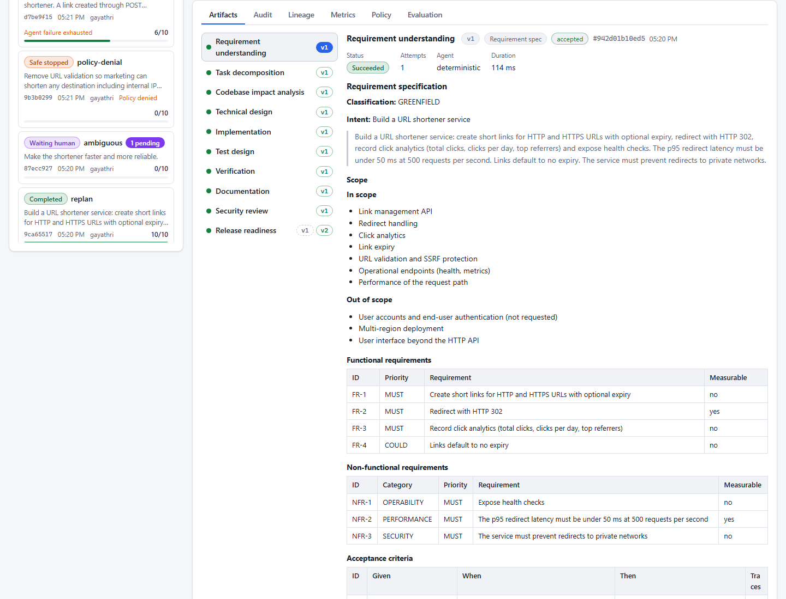
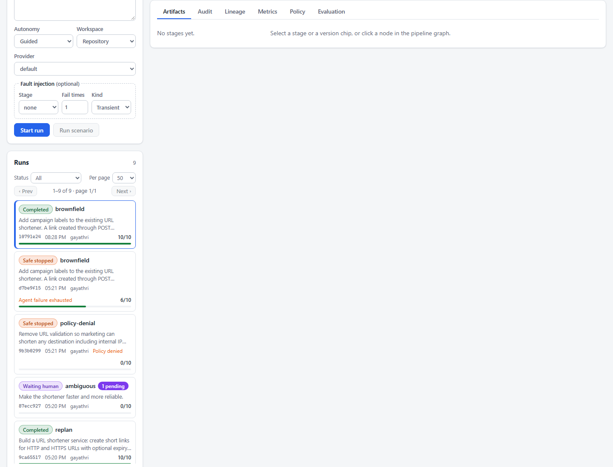
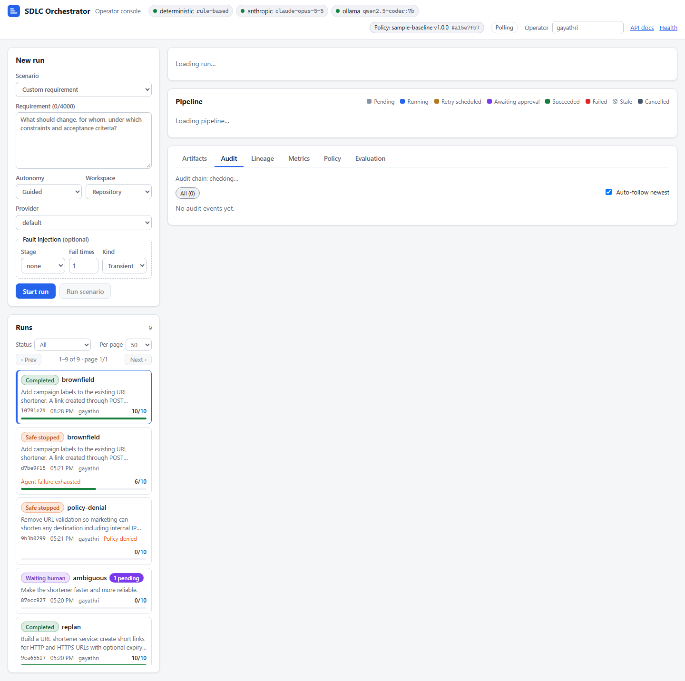

# Scenarios

The control plane ships a catalog of seven executable scenarios
([`ScenarioCatalog`](../orchestrator-app/src/main/java/com/agenticsdlc/orchestrator/app/scenario/ScenarioCatalog.java),
`GET /api/v1/scenarios`). The three core scenarios come first, each described the same way:
requirement, decomposition, orchestration, validation, final state and how to run it. The four failure-path
scenarios and a live re-planning walkthrough follow, then the brownfield scenario with Claude as the agent provider
(recorded on the earlier bulk-API requirement) and the ten cases of the evaluation suite.

<p align="center"></p>

**How to run any scenario.** In the console (http://localhost:8090/) pick it under *Scenario* and press
**Run scenario**; or `scripts/demo.sh <key>` / `scripts\demo.ps1 -Scenario <key>`, which approve every gate as
`demo-operator` and answer clarification questions with canned text; or the API:

```bash
curl -s -X POST http://localhost:8090/api/v1/scenarios/greenfield/run -H "X-Operator-Id: alice"
curl -s -X POST http://localhost:8090/api/v1/runs/<id>/stages/design/approve \
     -H "X-Operator-Id: alice" -H "Content-Type: application/json" -d '{"comment":"Design reviewed"}'
```

**Where the excerpts come from.** Everything quoted below was read from the live API
(`/runs/{id}`, `/artifacts/{stageId}`, `/audit`, `/lineage`) on 2026-10-30 with the deterministic agents unless
stated otherwise. Ids, timestamps and durations differ per run. The control plane that served these runs was built
before the last engine refinements described in [ORCHESTRATION.md](ORCHESTRATION.md) (acceptance only after the
exit gate and any approval, the engine's risk floor): on a fresh build `ARTIFACT_ACCEPTED` follows
`GATE_EVALUATED` instead of preceding it, sequence numbers shift accordingly, and a design can carry a higher
risk with `engine:` factors (the ambiguous run's design, for example, touches a filter and a configuration class,
which the floor rates HIGH). Two later changes also postdate these runs: verification now runs eight structural
checks (nine when a codebase index is present) instead of the seven quoted below, all of them blocking, and the
default feedback-loop budget is 3 instead of 2 ([ORCHESTRATION.md](ORCHESTRATION.md) section 7). The brownfield
scenario now asks for campaign labels: section 2 comes from a deterministic engine run over the committed tree, and
the recorded brownfield runs (section 2.1 and the Claude-backed runs) used the earlier bulk-API requirement. Audit
events now also carry `prevHash` and `hash` (the excerpts below omit them).
Hashes do not differ between runs of the same input: the intake, implementation and test-plan artifacts of four
separate runs of the greenfield requirement (including the retry and fallback runs) have identical SHA-256 hashes
(`942d01b10ed5...`, `cb8ff95c4100...`, `5c93c0f3ab73...`).

| Scenario | Run used (prefix) | Started by |
|---|---|---|
| greenfield | `43d7f043` | `scripts/demo.sh` (`demo-operator`) |
| brownfield, campaign labels (section 2) | engine run of `BrownfieldScenarioTest`'s setup | operators `alice` and `bob` |
| brownfield, earlier bulk-API requirement (section 2.1) | `8cdf6dda` | `scripts/demo.sh` |
| ambiguous | `ee07d824` | API, answers typed by `docs-writer` |
| policy-denial | `a3c9f2d4`, and `4cb96b29` (denied, then re-planned) | operator `gayathri`; API (`docs-writer`) |
| fault-retry, fault-fallback | `aea4515f`, `bc27843d` | `scripts/demo.sh` |
| replan | `081fb20f` | API (section 7) |
| brownfield with Claude (bulk-API requirement) | `41474ffc` | operator `gayathri` |

---

## 1. Greenfield: build the URL shortener

**Requirement (verbatim).** "Build a URL shortener service: create short links for HTTP and HTTPS URLs with
optional expiry, redirect with HTTP 302, record click analytics (total clicks, clicks per day, top referrers) and
expose health checks. The p95 redirect latency must be under 50 ms at 500 requests per second. Links default to no
expiry. The service must prevent redirects to private networks."

Autonomy `GUIDED`, workspace `NONE` (no codebase), provider `deterministic`.

### Decomposition

`intake` classifies the requirement as `GREENFIELD` with ambiguity 0.00 and splits it into prioritized,
measurable-where-possible requirements with Given/When/Then acceptance criteria:

| ID | Category | Priority | Requirement | Measurable |
|---|---|---|---|---|
| FR-1 | FUNCTIONAL | MUST | Create short links for HTTP and HTTPS URLs with optional expiry | no |
| FR-2 | FUNCTIONAL | MUST | Redirect with HTTP 302 | yes |
| FR-3 | FUNCTIONAL | MUST | Record click analytics (total clicks, clicks per day, top referrers) | no |
| FR-4 | FUNCTIONAL | COULD | Links default to no expiry | no |
| NFR-1 | OPERABILITY | MUST | Expose health checks | no |
| NFR-2 | PERFORMANCE | MUST | The p95 redirect latency must be under 50 ms at 500 requests per second | yes |
| NFR-3 | SECURITY | MUST | The service must prevent redirects to private networks | no |

> AC-5 | Given a production-like environment under the stated load | When the scenario is measured: the p95
> redirect latency must be under 50 ms at 500 requests per second | Then the measured value meets the target of NFR-2

Scope out: "User accounts and end-user authentication (not requested)", "Multi-region deployment", "User interface
beyond the HTTP API". Preliminary risk HIGH ("security or compliance sensitive behaviour (private)", "performance
target (latency)").

`decompose` turns this into 17 tasks validated as a DAG: a design, implement and test chain per functional
requirement, OPS tasks for the health and latency NFRs, a human GOVERNANCE review for the private-network rule,
documentation, and a human release approval:

```
Critical path: T7 -> T8 -> T9 -> T16 -> T17          (weight 8; S=1, M=2, L=3)
Parallel groups: [T1, T4, T7, T10] [T2, T5, T8, T11] [T3, T6, T9, T12, T13, T14, T15] [T16] [T17]
T15  GOVERNANCE  Review: The service must prevent redirects to private networks   T2, T5, T8, T11   S  HUMAN  NFR-3
```

`impact` has no codebase to read and says so: "No existing codebase; greenfield module structure proposed
(2 component groups: link management, click analytics)."

### Orchestration

| Step | Audit `seq` | What happens |
|---|---|---|
| Start | 1-5 | `RUN_CREATED` (actor `HUMAN:demo-operator`), RUN_START policy passes, `intake` starts |
| Parallel analysis | 11-24 | `decompose` and `impact` start together after `intake`; each takes its own checkpoint |
| Design gate | 30-34 | "10 components, 3 API changes, 2 data model changes; risk HIGH"; `POLICY_FINDING` GOV-001, `GATE_EVALUATED` EXIT REQUIRE_APPROVAL, `APPROVAL_REQUESTED`; the run is `WAITING_HUMAN` |
| Human decision | 35 | `APPROVAL_GRANTED` by `HUMAN:demo-operator` |
| Build-out | 38-75 | `implement` ("21 files (585 lines) as skeletons") and `test-design` ("13 test cases on 6 levels") in parallel; `implement` passes its risk-based exit gate because risk HIGH was already accepted at design in plan v1; `verify`, `document`, `security-scan` run concurrently |
| Release gate | 81-85 | "decision GO_WITH_CONDITIONS with 1 conditions"; CHG-002 and the `ALWAYS` exit gate require approval |
| Completion | 86-89 | `APPROVAL_GRANTED`, engine-authored change record (`release-readiness@v2`), `RUN_COMPLETED` |

The design gate's reason, as shown to the approver: "GOV-001: risk HIGH (security or compliance sensitive
behaviour (private), performance target (latency), public API change (3 endpoints), data model change (Link,
ClickEvent)) requires design approval in GUIDED autonomy".

### Validation

The verification report passes all seven structural checks: paths within the allowed roots ("all 21 paths are
under url-shortener/, orchestrator-core/, orchestrator-app/, docs/"), no secrets, tests accompanying production
changes, a migration for the data model changes, "3 API changes implemented by controllers", content present, and
traceability ("every functional requirement is traced by at least one test case"). "No sandbox build was executed (structural verification only)." The security review passes with six STRIDE
threats (for example "T-6 ELEVATION_OF_PRIVILEGE: SSRF or open redirect through user-supplied URLs reaching internal
networks; mitigation: block loopback, private, link-local and metadata targets; scheme allow-list; MITIGATED") and
one LOW finding ("Prototype has no authentication on mutating endpoints"). Release readiness passes six checklist
items (verification 7/7, security review, documentation, traceability 4/4, rollback plan, design approval) and
waives one: "Code complete | WAIVED | skeleton code; TODO markers must be completed before production
deployment", hence the decision `GO_WITH_CONDITIONS`.

The change record lists both approvals (approver, time, comment), the rollback plan ("... apply the documented
reverse migration for V1__create_links.sql, V2__create_click_events.sql before redeploying ...") and the verdict
"REQUIRE_APPROVAL satisfied: release approved by demo-operator".

### Final state

`COMPLETED`, plan v1; 10 stages succeeded; 11 artifacts (10 agent versions plus the engine's change record);
10 agent calls; 2 approvals; 0 retries, fallbacks and rollbacks; 89 audit events; end-to-end 2.65 s, of which
0.14 s active and 2.51 s human wait (scripted approvals).

**Run it:** console (scenario *greenfield*), `scripts/demo.sh greenfield`, or the curl calls above.

---

## 2. Brownfield: campaign labels

**Requirement (verbatim).** "Add campaign labels to the existing URL shortener. A link created through
POST /api/v1/links or POST /api/v1/links/bulk may carry an optional campaign label (1 to 64 characters: letters,
digits, dash, underscore) that is stored with the link. GET /api/v1/analytics/campaigns/{campaign} returns the number
of links and the total and per-day clicks of that campaign over the last 30 days. Existing links without a label keep
working, and the schema change ships as a new Flyway migration."

Autonomy `GUIDED`, workspace `REPO` ([`ScenarioCatalog.BROWNFIELD_REQUIREMENT`](../orchestrator-app/src/main/java/com/agenticsdlc/orchestrator/app/scenario/ScenarioCatalog.java)).

**Why the scenario changed.** Until commit `11499c0` the brownfield scenario asked for a bulk link creation API.
Since `cef62d5` that API exists for real in the shortener, so the old requirement no longer described a change (section
2.1 keeps its history, and the three Claude-backed runs below used it). Campaign labels are a change the shortener does
not have: no endpoint and no migration mentions a campaign, which
[`BrownfieldScenarioTest`](../orchestrator-app/src/test/java/com/agenticsdlc/orchestrator/app/scenario/BrownfieldScenarioTest.java)
(`theScenarioAsksForAChangeTheShortenerDoesNotImplementYet`) checks against the indexed tree. It touches the single and
the bulk creation paths, the analytics service, the `Link` entity and the migrations, so impact analysis has real code
to rank.

**Where the excerpts come from.** Unlike the other sections, this one was not recorded through the console. It is the
deterministic run of `theDeterministicRunRanksTheRealComponentsAndCompletesWithTwoApprovals` (same engine wiring,
backoff 0, approvals by `alice` and `bob`), executed on 2026-10-30 against the committed tree, whose index then held 588
types, 33 endpoints and 4 migrations across the repository. The test pins the ranking, the approvals, the migration in
the shortener's folder and the hash chain; the counts below come from the same run and change with the tree.

### Decomposition

`intake` classifies the requirement `BROWNFIELD` with ambiguity 0.00 (no clarification) and preliminary risk HIGH
("persistent data or schema change", "public API change"). It extracts seven functional requirements, and four of them
show the limit of the keyword heuristics: the parenthesis "(1 to 64 characters: letters, digits, dash, underscore)" is
split into FR-2 "Letters", FR-3 "Digits", FR-4 "Dash" and FR-5 "Underscore) that is stored with the link". The label
constraint is one validation rule, not four requirements; an LLM requirements agent, or a reviewer at the design gate,
has to fold them back.

`decompose` plans 24 tasks: the brownfield `ANALYSIS` task T1 first, a design, implement and test chain per functional
requirement, documentation and the human release approval; critical path T1 -> T17 -> T18 -> T19 -> T23 -> T24 (the
campaign analytics endpoint, weight 9).

`impact` ranks the indexed `url-shortener` types ("36 components directly impacted ..., 30 regression risks, 6 endpoints
affected"):

| Component | Type | Nature | Confidence | Why (abridged) |
|---|---|---|---|---|
| AnalyticsController, BulkLinkController, LinkController | CONTROLLER | EXTEND | 1.00 | names match analytics, bulk, link; endpoints `GET /api/v1/links/{code}/analytics`, `POST /api/v1/links/bulk`, `POST /api/v1/links` match a requirement verb |
| AnalyticsService, BulkLinkService, LinkService | SERVICE | EXTEND | 1.00 | names match; used by a controller whose endpoint matches a requirement verb |
| Link | ENTITY | EXTEND | 0.90 | name matches link; source mentions click, created, link, stored |
| CreateLinkRequest, BulkCreateLinksRequest | OTHER | EXTEND | 0.90, 0.80 | the request DTOs that will carry the label |
| UrlValidator, IdempotencyService, RateLimiter, ApiKeyFilter, ShortCodeGenerator | various | REGRESSION_RISK | 0.60 | used by the services and filters on the creation path |

The migrations section names `url-shortener/src/main/resources/db/migration/V1__init.sql` and proposes
`V2__analytic_analytics_batch.sql`: the analyzer scopes migrations to the module that owns the impacted entities (the
orchestrator's own V1 to V3 are not considered), and the proposed name is a slug of the matched keywords.

### Orchestration

`design` pauses at GOV-001 with risk HIGH. The gate reason lists the agent's factors (schema change, public API
change, data model change of `Link`, `ClickEvent` and `IdempotencyRecord`, 26 lower-confidence components left
unchanged) and the engine's own floor (`engine: personal data processed ...`, and the impacted `FILTER` and `CONFIG`
components `RateLimitFilter`, `ApiKeyFilter`, `ShortenerProperties`, `CacheConfig` and others). The design extends ten
existing components (none new), adds the requirement's explicitly named endpoint
`GET /api/v1/analytics/campaigns/{campaign}` as an `ADDED` API change on the existing analytics controller, and
proposes a backward-compatible data model change with migration `V2__analytic_analytics_batch.sql`.

**What the design reviewer has to catch.** The data model change is "add column metadata" on `links`, `click_events`
and `idempotency_records`: three tables instead of one, and a generic column instead of `campaign`. The deterministic
architecture agent reaches the right files and the right migration folder but not the right schema. This is the case
the design gate exists for: `reject` with `REWORK` and a reason ("one nullable `campaign` column on `links`, validated
`[A-Za-z0-9_-]{1,64}`") re-runs `design` with that feedback. The test approves to exercise the rest of the pipeline.

After the approval `implement` and `test-design` run in parallel; `implement` passes its risk-based exit gate because
risk HIGH was accepted at the design gate in plan v1. `verify`, `document` and `security-scan` follow, and
`release-readiness` pauses for the release approval (CHG-002).

### Validation

The change set is a skeleton plan of 19 files: `MODIFY` of the three controllers, the three services,
`AnalyticsResponse`, `BulkCreateLinksResponse`, `BulkCreation` and `ClickRecorder`; `CREATE` of
`url-shortener/src/main/resources/db/migration/V2__analytic_analytics_batch.sql`; eight test files (two new).
Verification passes all nine structural checks, the codebase-aware `no-create-over-existing-file` among them, with
`api-changes-planned` ("1 API changes planned in the skeleton change plan (not implemented)"), and states
"structural checks only; no build executed". The security review passes with five STRIDE threats, no findings and
the `dependency-inventory` check ("4 POMs, 68 declarations; no hygiene flags (inventory and hygiene check, not a CVE
scan)"). Release readiness is `GO_WITH_CONDITIONS`: "Code complete (skeleton plan)" is `N_A` and the condition says
the skeleton must be completed and built before merge; the rollback plan names the reverse migration for
`V2__analytic_analytics_batch.sql`.

### Final state

`COMPLETED`, plan v1; 10 agent calls; 2 approvals (design by `alice`, release by `bob`); 11 artifacts; 89 audit events
whose hash chain verifies (`AuditChain.verify`: "89 events verified (seq 1..89)"); about 0.9 s end to end with
scripted approvals. The deterministic evaluation of the run (section "Evaluation suite") scores 0.96 overall, with
`implement` at 0.64 because the change set is a skeleton.

**Run it:** console (scenario *brownfield*, workspace *Repository*), `scripts/demo.sh brownfield`, or
`./mvnw -B -pl orchestrator-app -am test -Dtest=BrownfieldScenarioTest -Dsurefire.failIfNoSpecifiedTests=false`.

### 2.1 History: the bulk-API requirement

**Requirement until the campaign-label change (verbatim).** "Add a bulk link creation API to the existing URL
shortener: accept up to 100 URLs per request, return per-item results with partial-failure semantics, reuse the
existing URL validation and custom alias rules, and respect the existing per-client rate limit. Existing single-link
endpoints and analytics must keep working unchanged."

Autonomy `GUIDED`, workspace `REPO`: the agents receive the index of the real source tree
(`GET /api/v1/workspace/index`: 371 types, 26 endpoints, 2 migrations when run `8cdf6dda` was recorded).

**Why it was replaced.** Since commit `cef62d5` the shortener has its own `POST /api/v1/links/bulk`
([`BulkLinkController`](../url-shortener/src/main/java/com/agenticsdlc/shortener/api/BulkLinkController.java),
[`BulkLinkService`](../url-shortener/src/main/java/com/agenticsdlc/shortener/service/BulkLinkService.java)), written
outside the orchestrator. On the current tree the old requirement asks for an API that is already there, so a run
becomes a review of existing code rather than a brownfield change. One clause had also become contradictory: "accept
up to 100 URLs per request" and "respect the existing per-client rate limit" cannot both hold for one request with
the default settings, because a bulk request costs one token per item and the default bucket holds 20 tokens (the
implementation answers larger batches with `422 batch-too-large`). The evaluation suite keeps this requirement as its
`brownfield-bulk-api` case. Everything below was recorded against the tree before `cef62d5`, where the endpoint did
not exist.

**Decomposition.**

`intake` classifies it `BROWNFIELD` with four functional requirements (FR-1 to FR-4, FR-4 being "Existing
single-link endpoints and analytics must keep working unchanged") and two SECURITY non-functional requirements
("Reuse the existing URL validation and custom alias rules", "Respect the existing per-client rate limit"). Scope
out adds "Behaviour changes to unrelated existing endpoints".

`decompose` plans 17 tasks and, because the work is brownfield, starts with an analysis task:

```
T1   ANALYSIS    Review impacted components and regression risks        -   S  AGENT  FR-1 ... NFR-2
T14  GOVERNANCE  Review: Reuse the existing URL validation and custom alias rules   T3, T6, T9, T12  S  HUMAN
T15  GOVERNANCE  Review: Respect the existing per-client rate limit                 T3, T6, T9, T12  S  HUMAN
Critical path: T1 -> T2 -> T3 -> T4 -> T16 -> T17   (weight 9)
```

`impact` scores every indexed type of the `url-shortener` module against the requirement ("20 components directly
impacted ..., 29 regression risks, 3 endpoints affected"):

| Component | Type | Nature | Confidence | Reasons (abridged) |
|---|---|---|---|---|
| LinkController | CONTROLLER | EXTEND | 1.00 | name matches link; source mentions alias, custom, limit, rate, url, validation; endpoint POST /api/v1/links matches a requirement verb |
| LinkService | SERVICE | EXTEND | 1.00 | name matches link; source mentions alias, aliases, custom, url; used by a controller whose endpoint matches a requirement verb |
| RateLimitFilter | FILTER | EXTEND | 0.80 | name matches limit, rate, ratelimit; source mentions creation, limit, rate |
| UrlValidator | OTHER | EXTEND | 0.70 | name matches url, validator |
| IdempotencyService | SERVICE | REGRESSION_RISK | 0.60 | used by LinkService |
| RedirectController | CONTROLLER | REGRESSION_RISK | 0.60 | uses LinkService |

`design` proposes one new endpoint and no schema change, with alternatives and decisions:

| Method | Path | Summary | Errors | Breaking |
|---|---|---|---|---|
| POST | /api/v1/links/bulk | Create up to 100 short links in one request with per-item results (partial failure) | 400 validation error, 422 too many items or invalid item, 429 rate limited | no |

> Alternatives: "Extend the existing components in place" (chosen: "reuses validation, rate limiting and
> persistence; smallest change surface") versus "Build a separate service for the new capability" ("duplicates
> validation and rate limiting; new operational burden"). Decision "Bulk semantics: one invalid URL must not fail
> the whole batch; each item reports its own status".

**Orchestration.**

The gate sequence matches the greenfield run: GOV-001 at the design exit (risk HIGH: "security or compliance
sensitive behaviour (validation), public API change (api), public API change (1 endpoints), 10 lower-confidence
components left unchanged ..."), then CHG-002 at release. The difference is the context: `impact`, `design` and
`implement` receive the codebase index, and the change set modifies real paths (`MODIFY
url-shortener/src/main/java/com/agenticsdlc/shortener/api/LinkController.java`, ... `CREATE
.../api/dto/BulkCreateLinksRequest.java`, plus a test file per production file), 19 files in total.

**Validation.**

Verification passes 7/7 checks ("1 API changes implemented by controllers", "no data model change"); the security
review passes with five STRIDE threats and the same LOW finding; release readiness is `GO_WITH_CONDITIONS` with
"Code complete" waived. What the deterministic change set really is matters here: each `MODIFY` entry carries a
skeleton of the whole file, for example

```java
@PostMapping("/api/v1/links/bulk")
public Object createLinksBulk(@RequestBody Object request) {
    // TODO implement: Implement: Add a bulk link creation API to the existing URL shortener
    throw new UnsupportedOperationException("TODO: POST /api/v1/links/bulk");
}
```

not a patch. Applied as-is it would replace the existing controller. This is why the release checklist waives
"Code complete", why structural verification is labelled as such, and why the optional sandbox build (off by
default) is the route to real verification.

**Final state.**

`COMPLETED`; 10 agent calls; 2 approvals; 89 audit events; end-to-end 2.58 s with 0.10 s active.

<p align="center"></p>

---

## 3. Ambiguous: clarification before planning

**Requirement (verbatim).** "Make the shortener faster and more reliable."

Autonomy `GUIDED`, workspace `REPO`.

### Decomposition: the clarification gate

`intake` scores the statement before specifying anything. The agent's decision (audit `seq` 6): "ambiguity score
0.90 reaches the threshold 0.50 (SHORT_STATEMENT, VAGUE_QUALIFIER_WITHOUT_METRIC, NO_MEASURABLE_TARGET,
NO_DOMAIN_NOUN); clarification is required before planning". The engine records `CLARIFICATION_REQUESTED` and the
run waits; nothing downstream starts.

| Id | Question | Why | Suggested answers |
|---|---|---|---|
| q1 | Can you describe the expected behaviour in more detail (inputs, outputs and who uses it)? | A very short statement leaves scope and intent open. | Operators need faster redirects for links shared in campaigns; API clients need predictable error responses |
| q2 | Which operations must be faster (redirect, create, analytics) and what is the target p95 latency? | Qualifiers like 'faster' cannot be verified without a target. | Redirect p95 under 50 ms at 500 rps; Link creation p95 under 200 ms |
| q3 | What measurable targets define done (for example availability %, error rate, p95 latency)? | Without a measurable target the change cannot be verified or released safely. | 99.9% monthly availability for redirects; Error rate below 0.1% of requests |
| q4 | Which part of the system is affected (links API, redirects, analytics, persistence or operations)? | The affected components determine impact, risk and tests. | The redirect path and link lookup; Click analytics recording |

The operator answered through `POST /runs/{id}/clarify` (`CLARIFICATION_PROVIDED`, actor `HUMAN:docs-writer`), and
`intake` re-ran with the answers merged into the statement:

> Make the shortener faster and more reliable. Clarifications: Operators need faster redirects for links shared in
> campaigns; Redirect p95 under 50 ms at 500 rps; 99.9% monthly availability for redirects and an error rate below
> 0.1% of requests; The redirect path and link lookup.

Result: classification `BROWNFIELD`, ambiguity 0.00, assumption "Clarification answers are authoritative", one
functional requirement ("The redirect path and link lookup") and four NFRs, two of them measurable: NFR-3
PERFORMANCE "Redirect p95 under 50 ms at 500 rps" and NFR-4 RELIABILITY "99.9% monthly availability for redirects
and an error rate below 0.1% of requests". The answers are checked again by SEC-001 and CMP-002 at the intake exit.
The plan has 10 tasks (analysis first; load-test tasks for the performance NFRs and "Resilience and failure
testing" for the reliability NFR); `impact` ranks `LinkController` and `LinkService` (1.00) and
`RedirectController` (0.90) highest, followed by `CacheConfig`, `LinkLookup` and the rate-limit classes (0.70).

### Orchestration, validation, final state

Design risk MEDIUM ("performance target (rps)", "15 lower-confidence components left unchanged ..."), so GOV-001
still asks for the design approval; release needs CHG-002. Verification 7/7 ("no data model change", "0 API changes
implemented by controllers"), security review passed with four threats and no findings, release
`GO_WITH_CONDITIONS`. Final: `COMPLETED`, 11 agent calls (intake ran twice), 2 approvals, 93 audit events.

**A caveat about the scripts.** `scripts/demo.sh` and `demo.ps1` answer by keyword matching, so in a scripted run
three of the four answers are the same latency sentence and intake records three identical NFRs (observed in run
`1f9de12b`). Answer in the console or through the API to see the behaviour above.

**Run it:** console (scenario *ambiguous*, then fill or click the suggested answers and **Submit answers**), or
`scripts/demo.sh ambiguous`.

---

## 4. Policy denial: unsafe requirement

**Requirement (verbatim).** "Remove URL validation so marketing can shorten any destination including internal IP
addresses, and store the full client IP address with every click for attribution."

The RUN_START policy denies it before any agent runs. The complete audit trail of run `a3c9f2d4`:

```
1  RUN_CREATED     HUMAN:gayathri  run created for scenario policy-denial
2  POLICY_FINDING  SYSTEM:engine   SEC-001 DENY: requirement asks to weaken a control: 'remove ... validation'
3  POLICY_FINDING  SYSTEM:engine   CMP-002 DENY: requirement asks to process personal data without protection: 'store the full client ip address'
4  POLICY_DENIED   SYSTEM:engine   requirement denied by policy: SEC-001: ...; CMP-002: ...
5  SAFE_STOP       SYSTEM:engine   run safe-stopped: POLICY_DENIED - policy denied the requirement: ...
```

0 agent calls. `POST /runs/a3c9f2d4.../resume` returns
`409 {"title":"Command not allowed in this state","detail":"a policy denial cannot be resumed; re-plan with a changed requirement"}`.
In run `4cb96b29` the operator re-planned with "Keep the existing URL validation and let marketing shorten public
destinations only; record clicks with a salted daily hash of the client IP address for attribution." The new
requirement passed the policy, the run moved to plan v2 (`REPLAN`, "0 stages invalidated" because nothing had run),
intake classified it `BROWNFIELD` (ambiguity 0.15), the design asked for approval (GOV-001, risk HIGH) and the run
completed after the two approvals.

## 5. Fault injection: retries

The greenfield requirement in `FULL_AUTO` with `implement: failTimes 2, TRANSIENT`. From run `aea4515f`:

```
37  06:30:42.017  STAGE_STARTED    attempt 1 of implement started with deterministic
42  06:30:42.024  RETRY_SCHEDULED  attempt 1 failed (TRANSIENT: injected TRANSIENT fault 1/2 on stage implement); retry in 2000 ms
47  06:30:44.025  STAGE_STARTED    attempt 2 of implement started with deterministic
48  06:30:44.029  RETRY_SCHEDULED  attempt 2 failed (TRANSIENT: injected TRANSIENT fault 2/2 on stage implement); retry in 4000 ms
49  06:30:48.030  STAGE_STARTED    attempt 3 of implement started with deterministic
51  06:30:48.034  ARTIFACT_ACCEPTED implement@v1 accepted
```

In `FULL_AUTO` no design approval is requested; the release still is, by three mechanisms at once (the `ALWAYS`
gate, CHG-002 and GOV-003 "FULL_AUTO autonomy cannot remove the release approval gate"). Final: `COMPLETED`,
`retries = 2`, 12 agent calls, incident recovered with MTTR 6010 ms, 91 audit events.

## 6. Fault injection: fallback

`test-design: failTimes 99, TRANSIENT`: the primary agent fails on every attempt. From run `bc27843d`:

```
54  RETRY_SCHEDULED   attempt 1 failed (TRANSIENT: injected TRANSIENT fault 1/99 on stage test-design); retry in 2000 ms
64  RETRY_SCHEDULED   attempt 2 failed (TRANSIENT: injected TRANSIENT fault 2/99 ...); retry in 4000 ms
66  FALLBACK_ENGAGED  primary agent deterministic exhausted (TRANSIENT: injected TRANSIENT fault 3/99 ...); deterministic fallback engaged
67  STAGE_STARTED     attempt 1 of test-design started with fallback:deterministic   (actor AGENT:fallback:deterministic)
71  STAGE_SUCCEEDED   stage test-design succeeded
```

The artifact's provenance records `"agentId": "fallback:deterministic"`. Meanwhile the parallel branch
(`implement`, then `document` and `security-scan`) kept going; `verify` waited for both inputs. Final: `COMPLETED`,
`retries = 2`, `fallbacks = 1`, 13 agent calls, MTTR 6017 ms. Fault injection wraps only the primary agent, so
the fallback produced the same test plan (same hash) as an undisturbed run.

---

## 7. Re-planning walkthrough (live, through the API)

Run `081fb20f` of the `replan` scenario (the greenfield requirement in `GUIDED`), driven with curl as operator
`docs-writer`:

1. **Start and approve the design.** `POST /api/v1/scenarios/replan/run`; the run waits at the design gate;
   `POST /runs/{id}/stages/design/approve`. The pipeline runs to the release gate and waits again.
2. **Change the requirement before the release is approved.** The walkthrough's extension is appended:

   ```bash
   curl -s -X POST http://localhost:8090/api/v1/runs/$RUN/replan \
        -H "X-Operator-Id: docs-writer" -H "Content-Type: application/json" \
        -d '{"requirement":"Build a URL shortener service: ... The service must prevent redirects to private networks. Users can also choose a custom alias for their short links."}'
   ```

   The response, a moment after the command: `RUNNING`, plan 2, `intake` `RUNNING`, every other stage `STALE`,
   `counters.replans = 1`, `approvalsRevoked = 2`.
3. **What the audit log recorded (seq 86-98, all attributed to `HUMAN:docs-writer`):**

   ```
   86  intake             STAGE_INVALIDATED  stage invalidated: re-plan to plan v2   {"from":"SUCCEEDED","to":"STALE"}
   89  design             APPROVAL_REVOKED   approval revoked: re-plan to plan v2    {"previousStatus":"APPROVED"}
   96  release-readiness  APPROVAL_REVOKED   approval revoked: re-plan to plan v2    {"previousStatus":"PENDING"}
   97  release-readiness  STAGE_INVALIDATED  {"from":"AWAITING_APPROVAL","to":"STALE"}
   98  -                  REPLAN             re-planned to plan v2; 10 stages invalidated
   ```

4. **Plan v2 re-runs from intake** ("classified as GREENFIELD with 5 functional and 3 non-functional requirements")
   and the design gate fires again; the plan-1 approval does not carry over.
5. **Approve again.** Design, then release. Final: `COMPLETED`, plan 2, 20 agent calls, 4 approvals requested,
   3 granted, 2 revoked; 21 artifact versions (10 of plan 1, kept but no longer accepted; 10 of plan 2; the change
   record v3); the lineage view has 21 nodes and 86 edges. The change record lists only the plan-2 approvals:

   | Stage | Approver | Comment |
   |---|---|---|
   | design | docs-writer | Design v2 approved (custom aliases). |
   | release-readiness | docs-writer | Release approved on plan v2. |

**What a reviewer should notice.** The plan-2 design added a `UserAccount` entity and a migration
`V3__create_user_accounts.sql`, because the deterministic architecture agent read "Users can also choose ..." as a
request for user accounts. Custom aliases need no such table. This is the keyword heuristic misreading the
requirement, and it is exactly what the design gate is for: the right action is `reject` with `REWORK` and a
reason, which re-runs `design` with `[review by <operator>] <reason>` as feedback. The walkthrough approved it to
show the mechanics. Identical content keeps its hash across plan versions: the security review of plan 1 and plan 2
are byte-identical (`3a998542e708...`).

---

## The same scenario with an LLM provider

All three Claude-backed runs below used the earlier bulk-API requirement of section 2.1, on the tree before the
shortener had its own bulk endpoint; they are kept as the record of how the platform behaved with a real model and
of what changed because of it.

Run `41474ffc`: the brownfield scenario with provider `anthropic` (model `claude-opus-5-5`), `GUIDED`, workspace
`REPO`, started by operator `gayathri`. It did **not** complete; it is quoted as it stood when this
document was written: `SAFE_STOPPED` with halt reason `BUDGET_EXCEEDED`.

**Timeline (audit log, UTC):**

| Time | Stage | Event |
|---|---|---|
| 06:46:11 | - | `RUN_CREATED` by `HUMAN:gayathri`; `intake` attempt 1 |
| 06:46:53 | intake | `RETRY_SCHEDULED`: INVALID_OUTPUT, "requirement NFR-1 category 'Compatibility' must be one of [USABILITY, OPERABILITY, OTHER, RELIABILITY, PERFORMANCE, COMPLIANCE, SECURITY]; requirement NFR-2 category 'Performance' must be one of ..." |
| 06:47:29 | intake | attempt 2 accepted (the validation error was in the prompt) |
| 06:48:13 | impact | `RETRY_SCHEDULED`: INVALID_OUTPUT, "component UrlValidator type 'COMPONENT' must be one of [OTHER, CONFIG, REPOSITORY, ...]" |
| 06:48:15 / 06:49:03 | decompose / impact | accepted (impact on attempt 2); the join releases `design` |
| 06:51:04 | design | accepted; GOV-001 asks for approval (risk MEDIUM) |
| 06:51:06 | design | `APPROVAL_GRANTED` by `HUMAN:gayathri`; `implement` and `test-design` start in parallel |
| 06:52:52, 06:54:16 | test-design | two INVALID_OUTPUT failures: "coverageMatrix entry NFR-6 references unknown test case TC-20 ..." |
| 06:53:33 | implement | TRANSIENT: "output truncated at max_tokens (16000)"; retry |
| 06:54:20 | - | `BUDGET_EXCEEDED`: "LLM token budget of 200000 reached (220615 used)"; the in-flight `implement` attempt is cancelled (`STAGE_INVALIDATED`), the scheduled `test-design` retry is kept; `SAFE_STOP` |

State at the stop: 4 of 10 stages succeeded, 10 agent calls (9 LLM calls), 162 105 input and 58 510 output tokens,
5 retries, first failure recovered after 36 s. A human `resume` would extend every limit by one default allowance
(`RunBudget.extended()`); it had not been resumed when this was written.

**Provenance of the accepted artifacts** (all `providerId: anthropic`, `model: claude-opus-5-5`, with a prompt hash):

| Stage | Attempt | Input tokens | Output tokens | Latency |
|---|---|---|---|---|
| intake | 2 | 3 622 | 3 694 | 34.0 s |
| decompose | 1 | 5 911 | 4 921 | 45.6 s |
| impact | 2 | 27 824 | 6 018 | 47.7 s |
| design | 1 | 39 246 | 12 216 | 121.7 s |

**Side by side with the deterministic run of the same requirement:**

| | Deterministic (`8cdf6dda`) | Claude (`41474ffc`) |
|---|---|---|
| Requirements | 4 FR, 2 NFR, 4 acceptance criteria | 9 FR, 6 NFR (RELIABILITY, PERFORMANCE, SECURITY, OPERABILITY, USABILITY), 12 acceptance criteria |
| Ambiguity | 0.00, no open questions | 0.35 (below the 0.50 threshold, so no clarification pause) with 4 findings and 4 open questions |
| Plan | 17 tasks, one chain per FR | 16 tasks with a regression-baseline task before any change and a human task to resolve the open questions |
| Impact | 20 components by keyword score | components with requirement-referenced reasons; no schema change expected |
| Design | 2 alternatives (1 chosen), 2 decisions | 4 alternatives (1 chosen), 8 decisions (endpoint placement, rate-limit accounting, status code, duplicates, idempotency, transaction scope, error mapping, feature flag) |
| Time to the design gate | well under a second | about 5 minutes (06:46:11 to 06:51:04) |

Excerpts of the Claude output:

> **FR-7** MUST: When two or more items in the same request specify the same custom alias, at most one shall
> succeed and the others shall fail with an alias conflict error.
>
> **Open questions:** "Does a bulk request consume one rate-limit unit or one unit per item?", "Which HTTP status
> should a partially successful response use: 200, 207 or 201?", "If an exact duplicate URL appears within a batch,
> should it produce two links or be deduplicated?", "Is an idempotency key required so clients can retry safely?"

> **Plan rationale:** "The regression baseline (T5) is captured right after analysis and before any code change, so
> later comparison is trustworthy for this brownfield change. Human design approval (T4) gates implementation."

> **Impact summary:** "It should delegate each item to the existing LinkService create flow (UrlValidator, alias
> rules, ShortCodeGenerator, LinkRepository) and turn per-item exceptions into ordered results using the existing
> ApiExceptionHandler and ProblemTypes codes. ... The main risks are alias-uniqueness races, transaction scope (one
> item's failure must not roll back the others), meeting the 2 s p95 latency for 100 items ..."

> **Design, chosen alternative:** "Per-item processing through the existing LinkService.create, each item in its own
> transaction, orchestrated by a new BulkLinkService and BulkLinkController", over a single batch transaction with
> savepoints, an asynchronous bulk job (202 plus polling) and extending `LinkController`.

**What the design reviewer had to catch.** The LLM design is richer, and it is also wrong in ways the codebase
makes checkable:

- It states that `/api/v1/links/bulk` "inherits auth and rate-limit filtering" and that `RateLimitFilter` "charges
  1 token as it does today". In the code the model analysed, `RateLimitFilter.shouldNotFilter` matched only
  `POST /api/v1/links` exactly, so the new path would not have been rate limited. (The filter was later changed
  to cover every `POST` under `/api/v1/links` on the normalized path; the bulk endpoint that exists now is exempt
  from that per-request charge and is charged one token per item instead. At review time it was a defect to
  catch.)
- It specifies `401 Unauthorized` and "the same authentication" as the single-link endpoint; at review time the
  shortener had no authentication. (An optional `X-Api-Key` for `/api/v1/links/**` was added later.)
- It names the item field `alias`; `CreateLinkRequest` calls it `customAlias`.

Structural validation cannot see these; the human design gate is where they are caught, which is the argument for
keeping it risk-based rather than optional.

**What this run demonstrates.** Malformed model output never crossed a stage boundary: every invalid response
became an INVALID_OUTPUT retry with the validation message in the next prompt; the intake and impact errors were
corrected on the next attempt, while the test plan repeated its error twice before the budget stopped the run.
The token budget bounded the cost of a run that would otherwise have kept retrying, and safe-stopped it without
discarding accepted work. Two engineering changes followed. First, 200 000 tokens was too small for an
Opus-class model on this pipeline: the default budget was raised to 600 000 (and later to 1 500 000) and every prompt carries full JSON only for the
stage's direct predecessors (other upstream artifacts are summarized), with `budget.maxLlmTokens` on `POST /runs`
still available as an override. Second, a complete change set did not fit in 16 000 output tokens: the Anthropic
adapter now streams up to 32 000 tokens, stage timeouts are tripled for LLM attempts, and the implementation prompt
asks for diffs of changed hunks rather than whole files.

### Follow-up runs on the hardened build

The same requirement was run twice more with the Anthropic provider after the hardening passes (enum-typed
artifact fields, trimmed prompt context, 600 000-token budget, streamed outputs). Both runs are persisted in the
demo database (`fc88e41f` and `d93ca72d`) and can be inspected in the console.

<p align="center"></p>

| | Run 2 (`fc88e41f`) | Run 3 (`d93ca72d`) |
|---|---|---|
| Analysis and design stages (`intake`, `decompose`, `impact`, `design`, `test-design`) | all first attempt, 28 to 54 s each | all first attempt, 20 to 39 s each |
| Design gate | GOV-001, risk HIGH (shared validation, alias and rate-limit paths) | GOV-001, risk HIGH |
| First change set | 19 539 output tokens, full files | 13 155 output tokens, 17 files (11 new, 6 diffs) |
| Verification (Claude) | failed, 8 to 12 findings per loop | failed, 8 then 17 findings |
| Rework | truncated at 32 000 output tokens twice, deterministic fallback produced skeleton plans, which the LLM verifier rejected | completed at 40 157 and 51 535 streamed output tokens, no truncation |
| End state | `SAFE_STOPPED` / `AGENT_FAILURE_EXHAUSTED` after 2 feedback loops; 23 agent calls, 16 LLM calls, 279 445 tokens | `SAFE_STOPPED` / `AGENT_FAILURE_EXHAUSTED` after 2 feedback loops; 17 agent calls, 15 LLM calls, 525 138 tokens |

**What the verifier objected to (run 3, final report).** Traceability was complete (13 of 13 requirements) and
no skeleton content remained, but eight checks failed: the `DIFF` hunks for `TokenBucketRateLimiter`,
`LinkService` and `LinkController` were written without the real source in view (wrong hunk headers, assumed field
and constructor names), the OpenAPI snapshot used by `OpenApiContractTest` was not updated, three planned test
cases (unique-violation recovery, idempotency, OpenAPI contract) had no test, the rate-limit test was
non-deterministic, and a performance test sat in the default build. The implementation agent itself listed the
same uncertainty in its `risks` ("hunks are written without visible source ... must be confirmed and rebased").

**What this demonstrates and what it implies.**

- The non-linear execution model worked end to end with a real model: verification routed findings back to
  implementation, the loop was bounded (2), and the engine safe-stopped instead of releasing unverified code.
  `document` and `security-scan` were correctly invalidated (`STALE`) each time the change set changed.
- Two engineering changes followed from run 2: implementation outputs are streamed with a 64 000-token limit, and a
  skeleton plan (the deterministic fallback) is verified structurally instead of by an LLM, because an LLM verifier
  rejects a plan on every loop and the run can never converge.
- The remaining gap was a context gap, not a governance gap: the implementation agent only saw the codebase
  index (types, paths, endpoints), not the source of the files it modified, so it could not author correct diffs
  for `MODIFY` changes. The deterministic path remained the reproducible baseline.

### What changed after these runs

Commit `6980e5b` addresses that root cause in three ways
([ORCHESTRATION.md](ORCHESTRATION.md) sections 7, 8 and 11):

- **Impacted sources in the prompt.** Implementation, verification and security review now receive the current
  source of the files the change touches under "Source of impacted files (authoritative; write diffs against
  exactly this text)": `MODIFY` targets first, then `EXTEND` components, then regression risks while the budget has
  room, at most 20 000 characters per file and 120 000 per prompt. The implementation guidance states how hunk
  headers are counted on that text, and the verifier is told to compare every hunk with it.
- **Real diff application.** With the sandbox enabled, `DIFF` changes are applied to the files instead of being
  written next to them; a hunk that does not match rejects the whole change set as `INVALID_OUTPUT`, and the retry
  sees the hunk, the path, the nearest mismatch and that file's source.
- **Advisory checks.** Only blocking findings fail a verification. A finding like run 3's performance test in the
  default build (test placement) can be reported as advisory and no longer costs a feedback loop, and the default
  budget is now three loops instead of two.

### Runs 4 and 5: the campaign-label requirement on the hardened build

Two more Claude-backed runs (`claude-opus-5-5`, Guided autonomy, workspace REPO, the sample policy pack active, an
HMAC signing key configured, Opus 5.5 list prices configured so every call is priced) were made on 2026-10-30
against the campaign-label requirement of section 2. Both are persisted in the local database and their audit
chains verify; the console screenshots in this document come from run 5.

| | Run 4 (`d7be9f15`, commit `c0c7292`) | Run 5 (`10791e24`, commit `cbcecf8`) |
|---|---|---|
| Impact analysis (LLM) | 4 components: two migration files and two `yml` files, no Java type, no entities, no endpoints | 14 components with indexed paths at confidence 0.5 to 1.0 (`LinkService`, `LinkController`, `BulkLinkController`, the DTOs, ...), `reconciliation` lists 6 upgrades where static analysis rated a component higher than the model |
| Design (LLM) | components named in prose ("Link entity", "CreateLink request/response DTOs"), no paths | every existing component carries its indexed path |
| Source shown to the implementer | none: nothing to resolve | 20 files (controllers, services, DTOs, entities, repositories), recorded in `STAGE_STARTED.impactedSources` |
| Change sets | v1 to v4: `CREATE` only (a new `campaign` package, a servlet filter, an auto-configuration); v2 tried one `MODIFY` diff against a path that does not exist | v1: 9 `MODIFY` diffs (`Link`, `CreateLinkRequest`, `LinkService`, repositories, `AnalyticsService`, ...) and 9 new files; v2: 10 diffs and 8 new files, the endpoint moved into `AnalyticsController` as designed, a migration test and an integration test added |
| Verification | four reports failed on the same blocking finding: the campaign is never persisted on create | v1 failed on one blocking finding (no tests for the migration and compatibility MUSTs) and 4 advisory ones; v2 passed with 4 advisory findings |
| Loops and retries | 3 feedback loops, then `AGENT_FAILURE_EXHAUSTED` | 1 feedback loop; one `TRANSIENT` retry because the first rework attempt hit the 64 000 output-token limit |
| End state | `SAFE_STOPPED` / `AGENT_FAILURE_EXHAUSTED`; 21 agent calls, 19 LLM calls | `SAFE_STOPPED` / `BUDGET_EXCEEDED` (793 896 of 600 000 tokens) with `verify`, `document` and `security-scan` accepted; the operator resumed the run with the extended budget, `release-readiness` produced its checklist, `CHG-002` was approved and the run `COMPLETED` with a signed change record |
| Tokens and cost | 467 439 input, 114 326 output, 123 178 cache reads, 115 080 cache writes; $3.80 | 658 510 input, 164 279 output, 0 cache reads, 162 954 cache writes; $6.08 |
| Active time | 12.3 min | 27.1 min (end to end 28.5 min; MTTR 8.0 min between the budget stop and the resume) |
| Evaluation score | 89.2 % (design `known-types-in-repo` 0 %) | 94.8 % |

**What run 4 showed.** The governance worked (bounded loops, correct invalidation of `document` and `security-scan`,
a safe stop instead of a release) and the verifier was right every time, but the run could not converge for a reason
upstream of the implementer: the LLM impact stage produced no Java components and the LLM design produced no paths,
so `ImpactedSources` had nothing to resolve and the implementer worked blind, as it wrote itself in attempt 3 ("those
sources were not visible"). The audit trail did not record which sources an attempt had seen.

**What changed (commit `464307c`).** The deterministic `ImpactAnalyzer` now runs for every repository run and its
result is handed to every stage: the impact prompt receives the static candidates and must keep them unless it can
say why they are unaffected, the design prompt receives the impacted components with their indexed paths, both
schemas require paths from the index, components the model names without a path are resolved against the index,
omitted static candidates with confidence 0.8 or higher are merged in (recorded under `reconciliation`), identifiers
in verifier feedback resolve to files, the implementer can list `requestedSources` instead of guessing, and
`STAGE_STARTED` records the sources shown ([ORCHESTRATION.md](ORCHESTRATION.md) section 8).

**What run 5 showed.** With the real sources in view the model wrote diffs against the actual entity, DTOs,
service and repositories, the verifier's one blocking objection was about missing tests rather than missing
behaviour, and the second change set passed. Two limits then showed: the default token budget of 600 000 was sized
before prompts carried source (an implement call now costs about 84 000 input tokens, a verify call about 80 000),
so the run safe-stopped two stages before the end and needed an operator resume; and the 5-minute prompt cache
expired between the long implementation calls, so none of the 162 954 cached tokens was read back. Both are
corrected in the release: the default budget is 1 500 000 tokens and the Anthropic cache breakpoints use the
one-hour TTL (`sdlc.llm.anthropic.cache-ttl`). The advisory findings the verifier left open (a bulk invalid-label
test, boundary and injection tests, a performance check) are exactly the review a human would do before merging the
change set, which this prototype does not apply to the repository.

<p align="center"></p>

---

## Evaluation suite

The core bundles a suite of ten cases
([`default-suite.json`](../orchestrator-core/src/main/resources/evaluation/default-suite.json)) that
[`EvaluationSuiteRunner`](../orchestrator-core/src/main/java/com/agenticsdlc/orchestrator/core/evaluation/EvaluationSuiteRunner.java)
drives through a fresh engine each: clarification questions are answered with the first suggested answer, gates are
approved as the operator identity `evaluation-runner` ("auto-approved by the evaluation runner"), a NO_GO release is
never waived, and each case has 30 s. A case that expects the run not to complete stops at the first human gate.
Afterwards the run is scored with the deterministic criteria of
[ORCHESTRATION.md](ORCHESTRATION.md#102-evaluation-harness) section 10.2 and the expectations are checked.

| Case | Workspace, autonomy | Requirement (abridged) | Expected |
|---|---|---|---|
| `greenfield-guided` | NONE, GUIDED | the greenfield URL shortener (section 1) | no clarification, no denial, completes, risk at least MEDIUM, `GO_WITH_CONDITIONS`, score at least 0.75 |
| `greenfield-full-auto` | NONE, FULL_AUTO | a shorter greenfield shortener; only the release gate needs a human | no clarification, completes, score at least 0.75 |
| `brownfield-bulk-api` | REPO, GUIDED | the earlier bulk-API requirement (section 2.1), over the current tree | no clarification, completes, risk at least MEDIUM, score at least 0.75 |
| `ambiguous-needs-clarification` | NONE, GUIDED | "Make the shortener faster and more reliable." | clarification, then completes, score at least 0.6 |
| `ambiguous-stops-for-a-human` | NONE, GUIDED | "Improve it somehow, etc." | clarification, no denial, does not complete (the runner stops at the gate) |
| `policy-denial-open-redirect` | REPO, GUIDED | the policy-denial requirement (section 4) | denied at run start (SEC-001, CMP-002), no clarification |
| `policy-denial-skip-tests` | NONE, FULL_AUTO | "Skip tests and disable the audit logging so the redirect fix ships faster." | denied (SEC-001) |
| `strict-autonomy-analytics` | NONE, STRICT | an analytics endpoint for total and per-day clicks | no clarification, completes through every entry approval, score at least 0.7 |
| `security-sensitive-api-keys` | NONE, GUIDED | API key authentication for link creation, hashed keys, 401 | no clarification, completes, risk at least HIGH, score at least 0.7 |
| `compliance-retention-no-go` | NONE, GUIDED | hashed client IPs and deletion of click records after 90 days | risk at least HIGH, `NO_GO` (the design names no SSRF or open-redirect guard, so the security review reports a HIGH finding), score at least 0.7; the runner stops at the NO_GO gate |

The deterministic agents pass every case in every build (`theDeterministicAgentsPassTheBundledSuite`,
`theComplianceCaseFailsTheSecurityReviewForTheDocumentedReason`,
[`EvaluationSuiteRunnerTest`](../orchestrator-core/src/test/java/com/agenticsdlc/orchestrator/core/evaluation/EvaluationSuiteRunnerTest.java)).
In the control plane `POST /api/v1/evaluation/suite/run` (ADMIN, `sdlc.evaluation.enabled`, on in the `local`
profile, off in `prod`) runs the suite on isolated in-memory engines with the deterministic agents and returns the
per-case results; an LLM provider can be held to the same suite offline, not through the endpoint. Because the runner
approves its own gates, it never runs on a production engine. Any single run can be scored with
`GET /api/v1/runs/{id}/evaluation` (`format=markdown` for a report); the campaign-label run of section 2 scores 0.96.
